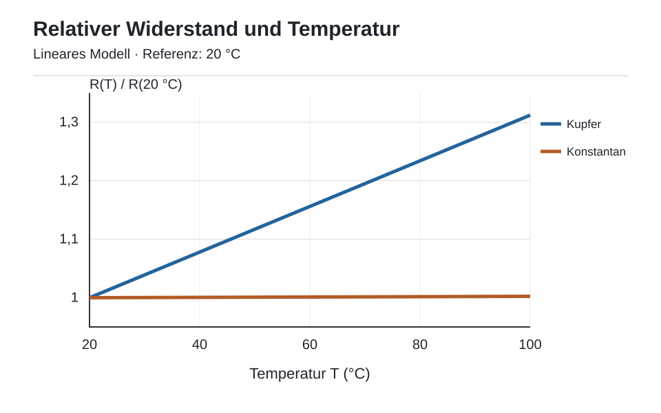

# M19-L1 – Leiterwerkstoffe und Temperaturabhängigkeit {#L1}

**Kursbereich:** M19 – Bachelor: Werkstoffe und Bauteiltechnologie

**Niveau:** Bachelor · Grundlagen

**Vorwissen:** [Widerstand und Ohmsches Gesetz](M1-L2.md), [Leitfähigkeit und Ladungsträger](M3-L1.md).

**Lernziel:** Material- und Geometrieeinflüsse trennen, Leitungsverluste bei Temperaturänderungen abschätzen und die Aussagekraft eines vereinfachten Materialvergleichs beurteilen.

## Vom Schaltbild zum Werkstoff {#S1}

Ein idealer Draht im Schaltbild hat keinen Spannungsabfall. Ein realer Leiter muss dagegen elektrische, thermische und mechanische Anforderungen erfüllen. Kupfer bietet eine hohe Leitfähigkeit; Aluminium erlaubt bei gleicher Masse meist größere Querschnitte. Eine Legierung kann bewusst einen höheren spezifischen Widerstand oder eine geringere Temperaturabhängigkeit besitzen, etwa für einen Messwiderstand. Welcher Werkstoff geeignet ist, hängt somit nicht allein von der Leitfähigkeit ab. Auch Kontakttechnik, Korrosion, mechanische Belastung und Wärmeabfuhr sind Teil der Auswahl.

## Materialparameter und Geometrie {#S2}

Für einen homogenen, isotropen Leiter mit gleichförmigem Querschnitt im Gleichstrommodell gilt

$$R=\rho\frac{\ell}{A},\qquad \sigma=\frac{1}{\rho},\qquad J=\frac{I}{A}.$$

$R$ ist der Widerstand in Ohm, $\rho$ der spezifische Widerstand in $\Omega\,\mathrm m$, $\ell$ die Leiterlänge, $A$ die Querschnittsfläche und $J$ die mittlere Stromdichte in $\mathrm{A/m^2}$. Aus $E=\rho J$ folgt bei räumlich konstantem Feld $U=E\ell$. Ein längerer Leiter besitzt also bei unverändertem Material und Querschnitt einen größeren Widerstand, nicht aber allein deshalb eine größere Stromdichte. Bei gegebenem Strom ergibt sich die Verlustleistung aus $P=I^2R$.

Für reine Metalle kann man nahe einem Referenzzustand häufig die lineare Näherung verwenden:

$$R(T)\approx R(T_0)\left[1+\alpha(T-T_0)\right].$$

$\alpha$ bezeichnet den Temperaturkoeffizienten in $\mathrm{K^{-1}}$. Eine Temperaturdifferenz von 50 K entspricht einer Differenz von 50 °C. Die Näherung setzt insbesondere eine vernachlässigbare Geometrieänderung und einen begrenzten Temperaturbereich voraus.

*Abbildung: Lineares Lehrmodell mit Referenz bei 20 °C; die Steigungen folgen den tabellierten Temperaturkoeffizienten. Die Konstantan-Kurve bleibt im dargestellten Maßstab nahezu waagerecht.*

## Durchgerechnet: zwei Leiterwerkstoffe {#S3}

Ein gedachter Kupferleiter der Länge 10 m und des Querschnitts 2 mm² wird bei 20 °C betrachtet. Für das Lehrmodell nutzen wir $\rho_\mathrm{Cu}=1{,}68\cdot10^{-8}\,\Omega\mathrm m$ und $\alpha_\mathrm{Cu}=0{,}0039\,\mathrm{K^{-1}}$. Damit gilt $R_{20}=0{,}084\,\Omega$. Bei 70 °C folgt $R_{70}=0{,}084(1+0{,}0039\cdot50)=0{,}10038\,\Omega$. Für einen konstant angenommenen Strom von 5 A ergibt sich eine Verlustleistung von 2,10 W bei 20 °C und rund 2,51 W bei 70 °C. Die 70 °C sind vorgegeben, nicht aus der Wärmebilanz berechnet.

Ein Aluminiumleiter gleicher Länge soll im Modell bei 20 °C denselben Widerstand besitzen. Mit $\rho_\mathrm{Al}=2{,}65\cdot10^{-8}\,\Omega\mathrm m$ folgt $A_\mathrm{Al}=A_\mathrm{Cu}\rho_\mathrm{Al}/\rho_\mathrm{Cu}\approx3{,}15\,\mathrm{mm^2}$. Der Vergleich zeigt, wie Materialwahl und Geometrie gemeinsam wirken. Er liefert keine zulässige Strombelastbarkeit und keinen normgerechten Installationsquerschnitt.

## Kontakte und Systemgrenzen {#S4}

Eine Verbindung mit einem angenommenen Kontaktwiderstand von 2 mΩ erzeugt bei 10 A eine lokale Verlustleistung von 0,2 W. Obwohl der Widerstand klein ist, kann die Wärme auf engem Raum bedeutsam sein. Das Leitermodell berücksichtigt weder solche räumlichen Hotspots noch Oxidschichten, mechanisches Kriechen, Haut- oder Proximityeffekte bei Wechselstrom. Eine belastbare Bauteilentscheidung erfordert Herstellerdaten, Anwendungsbedingungen, einen thermischen Nachweis und gegebenenfalls normgerechte Prüfungen durch qualifizierte Fachkräfte. Die Beispiele sind Rechenmodelle und keine Anweisung zum Aufbau oder Betrieb elektrischer Anlagen.

## Selbstkontrolle {#S5}

### Aufgaben

1. Ein homogener Leiter wird bei gleicher Temperatur doppelt so lang und erhält den halben Querschnitt. Um welchen Faktor ändert sich sein Widerstand?
2. Für den Kupferleiter aus S3 sinkt die Temperatur gegenüber 70 °C um 30 K. Bestimme seinen Widerstand mit demselben Referenzmodell.
3. Ein Messwiderstand soll seinen relativen Widerstand bei Temperaturänderung möglichst wenig verändern. Welcher Parameter ist dafür im linearen Modell entscheidend? Warum genügt er nicht für eine reale Bauteilauswahl?

::: {.lc-solutions data-lc-section="S5"}
1. $R\propto\ell/A$; der Widerstand wird viermal so groß.
2. Bei 40 °C ist die Differenz zu 20 °C gleich 20 K. $R_{40}=0{,}084(1+0{,}0039\cdot20)=0{,}090552\,\Omega$.
3. Ein kleiner Betrag von $\alpha$ begrenzt die relative Änderung. Zusätzlich sind etwa Toleranz, Langzeitstabilität, Eigenerwärmung, Frequenzverhalten und Belastbarkeit zu prüfen.
:::

## Quellen {#S6}

- [OpenStax – University Physics Volume 2, § 9.3 Resistivity and Resistance](https://openstax.org/books/university-physics-volume-2/pages/9-3-resistivity-and-resistance) · Tabelle 9.1 und Temperaturmodell; Materialparameter und Widerstandsbeziehungen · Zuletzt abgerufen: 2026-11-25 · Inhaltlich geprüft: 2026-11-25
