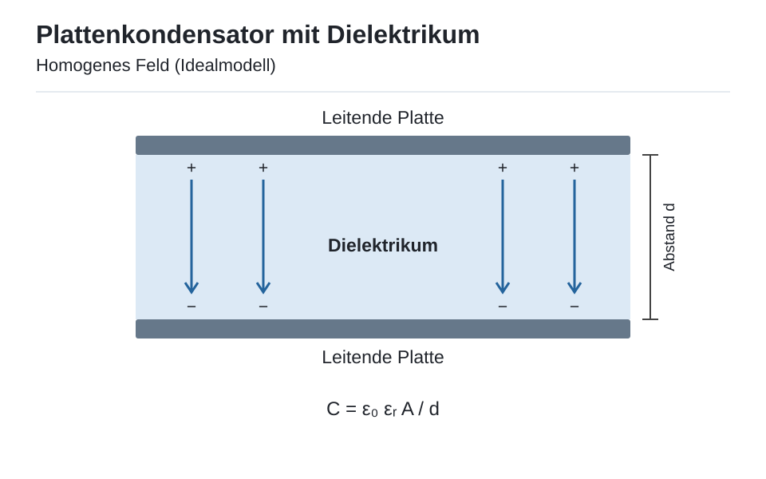

# M19-L2 – Dielektrika und Isolierstoffe {#L2}

**Kursbereich:** M19 – Bachelor: Werkstoffe und Bauteiltechnologie

**Niveau:** Bachelor · Grundlagen

**Vorwissen:** [M4-L1](M4-L1.md).

**Lernziel:** Permittivität, Feldbeanspruchung und die Grenzen idealer Isolierstoffmodelle unterscheiden.

## Polarisation und Materialparameter {#S1}

Ein Isolierstoff trennt leitfähige Teile. Ein Dielektrikum reagiert zusätzlich auf ein elektrisches Feld durch Polarisation. Gebundene Ladungen verschieben sich geringfügig; bei polaren Molekülen können sich Dipole ausrichten. Diese Effekte verändern das Verhältnis von elektrischer Flussdichte $D$ zur Feldstärke $E$. Im linearen, isotropen Modell gilt $D=\varepsilon_0\varepsilon_r E$. Die relative Permittivität $\varepsilon_r$ ist dimensionslos. Hohe Permittivität bedeutet nicht automatisch hohe Durchschlagfestigkeit: Die erste Eigenschaft beschreibt die Feldreaktion, die zweite die Grenze der Isolierwirkung unter bestimmten Bedingungen.

## Plattenmodell und Energie {#S2}

Für zwei große parallele Platten der Fläche $A$, deren Abstand $d$ klein gegenüber ihren Abmessungen ist, und einen homogenen Füllstoff gilt näherungsweise

$$C=\varepsilon_0\varepsilon_r A/d,\quad E=U/d,\quad Q=CU,\quad W=CU^2/2.$$

Das Modell vernachlässigt Randfelder. Bei festgehaltener Spannung vergrößert ein Dielektrikum die Kapazität und die im Feld gespeicherte Energie; bei festgehaltener Ladung sinken Spannung und Feldenergie, denn $W=Q^2/(2C)$. Die elektrische Energiequelle bzw. mechanische Arbeit muss bei einer Energiebilanz berücksichtigt werden. Die Unterscheidung der Randbedingungen ist daher wichtiger als eine pauschale Aussage über die Wirkung des Isolierstoffs.

*Abbildung: Homogenes Feld (Idealmodell).*

## Rechenbeispiel: Kapazität und Feld {#S3}

Für $A=0{,}002\,\mathrm{m^2}$, $d=0{,}0005\,\mathrm m$ und einen hypothetischen Füllstoff mit $\varepsilon_r=4$ folgt mit $\varepsilon_0\approx8{,}854\cdot10^{-12}\,\mathrm{F/m}$ eine Kapazität von 141,7 pF. Bei 20 V sind $E=40\,\mathrm{kV/m}$, $Q=2{,}83\,\mathrm{nC}$ und $W=28{,}3\,\mathrm{nJ}$. Ohne Füllstoff sind es näherungsweise 35,4 pF. Wird stattdessen die Ladung des ursprünglichen leeren Kondensators festgehalten, sinkt die Spannung nach Einfügen des Dielektrikums von 20 V auf 5 V. Alle Werte sind Modellwerte und keine Bemessung einer realen Isolation.

## Auswahl und Versagensmechanismen {#S4}

Keramiken, Polymere, Gläser und Isolierflüssigkeiten erfüllen unterschiedliche Anforderungen an Wärmeabfuhr, mechanische Festigkeit, elektrische Verluste und Fertigung. Bei realen Bauteilen ändern sich Kennwerte mit Frequenz, Temperatur und Feuchte. Verunreinigungen, Hohlräume und scharfe leitfähige Kanten können lokale Feldspitzen verursachen. Ein hoher mittlerer Sicherheitsabstand im Rechenmodell ist daher kein Ersatz für die Prüfung der tatsächlichen Feldverteilung und Materialdaten. Für wechselnde Felder sind auch dielektrische Verluste und die thermische Bilanz relevant. Durchschlag ist ein Versagen der Isolierwirkung, während ein erhöhter Leckstrom auch ohne vollständigen Durchschlag auftreten kann. Praktische Isolationsprüfungen gehören in qualifizierte Laborumgebungen; hier wird nur gerechnet.

## Selbstkontrolle {#S5}

### Aufgaben

1. Wie ändert sich $C$, wenn $d$ bei sonst gleichen Bedingungen verdoppelt wird?
2. Berechne die Feldenergie des gefüllten Kondensators bei 10 V.
3. Warum darf die relative Permittivität nicht als Durchschlagfestigkeit interpretiert werden?

::: {.lc-solutions data-lc-section="S5"}
1. $C$ halbiert sich.
2. Mit 141,7 pF ergibt sich $W=7{,}085$ nJ.
3. Permittivität beschreibt Polarisation, Durchschlagfestigkeit die Feldbeanspruchung beim Versagen. Beide hängen zusätzlich von den Randbedingungen ab.
:::

## Quellen {#S6}

- [OpenStax – Capacitor with a Dielectric](https://openstax.org/books/university-physics-volume-2/pages/8-4-capacitor-with-a-dielectric) · Gleichungen 8.11–8.12, Ladungs- und Energierandbedingungen · Zuletzt abgerufen: 2026-11-25 · Inhaltlich geprüft: 2026-11-25
- [OpenStax – Capacitors and Capacitance](https://openstax.org/books/university-physics-volume-2/pages/8-1-capacitors-and-capacitance) · Gleichung 8.3, Plattenmodell und Feld · Zuletzt abgerufen: 2026-11-25 · Inhaltlich geprüft: 2026-11-25
