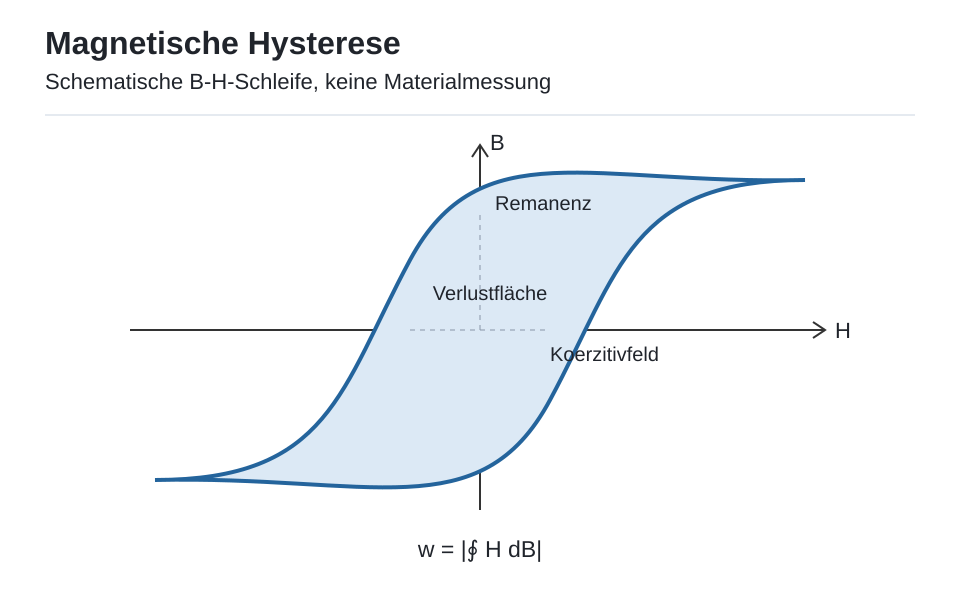

# M19-L3 – Magnetwerkstoffe und Verluste {#L3}

**Kursbereich:** M19 – Bachelor: Werkstoffe und Bauteiltechnologie

**Niveau:** Bachelor · Grundlagen

**Vorwissen:** [M4-L3](M4-L3.md).

**Lernziel:** Magnetische Kennlinien interpretieren und Hystereseverluste abschätzen.

## Magnetisierung und Sättigung {#S1}

Ein magnetischer Kern bündelt Fluss und verändert die Induktivität einer Wicklung. Bei einem linearen Modell gilt $B=\mu H$; $B$ wird in Tesla, $H$ in A/m und $\mu$ in H/m angegeben. Ferromagnetische Werkstoffe verhalten sich jedoch nicht über den gesamten Feldbereich linear. Mit wachsender Magnetisierung nimmt die zusätzliche Flussdichte je zusätzlicher Feldstärke ab. Die differentielle Permeabilität $\mathrm dB/\mathrm dH$ sinkt im Sättigungsbereich. In einer Spule kann dadurch die inkrementelle Induktivität abnehmen, sodass bei einer angelegten Spannung der Strom schneller ansteigt.

## Hysterese und Energie {#S2}

Die Flussdichte hängt auch von der magnetischen Vorgeschichte ab. Nach Rückkehr auf $H=0$ kann eine Remanenz $B_r$ verbleiben; das Gegenfeld für $B=0$ kennzeichnet die Koerzitivfeldstärke. Für einen vollständig durchlaufenen quasistatischen Zyklus entspricht der Betrag der eingeschlossenen Fläche im B-H-Diagramm der dissipierten Energie je Kernvolumen:

$$w_h=\left|\oint H\,\mathrm dB\right|,\qquad P_h=fV_c w_h.$$

$V_c$ ist das Kernvolumen, $f$ die Zyklusfrequenz. Das Produkt A/m mal T entspricht J/m³. Bei einer dynamisch gemessenen Schleife können weitere Verlustanteile bereits in der Fläche enthalten sein; sie dürfen dann nicht nochmals addiert werden.

*Abbildung: Schematische B-H-Schleife, keine Materialmessung.*

## Rechenbeispiel: Kernverluste {#S3}

Ein hypothetischer Kern mit $V_c=80\,\mathrm{cm^3}=8\cdot10^{-5}\,\mathrm{m^3}$ besitzt eine quasistatische Schleifenfläche von 120 J/m³ pro Zyklus. Bei 50 Hz liefert das Modell $P_h=50\cdot8\cdot10^{-5}\cdot120=0{,}48\,\mathrm W$. Bei 100 Hz wären es 0,96 W, sofern die Schleife unverändert bleibt. Zusätzlich angenommen 0,35 W Wirbelstromverluste und 1,2 W Wicklungsverluste ergeben für den ersten Betriebspunkt 2,03 W Gesamtverlustleistung. Die Angaben sind erfunden und dienen nur der getrennten Verlustbilanz.

## Werkstoffwahl und Wirbelströme {#S4}

Weichmagnetische Materialien mit schmaler Hystereseschleife eignen sich für wiederholte Ummagnetisierung; hartmagnetische Materialien sind für dauerhafte Magnetisierung interessant. In leitfähigem Kernmaterial erzeugt eine zeitlich veränderliche Flussdichte induzierte Ströme. Isolierte Bleche unterbrechen großflächige Strompfade; hochohmige Ferrite können Wirbelstromverluste bei höheren Frequenzen verringern. Allerdings unterscheiden sich Werkstoffe auch in Sättigungsflussdichte, Temperaturabhängigkeit, mechanischen Eigenschaften und Kosten. Die tatsächliche Auswahl erfordert die Kennlinien für Frequenz, Temperatur, Flusshub und Vormagnetisierung sowie die Wärmebilanz. Ein statischer B-H-Verlauf allein liefert keine vollständige Verlustprognose.

## Selbstkontrolle {#S5}

### Aufgaben

1. Welche Einheit hat die Schleifenfläche?
2. Wie groß ist $P_h$ bei 25 Hz im Beispiel?
3. Weshalb kann ein Ferrit trotz geringer Wirbelstromverluste ungeeignet sein?

::: {.lc-solutions data-lc-section="S5"}
1. J/m³ pro Zyklus.
2. 0,24 W bei unveränderter Schleife.
3. Zum Beispiel wegen zu geringer zulässiger Flussdichte, Temperaturgrenzen oder ungeeigneter Geometrie.
:::

## Quellen {#S6}

- [Stanford EE152 – Magnetics](https://web.stanford.edu/class/ee152/docs/Magnetics_102114.pdf) · Abschnitte Magnetic Materials und Core Loss due to Hysteresis; PDF-Text geprüft, Screenshot nicht verfügbar · Zuletzt abgerufen: 2026-11-25 · Inhaltlich geprüft: 2026-11-25
