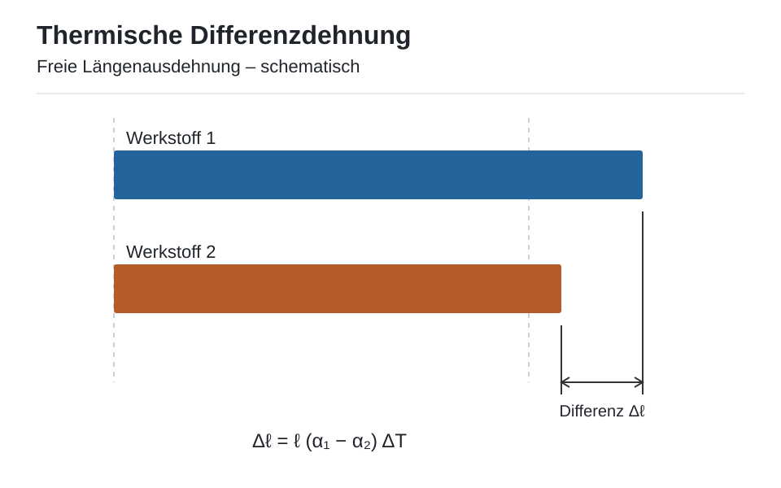

# M19-L4 – Aufbau- und Verbindungstechnik, Alterung {#L4}

**Kursbereich:** M19 – Bachelor: Werkstoffe und Bauteiltechnologie

**Niveau:** Bachelor · Grundlagen

**Vorwissen:** [M19-L1](M19-L1.md).

**Lernziel:** Elektrische, thermische und mechanische Belastungen von Verbindungen modellieren und Diagnosegrenzen erkennen.

## Funktion einer Verbindung {#S1}

Eine elektrische Verbindung ist zugleich Strompfad, Wärmeweg und mechanischer Übergang. Lötverbindungen, Presskontakte, Steckverbinder und Bondverbindungen haben unterschiedliche Anforderungen an Fertigung und Einsatz. Ein geringer Kontaktwiderstand allein belegt keine zuverlässige Verbindung: Geometrie, Oberflächenzustand, Materialkombination, Temperatur und mechanische Beanspruchung beeinflussen den Betrieb. Bei einem Modell mit $R_c$ und Strom $I$ entsteht $P=I^2R_c$. Diese Verlustleistung kann sich lokal konzentrieren und die Eigenschaften der Verbindung verändern.

## Thermische Ausdehnung und Ermüdung {#S2}

Zwei fest verbundene Werkstoffe mit unterschiedlichen linearen Ausdehnungskoeffizienten $\alpha_1$ und $\alpha_2$ würden sich bei freier Ausdehnung unterschiedlich verlängern. Als erste Abschätzung für die relative freie Längendifferenz gilt

$$\Delta\varepsilon=(\alpha_1-\alpha_2)\Delta T,\qquad \Delta\ell=\ell\Delta\varepsilon.$$

Im realen Verbund entstehen abhängig von Geometrie und Nachgiebigkeit Spannungen, Schubverformungen oder Kriechen. Wiederholte Temperaturzyklen können Ermüdungsrisse fördern. Die freie Längendifferenz ist weder die tatsächliche lokale Dehnung in einer Lötstelle noch eine Lebensdauerformel; eine Aussage zur Lebensdauer benötigt ein validiertes Material- und Belastungsmodell.

*Abbildung: Freie Längenausdehnung – schematisch.*

## Rechenbeispiel: Differenzdehnung {#S3}

Für zwei fiktive Werkstoffe seien $\alpha_1=18\cdot10^{-6}\,\mathrm{K^{-1}}$ und $\alpha_2=6\cdot10^{-6}\,\mathrm{K^{-1}}$ gegeben. Bei $\ell=20$ mm und $\Delta T=60$ K folgt $\Delta\varepsilon=720\cdot10^{-6}=0{,}072\,\%$ und $\Delta\ell=14{,}4\,\mu\mathrm m$. Eine hypothetische Kontaktstelle mit $R_c=5$ mΩ und $I=4$ A setzt 0,08 W um. Steigt der Widerstand auf 15 mΩ, steigt die Leistung bei unverändertem Strom auf 0,24 W. Daraus lässt sich ohne Wärmeübergangsmodell keine Temperatur der Kontaktstelle berechnen.

## Alterung und Verifikation {#S4}

Korrosion, mechanische Ermüdung, Materialwanderung und thermische Überlastung sind mögliche Ursachen für Funktionsverlust. Ein geeigneter Prüfplan trennt elektrische Messgrößen, Sichtbefunde und mechanische oder thermische Nachweise. Bei intermittierenden Fehlern kann ein statischer Widerstandswert unauffällig sein. Deshalb sollten Lastgeschichte und Messbedingungen dokumentiert sowie Referenzwerte und Messunsicherheit berücksichtigt werden. Beschleunigte Alterungstests müssen den relevanten Ausfallmechanismus abbilden; Ergebnisse lassen sich nicht ohne Modell auf eine andere Umgebung übertragen. Diese Lektion beschreibt Entwurfs- und Diagnoseprinzipien, keine Arbeiten an aktiven Anlagen.

## Selbstkontrolle {#S5}

### Aufgaben

1. Berechne die freie Längendifferenz bei 30 K.
2. Wie ändert sich $P$ bei doppeltem Strom und gleichem Kontaktwiderstand?
3. Warum reicht eine einmalige Widerstandsmessung nicht als Lebensdauernachweis?

::: {.lc-solutions data-lc-section="S5"}
1. 7,2 µm.
2. Die Verlustleistung vervierfacht sich.
3. Sie erfasst nur den aktuellen Zustand unter bestimmten Messbedingungen; zyklische Ermüdung, Umwelteinflüsse und intermittierende Ausfälle bleiben unberücksichtigt.
:::

## Quellen {#S6}

- [NASA Safety and Mission Assurance – Workmanship](https://sma.nasa.gov/sma-disciplines/workmanship) · PCB-Materialien, thermische Ausdehnung und zyklische Lötstellenbelastung, Absätze 780–782 im abgerufenen Text · Zuletzt abgerufen: 2026-11-25 · Inhaltlich geprüft: 2026-11-25
