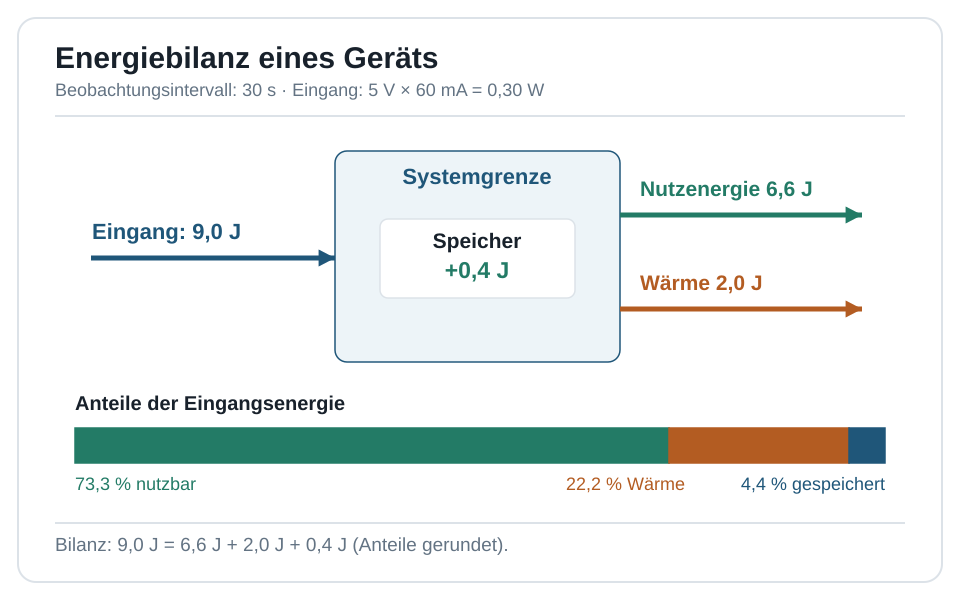

# M2-L1 – Größen, Einheiten und physikalische Bilanzen {#L1}

**Kursbereich:** M2 – Bachelor: Mathematische, physikalische und rechnerische Grundlagen

**Niveau:** Bachelor

**Vorwissen:** [Ladung, Strom, Spannung und Leistung](M1-L1.md), Zehnerpotenzen und die Grundrechenarten.

**Lernziel:** Größen in konsistente SI-Einheiten umrechnen, die Dimension von Termen prüfen und aus einer Energiebilanz eine unbekannte Größe bestimmen.

## Zahlenwert, Einheit und Dimension {#S1}

Ein Messwert wie $470\,\mathrm{\mu F}$ besteht aus einem Zahlenwert und einer Einheit. Aus $470\,\mathrm{\mu F}=4{,}70\cdot10^{-4}\,\mathrm F$ wird beim Einsetzen dieselbe physikalische Größe. Die Zahl allein hängt dagegen von der Wahl der Einheit ab. Bei einem Ohmwert von $2{,}2\,\mathrm{k\Omega}$ ist der in einem reinen SI-Zahlenmodell erwartete Wert $2200$. Wer dort $2{,}2$ einsetzt, berechnet einen tausendfach zu kleinen Widerstand.

Dimensionssymbole beschreiben die Art einer Größe. Für Energie $W$ gilt $[W] = \mathrm{M L^2 T^{-2}}$, wobei $\mathrm M$ Masse, $\mathrm L$ Länge und $\mathrm T$ Zeit bezeichnet. Die SI-Einheit ist Joule mit $\mathrm J=\mathrm{kg\,m^2\,s^{-2}}$. Leistung $P=\mathrm d W/\mathrm d t$ hat entsprechend die Einheit $\mathrm W=\mathrm{J/s}$. Im Folgenden steht ein kursives $W$ für Energie und ein aufrechtes $\mathrm W$ für die Leistungseinheit Watt.

## Dimensionsprüfung im Rechenweg {#S2}

Durch dieselbe physikalische Einheit lassen sich Terme vergleichen, die mit unterschiedlichen Symbolen notiert sind. Bei einem Widerstand gilt $P=U I=U^2/R$. Mit $\mathrm{\Omega} = \mathrm{V/A}$ erhält man $\mathrm{V^2/\Omega}=\mathrm{V\,A}=\mathrm W$. Die Maßzahl hängt weiter von den eingesetzten Werten ab. Die Dimensionsprüfung erkennt beispielsweise $P=U/R$ als falsch, weil $\mathrm{V/\Omega}=\mathrm A$ einen Strom bezeichnet.

Addieren darfst du nur Terme mit derselben Dimension. Eine Summe zweier Energien in Joule und Millijoule erfordert zusätzlich die Umrechnung auf dieselbe Einheit. Argumente von Exponentialfunktionen müssen dimensionslos sein. In $\exp(-t/\tau)$ hat deshalb die Zeitkonstante $\tau$ dieselbe Dimension wie $t$. Ein dimensionsrichtiger Ausdruck kann fachlich trotzdem falsch sein. So haben sowohl $P=UI$ als auch $P=2UI$ die Einheit Watt. Welcher Zusammenhang gilt, entscheidet das jeweilige Modell.

## Energiefluss und Speicher {#S3}

Wähle zuerst eine Systemgrenze und zähle die Energiezuflüsse und -abflüsse als positive Beträge. Für ein elektrisches Prüfmodell mit einem Speicher, einem nutzbaren Ausgang und Wärmeabgabe gilt

$$
\Delta W_\mathrm{Speicher}=W_\mathrm{ein}-W_\mathrm{nutz}-W_\mathrm{Wärme}.
$$

Im üblichen passiven Vorzeichen für ein einzelnes Bauteil ist $p=ui$ positiv, wenn der Strom am positiven Spannungsanschluss eintritt. Eine zeitweise negative Leistung kann bei einem Speicher auf Rückgabe von zuvor aufgenommener Energie hinweisen. Eine Leistungsbilanz für einen Zeitpunkt und eine Energiebilanz über ein Zeitintervall beantworten daher verschiedene Fragen.

## Rechenbeispiel {#S4}

Ein vereinfachtes Gerät nimmt über $30\,\mathrm s$ konstant $5\,\mathrm V$ und $60\,\mathrm{mA}$ auf. Es liefert in dieser Zeit $6{,}6\,\mathrm J$ an den Ausgang und erhöht seine gespeicherte Energie um $0{,}4\,\mathrm J$. Gesucht sind Eingangsenergie und Wärmeabgabe. Nach Umrechnung des Stroms gilt

$$
P_\mathrm{ein}=5\,\mathrm V\cdot0{,}060\,\mathrm A=0{,}30\,\mathrm W,\qquad
W_\mathrm{ein}=0{,}30\,\mathrm W\cdot30\,\mathrm s=9{,}0\,\mathrm J.
$$

Die Wärmeabgabe beträgt $9{,}0\,\mathrm J-6{,}6\,\mathrm J-0{,}4\,\mathrm J=2{,}0\,\mathrm J$. Der Ausgang hat $6{,}6/9{,}0\approx73{,}3\,\%$ der Eingangsenergie erhalten. Die gespeicherten $0{,}4\,\mathrm J$ zählen für dieses Intervall gesondert. Die mittlere thermische Leistung beträgt rund $66{,}7\,\mathrm{mW}$. Ihre Größenordnung passt zur Eingangsleistung von $300\,\mathrm{mW}$.

{alt="Gerätebilanz mit 9 Joule Eingangsenergie, 6,6 Joule Nutzenergie, 2 Joule Wärmeabgabe und 0,4 Joule Zunahme des Speichers."}

Das Bilanzbild trennt Energieflüsse über die Systemgrenze und die Änderung der gespeicherten Energie. Der untere Balken zeigt die Anteile am Eingang über das gesamte Zeitintervall.

## Übung und Lösung {#S5}

**Aufgabe.** Ein Kondensator der Kapazität $470\,\mathrm{\mu F}$ wird im idealen Modell auf $9\,\mathrm V$ geladen. Welche Energie steckt gemäß $W_C=\tfrac12 C U^2$ im Feld? Prüfe die Dimension der Formel. Rechne außerdem $0{,}20\,\mathrm{Wh}$ in Joule um.

**Lösung.** Es gilt $\mathrm F=\mathrm{C/V}$ und damit $\mathrm{F\,V^2}=\mathrm{C\,V}=\mathrm J$. Die Feldenergie beträgt $\tfrac12\cdot470\cdot10^{-6}\,\mathrm F\cdot(9\,\mathrm V)^2=0{,}019035\,\mathrm J$, also rund $19{,}0\,\mathrm{mJ}$. Wegen $1\,\mathrm h=3600\,\mathrm s$ entsprechen $0{,}20\,\mathrm{Wh}$ genau $720\,\mathrm J$.

## Modellgrenzen und Weiterlernen {#S6}

Bei zeitabhängigen Größen musst du $p(t)$ integrieren. Das Produkt zweier einzeln gemittelter Werte liefert im Allgemeinen keine mittlere Leistung. Wärme über die Systemgrenze und im Gerät gespeicherte innere Energie sind verschiedene Posten. Welche Beiträge in die Bilanz gehören, folgt aus der gewählten Grenze und dem Beobachtungszeitraum.

In [M2-L2](M2-L2.md) wendest du die Bilanzidee auf Ströme an und prüfst eine Netzlösung anhand ihres Residuums.

## Quellen {#S7}

- [BIPM, The International System of Units, 9. Auflage](https://www.bipm.org/en/publications/si-brochure/) · SI-Einheiten, Vorsätze und Größenrechnung. · Zuletzt abgerufen: 2026-11-25
- [OpenStax, University Physics Volume 2, § 8.3 – Energy Stored in a Capacitor](https://openstax.org/books/university-physics-volume-2/pages/8-3-energy-stored-in-a-capacitor) · Abschnitt 8.3 – Feldenergie des idealisierten Kondensators. · Zuletzt abgerufen: 2026-11-25
