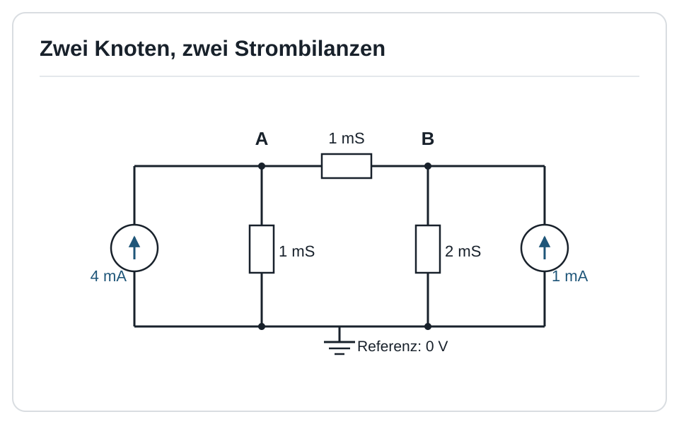

# M2-L2 – Lineare Gleichungssysteme und Matrizen {#L2}

**Kursbereich:** M2 – Bachelor: Mathematische, physikalische und rechnerische Grundlagen

**Niveau:** Bachelor

**Vorwissen:** [Kirchhoff-Regeln und systematische Netzwerkanalyse](M1-L3.md) sowie [Größen und Einheiten](M2-L1.md). Die allgemeinen Begriffe zu linearen Abbildungen findest du in [Universitätsmathematik M1-L5](index.html?course=university_mathematics&module=M1&lesson=L5&syslang=de&doclang=de&theme=light).

**Lernziel:** Aus Knotenbilanzen ein lineares Gleichungssystem aufstellen, es durch Elimination lösen und die Lösung anhand der unausgeglichenen Knotensummen kontrollieren.

## Eine Zeile pro Knoten {#S1}

An einem unbekannten Knoten gilt als Bilanz, dass die durch Widerstände abfließenden Ströme zusammen dem eingespeisten Strom entsprechen. Wird ein Referenzknoten auf null Volt gelegt, trägt ein Leitwert $g$ zur Diagonale der Matrix des Knotens bei. Verbindet ein Zweig zwei unbekannte Knoten, steht in ihrer Bilanz zusätzlich der Koeffizient $-g$ vor dem jeweils anderen Potential. Der negative Term folgt direkt aus $i=g(v_1-v_2)$. So wird jede Zeile des Modells zu einer Strombilanz und nicht bloß zu einer Rechenvorschrift.

Für das Beispiel verbindet $1\,\mathrm{mS}$ die beiden Knoten A und B. Von A zur Referenz liegt ein weiterer Leitwert von $1\,\mathrm{mS}$, von B zur Referenz einer von $2\,\mathrm{mS}$. Zwei ideale Quellen speisen $4\,\mathrm{mA}$ in A und $1\,\mathrm{mA}$ in B ein. Wir rechnen numerisch mit Leitwerten in Millisiemens, Spannungen in Volt und Strömen in Milliampere.

{alt="Zwei ideal gespeiste Knoten A und B, verbunden durch einen Leitwert von 1 mS. Von A zur Referenz liegt 1 mS, von B zur Referenz liegen 2 mS."}

## Matrix und Elimination {#S2}

In der Reihenfolge A, B lautet $Gv=b$

$$
\begin{pmatrix}2&-1\\-1&3\end{pmatrix}
\begin{pmatrix}v_A\\v_B\end{pmatrix}
=
\begin{pmatrix}4\\1\end{pmatrix}.
$$

In der ersten Zeile stehen $v_A+(v_A-v_B)=4$, in der zweiten $2v_B+(v_B-v_A)=1$. Addiere die halbe erste Zeile zur zweiten. Sie lautet dann $2{,}5v_B=3$. Daraus folgen $v_B=1{,}2\,\mathrm V$ und nach Rückeinsetzen $v_A=2{,}6\,\mathrm V$. Die erste Knotengleichung liefert $2{,}6+1{,}4=4$ in Milliampere. Am zweiten Knoten gleichen $2{,}4\,\mathrm{mA}$ zur Referenz und $-1{,}4\,\mathrm{mA}$ von B nach A genau die Einspeisung von $1\,\mathrm{mA}$ aus.

Die Wahl der Rechenreihenfolge ist von der Schaltungstopologie zu unterscheiden. Eine Umordnung der Knoten ist möglich, wenn die Spalten der Unbekannten und die Zeilen der Bilanz konsistent umgeordnet werden. Bei größeren Zahlenmodellen wird ein System mit einer geeigneten Faktorisierung gelöst. Die explizite Berechnung von $G^{-1}$ ist für diese Aufgabe nicht erforderlich.

## Das Residuum als Fehleranzeige {#S3}

Für einen Näherungsvektor $\hat v$ messen wir die nicht ausgeglichene Einspeisung mit $r=b-G\hat v$. Für $\hat v=(2{,}5,1{,}2)^\mathsf T\,\mathrm V$ ergibt sich

$$
r=\begin{pmatrix}4\\1\end{pmatrix}
-\begin{pmatrix}3{,}8\\1{,}1\end{pmatrix}
=\begin{pmatrix}0{,}2\\-0{,}1\end{pmatrix}\,\mathrm{mA}.
$$

Am Knoten A fehlt also ein Abfluss von $0{,}2\,\mathrm{mA}$, am Knoten B ist der berechnete Abfluss um $0{,}1\,\mathrm{mA}$ größer als die Einspeisung. Die Maximumsnorm $\|r\|_\infty=0{,}2\,\mathrm{mA}$ zeigt die größte Abweichung einer Zeile. Bei sehr unterschiedlich skalierten Größen oder einem schlecht konditionierten System ist diese Kennzahl allein kein Nachweis für genaue Spannungen. Sie prüft, ob die berechneten Spannungen das notierte Modell erfüllen. Ein Modellierungsfehler kann auch bei verschwindendem Residuum bestehen bleiben.

## Übung und Lösung {#S4}

**Aufgabe.** Reduziere den Leitwert von B zur Referenz auf $1\,\mathrm{mS}$. Alle übrigen Leitwerte und Einspeisungen bleiben erhalten. Bestimme beide Potentiale und prüfe den Strom in der Verbindung.

**Lösung.** In $G$ ändert sich nur der zweite Diagonaleintrag von $3$ auf $2$. Aus $2 v_A-v_B=4$ und $-v_A+2v_B=1$ folgen $v_A=3\,\mathrm V$ und $v_B=2\,\mathrm V$. Durch die Verbindung fließt $1\,\mathrm{mA}$ von A nach B. Am zweiten Knoten gehen $2\,\mathrm{mA}$ zur Referenz, während $1\,\mathrm{mA}$ aus A ankommt. Die externe Einspeisung von $1\,\mathrm{mA}$ schließt die Bilanz.

## Modellgrenzen und Weiterlernen {#S5}

Das Beispiel verwendet ohmsche Zweige und legt eine eindeutige Referenz fest. Ein schwebender Teilkreis ohne Potentialreferenz kann trotz eindeutig bestimmter Spannungsdifferenzen eine singuläre Knotengleichung ergeben. Nichtlineare Bauteile erfordern zusätzliche Modellierung. Zeitabhängige Speicher verknüpfen die Knotengleichung mit Ableitungen. Diesen Übergang zeigt [M2-L3](M2-L3.md).

## Quellen {#S6}

- [MIT OpenCourseWare, 18.06SC – Elimination with Matrices](https://ocw.mit.edu/courses/18-06sc-linear-algebra-fall-2011/pages/ax-b-and-the-four-subspaces/elimination-with-matrices/) · Elimination als elementare Zeilenoperation und Matrixrechnung. · Zuletzt abgerufen: 2026-11-25
- [OpenStax, University Physics Volume 2, § 10.3 – Kirchhoff’s Rules](https://openstax.org/books/university-physics-volume-2/pages/10-3-kirchhoffs-rules) · Abschnitt 10.3 – Knotenregel und Bilanzvorzeichen. · Zuletzt abgerufen: 2026-11-25
