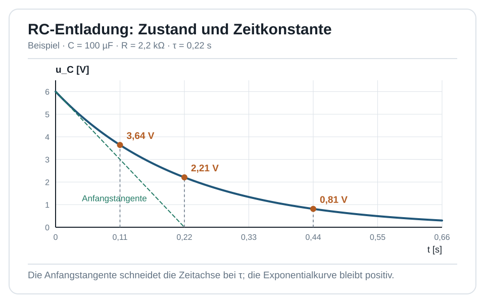

# M2-L3 – Analysis und Differentialgleichungen für zeitabhängige Modelle {#L3}

**Kursbereich:** M2 – Bachelor: Mathematische, physikalische und rechnerische Grundlagen

**Niveau:** Bachelor

**Vorwissen:** [Kondensator, Spule und Einschwingvorgänge](M1-L5.md), Steigung und Exponentialfunktion. Die mathematische Vertiefung findest du in [Universitätsmathematik M1-L9](index.html?course=university_mathematics&module=M1&lesson=L9&syslang=de&doclang=de&theme=light).

**Lernziel:** Die Momentanänderung eines Speicherzustands von der kumulierten Änderung unterscheiden und eine lineare Differentialgleichung an ihrem Anfangswert sowie an einer Bilanz prüfen.

## Ableitung und Integral als zwei Sichtweisen {#S1}

Für einen idealen Kondensator konstanter Kapazität $C$ ist $q=Cu_C$. Unter passiver Vorzeichenkonvention zählt ein positiver Strom als Ladungszufluss am positiven Anschluss. Die Änderungsrate ist $i_C=\mathrm d q/\mathrm d t=C\,\mathrm d u_C/\mathrm d t$. Multipliziert man die momentane Steigung der Spannung in $\mathrm{V/s}$ mit $\mathrm F$, ergibt sich die Einheit Ampere. Der umgekehrte Rechenweg addiert Ladung über ein Zeitfenster

$$
u_C(t)=u_C(0)+\frac{1}{C}\int_0^t i_C(s)\,\mathrm d s.
$$

Der Anfangswert ist nötig, weil dasselbe Stromprofil bei verschiedenen Startspannungen zu verschiedenen Zustandsverläufen führt. Bei einer Diskretisierung approximieren gewichtete Rechtecke oder Trapeze das Stromintegral. In der Differentialgleichung steht dagegen die lokale Änderungsrate. Aus anfangs großen Beträgen von $i_C$ folgen schnellere Änderungen, sofern $C$ konstant bleibt.

## Entladen über einen Widerstand {#S2}

Ein Kondensator mit Anfangsspannung $u_0$ entlädt sich über $R>0$. An der oberen gemeinsamen Klemme zählen die Zweigströme nach unten. Dann gilt $i_C+i_R=0$, wobei $i_R=u_C/R$. Die Bilanz liefert

$$
\frac{\mathrm d u_C}{\mathrm d t} + \frac{1}{RC} u_C=0,
\qquad u_C(0)=u_0.
$$

Setze $\tau=RC$. Multipliziert man mit $\exp(t/\tau)$, wird die linke Seite zur Ableitung von $\exp(t/\tau)u_C(t)$. Das Produkt ist daher konstant und beim Start gleich $u_0$. Die Lösung lautet $u_C(t)=u_0\exp(-t/\tau)$. Diese Herleitung vermeidet eine Division durch $u_C$. Sie gilt somit auch bei $u_0=0$ und bei negativem Anfangswert.

Zur Kontrolle liefert Ableiten $\mathrm d u_C/\mathrm d t=-u_C/\tau$. Bei $t=0$ stimmt die Lösung mit $u_0$ überein. Weil $\tau>0$ ist, geht der Zustand für große Zeiten gegen null. Jede der drei Prüfungen deckt eine andere mögliche Fehlerquelle ab.

## Rechenbeispiel und Bilanz {#S3}

Ein Kondensator mit $100\,\mathrm{\mu F}$ und Anfangsspannung $6\,\mathrm V$ entlädt sich über $2{,}2\,\mathrm{k\Omega}$. Die Zeitkonstante beträgt $0{,}22\,\mathrm s$. Am Anfang fließen $i_C(0)=-6/2200\,\mathrm A\approx-2{,}73\,\mathrm{mA}$ in der passiven Bezugsrichtung. Der Betrag der Stromstärke nimmt mit der Spannung ab. Nach $0{,}11\,\mathrm s=\tau/2$ liegt die Spannung bei rund $3{,}64\,\mathrm V$.

Bis dahin ist die Ladungsänderung $C(6\exp(-1/2)-6)\,\mathrm V\approx-236\,\mathrm{\mu C}$. Die Integration von $i_C(t)=-(u_0/R)\exp(-t/\tau)$ liefert denselben Wert, weil $\tau/R=C$ gilt. Bei positiven Vorzeichen an der Kondensatorspannung und negativem Kondensatorstrom nimmt die Feldenergie ab. Im idealen Zweig erscheint derselbe momentane Leistungsbetrag als Verlustleistung des Widerstands. Diese Bilanz ist zusätzlich zur Ableitungsprobe möglich.

{alt="Exponentialkurve der Entladung von 6 Volt mit markierten Spannungen nach 0,11, 0,22 und 0,44 Sekunden sowie Anfangstangente."}

Die Anfangstangente verdeutlicht die anfängliche Änderungsrate. Ihr Schnittpunkt mit der Zeitachse liegt bei einer Zeitkonstante; die wirkliche Entladekurve erreicht null dagegen erst im Grenzwert.

## Übung und Lösung {#S4}

**Aufgabe.** Berechne die Spannung im Beispiel nach $0{,}44\,\mathrm s$. Wie lange dauert es, bis die Spannung zum ersten Mal auf den halben Ausgangswert gefallen ist? Was sagt das Modell für eine anfängliche Spannung von $-6\,\mathrm V$ voraus?

**Lösung.** Nach zwei Zeitkonstanten verbleiben $6\exp(-2)\,\mathrm V\approx0{,}812\,\mathrm V$. Die Halbwertszeit ist $\tau\ln 2\approx0{,}152\,\mathrm s$. Beim negativen Anfangswert bleibt die Spannung für endliche Zeiten negativ und wächst gegen null. Die Feldenergie hängt vom Quadrat der Spannung ab. Ihr zeitlicher Verlauf bei Anfangswerten $+6\,\mathrm V$ und $-6\,\mathrm V$ ist deshalb identisch.

## Modellgrenzen und Weiterlernen {#S5}

Die Exponentiallösung setzt konstante Werte für $R$ und $C$ voraus. Eine zusätzliche Quelle ändert den Gleichgewichtswert. Für konstante Quellspannung lässt sich dann die Abweichung vom neuen Gleichgewicht als Zustand wählen. Leckströme, Abhängigkeiten von Temperatur und Spannung sowie zusätzliche Speicher können die Abklingkurve verändern. In [M2-L4](M2-L4.md) lernst du eine Darstellung für dauerhaft sinusförmige Anregungen kennen.

## Quellen {#S6}

- [OpenStax, University Physics Volume 2, § 10.5 – RC Circuits](https://openstax.org/books/university-physics-volume-2/pages/10-5-rc-circuits) · Abschnitt 10.5 – Differenzialgleichungen erster Ordnung, Entladevorgang und Zeitkonstante. · Zuletzt abgerufen: 2026-11-25
