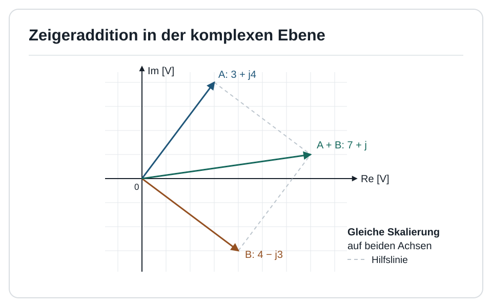

# M2-L4 – Komplexe Zahlen, Sinusfunktionen und Zeiger {#L4}

**Kursbereich:** M2 – Bachelor: Mathematische, physikalische und rechnerische Grundlagen

**Niveau:** Bachelor

**Vorwissen:** Sinus, Kosinus und [sinusförmiger Wechselstrom](M1-L6.md). Für die Grundlagen siehe [Universitätsmathematik M2-L5](index.html?course=university_mathematics&module=M2&lesson=L5&syslang=de&doclang=de&theme=light).

**Lernziel:** Einen Effektivwertzeiger in kartesischer und polarer Form darstellen, Zeiger addieren und ihre Phasendifferenz in eine Zeitverschiebung umrechnen.

## Zwei Formen für dieselbe Zahl {#S1}

In der Elektrotechnik wird die imaginäre Einheit meist als $\mathrm j$ geschrieben, weil $i$ den Strom bezeichnet. Für $z=a+\mathrm j b$ gilt $\mathrm j^2=-1$. Der Betrag ist $r=\sqrt{a^2+b^2}$. Für $r>0$ bezeichnen wir den Winkel zur positiven reellen Achse mit $\varphi$ und schreiben $z=r\exp(\mathrm j\varphi)$. Nach der Euler-Formel sind $a=r\cos\varphi$ und $b=r\sin\varphi$.

Beim Rückweg liefert eine Quadrantenfunktion wie die Python-Funktion atan2 den Winkel aus $b$ und $a$. Der Ausdruck $\arctan(b/a)$ alleine unterscheidet beispielsweise den ersten und dritten Quadranten nicht. Er scheitert auch bei $a=0$. Der Nullzeiger hat Betrag null und keinen festgelegten Phasenwinkel.

## Zeiger und Zeitfunktion {#S2}

Wir verwenden Kosinus als Bezug und speichern den Effektivwert als Betrag des Zeigers. Aus $X=X_\mathrm{eff}\exp(\mathrm j\varphi)$ folgt bei positiver Kreisfrequenz $\omega=2\pi f$

$$
x(t)=\sqrt{2}\operatorname{Re}\!\left(X\exp(\mathrm j\omega t)\right)
=\sqrt{2}X_\mathrm{eff}\cos(\omega t+\varphi).
$$

Eine positive Phasendifferenz $\varphi_A-\varphi_B$ bedeutet in dieser Konvention, dass A gegenüber B vorauseilt. Sind die Frequenzen gleich, entspricht einer Phasendifferenz von $\Delta\varphi$ eine Zeitdifferenz vom Betrag $\lvert\Delta\varphi\rvert/\omega$. Die Zeitlage ist jeweils nur bis auf ganze Perioden eindeutig. Bei Rechnungen mit $\omega$ in Radiant pro Sekunde muss der Winkel in Radiant eingesetzt werden. Gradangaben sind bei der Darstellung der Ergebnisse weiterhin sinnvoll.

## Addieren und Phasen vergleichen {#S3}

Zwei gleichfrequente Spannungen haben die Effektivwertzeiger $U_A=(3+\mathrm j4)\,\mathrm V$ und $U_B=(4-\mathrm j3)\,\mathrm V$. Beide Beträge sind $5\,\mathrm V$. A liegt im ersten und B im vierten Quadranten. Ihre Phasen sind etwa $53{,}13^\circ$ und $-36{,}87^\circ$.

Beim Addieren ist die kartesische Darstellung zweckmäßig. Die Summe ist $(7+\mathrm j)\,\mathrm V$ mit einem Betrag von $\sqrt{50}\,\mathrm V\approx7{,}07\,\mathrm V$ und einer Phase von ungefähr $8{,}13^\circ$. Die Beträge $5\,\mathrm V$ und $5\,\mathrm V$ direkt zu addieren wäre nur bei identischen Phasen korrekt. Für Division ist die Polarform praktisch, weil sich die Beträge dividieren und die Winkel subtrahieren. Hier gilt $U_A/U_B=\mathrm j$ und A eilt B um $90^\circ$ voraus. Bei $50\,\mathrm{Hz}$ entspricht das einer Viertelperiode oder $5\,\mathrm{ms}$.

{alt="Zeiger A endet bei 3 plus 4 j Volt, B bei 4 minus 3 j Volt und die Summe bei 7 plus j Volt. Eine gestrichelte Parallelogrammkonstruktion verdeutlicht die Addition."}

## Übung und Lösung {#S4}

**Aufgabe.** Schreibe $2\exp(\mathrm j135^\circ)\,\mathrm V$ kartesisch. Ein zweiter Effektivwertzeiger hat denselben Betrag und Phase $45^\circ$. Bestimme den Summenzeiger und die Phasendifferenz.

**Lösung.** Die beiden Zeiger lauten $(-\sqrt2+\mathrm j\sqrt2)\,\mathrm V$ und $(\sqrt2+\mathrm j\sqrt2)\,\mathrm V$. Die Realteile heben sich auf und die Summe ist $\mathrm j2\sqrt2\,\mathrm V$. Ihr Betrag ist $2\sqrt2\,\mathrm V$, ihre Phase beträgt $90^\circ$. Der erste Einzelzeiger eilt dem zweiten ebenfalls um $90^\circ$ voraus.

## Modellgrenzen und Weiterlernen {#S5}

Zeiger fassen Amplitude und Phase einer festen Frequenz zusammen. Signalanteile verschiedener Frequenz erhalten getrennte Zeiger. Ihre Zeitfunktionen werden anschließend addiert. Ein Gleichanteil oder ein Einschwingvorgang ist in einem einzelnen Zeiger ebenfalls nicht enthalten. Die komplexe Zahlenebene beschreibt hier Signale und ihre Zeitlage. Räumliche Richtung und räumliche Ableitungen behandelt dagegen [M2-L5](M2-L5.md).

## Quellen {#S6}

- [OpenStax, Precalculus 2e, § 8.5 – Polar Form of Complex Numbers](https://openstax.org/books/precalculus-2e/pages/8-5-polar-form-of-complex-numbers) · Abschnitt 8.5 – kartesische und polare Darstellung sowie Division in Polarform. · Zuletzt abgerufen: 2026-11-25
- [OpenStax, University Physics Volume 2, § 15.2 – Simple AC Circuits](https://openstax.org/books/university-physics-volume-2/pages/15-2-simple-ac-circuits) · Abschnitt 15.2 – Sinusgrößen, Effektivwert und Phasenbeziehungen. · Zuletzt abgerufen: 2026-11-25
