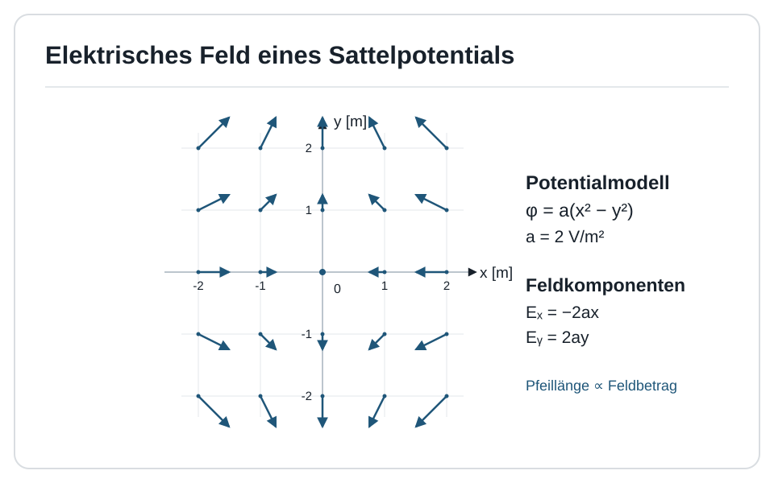

# M2-L5 – Vektorrechnung und räumliche Ableitungen {#L5}

**Kursbereich:** M2 – Bachelor: Mathematische, physikalische und rechnerische Grundlagen

**Niveau:** Bachelor

**Vorwissen:** Vektorkomponenten und Skalarprodukt sowie Ableitungen aus [M2-L3](M2-L3.md). Ein Vektorfeld ordnet jedem Ort einen Vektor zu. Ein Skalarfeld weist jedem Ort eine einzelne Zahl zu.

**Lernziel:** Aus einem Potential ein Feld berechnen, eine Feldskizze lesen und Fluss und Zirkulation anhand ihrer Flächen- beziehungsweise Linienanteile unterscheiden.

## Vom Potential zum Richtungspfeil {#S1}

Der Gradient $\nabla\phi$ eines skalaren Felds $\phi(x,y)$ besteht aus den partiellen Ableitungen $\partial\phi/\partial x$ und $\partial\phi/\partial y$. Bei jeder Ableitung bleibt die jeweils andere Koordinate fest. Das Skalarprodukt $\nabla\phi\cdot\hat{\boldsymbol s}$ gibt die lokale Änderungsrate in Einheitsrichtung $\hat{\boldsymbol s}$ an. Wenn $\nabla\phi\ne\boldsymbol 0$ ist, zeigt der Gradient in die Richtung des stärksten Anstiegs. An einer regulären Niveaulinie steht er senkrecht zur Tangente.

Im elektrostatischen Modell beschreibt $\boldsymbol E=-\nabla\phi$ das elektrische Feld. Das Minuszeichen zeigt an, dass das Potential in Feldrichtung sinkt. Aus einem Potential in Volt ergeben sich Feldkomponenten in Volt pro Meter.

## Feldskizze am Rechenbeispiel {#S2}

Betrachte $\phi(x,y)=a(x^2-y^2)$ mit $a=2\,\mathrm{V/m^2}$. Dann gilt

$$
\boldsymbol E(x,y)=(-2ax,\,2ay).
$$

Bei $x=2\,\mathrm m$, $y=1\,\mathrm m$ ist das Feld $(-8,4)\,\mathrm{V/m}$, sein Betrag ist $\sqrt{80}\,\mathrm{V/m}\approx8{,}94\,\mathrm{V/m}$. Entlang der waagerechten Achse zeigen die Pfeile zum Ursprung und entlang der senkrechten Achse zeigen sie vom Ursprung weg. Am Ursprung ist der Gradient null.

{alt="Pfeilgitter des Felds E gleich minus 4 x in x-Richtung und plus 4 y in y-Richtung. Zum Ursprung hin gerichtete Pfeile auf der x-Achse und nach außen gerichtete Pfeile auf der y-Achse bilden ein Sattelmuster."}

## Fluss und Zirkulation {#S3}

Ein orientierter **Fluss** durch eine Fläche summiert die Normalkomponente des Felds. Im einfachen Fall eines konstanten Felds $\boldsymbol F$ und einer ebenen Fläche $A$ gilt $\Phi=A\,\boldsymbol F\cdot\hat{\boldsymbol n}$. Ist das Feld parallel zur Fläche, verschwindet dieser Beitrag. Ein homogener elektrischer Feldvektor $(3,0,0)\,\mathrm{V/m}$ ergibt durch eine Fläche von $2\,\mathrm{m^2}$ mit Normale in positiver $x$-Richtung den Fluss $6\,\mathrm{V\,m}$. Kehrt man die Normale um, kehrt sich das Vorzeichen um. Die Flussdichte beziehungsweise Feldgröße und ihr integrierter Fluss haben unterschiedliche Einheiten.

Die **Zirkulation** summiert die Tangentialkomponente entlang einer geschlossenen, orientierten Kurve. Das Integral lautet $\oint\boldsymbol F\cdot\mathrm d\boldsymbol r$. Ein rein radialer Beitrag auf einem Kreis ist dort senkrecht zum Kurvenweg. Ein umlaufendes Feld kann dagegen ein von null verschiedenes Ergebnis liefern.

Für $\boldsymbol E=-\nabla\phi$ ist das Integral auf einem Weg der Potentialwert am Anfang minus der Potentialwert am Ende. Auf einem geschlossenen Weg verschwindet es daher. Im Beispiel ist auch die Divergenz von $\boldsymbol E$ null, weil $\partial E_x/\partial x=-2a$ und $\partial E_y/\partial y=2a$ einander aufheben. Das bedeutet nicht, dass die Feldvektoren null sind. Es beschreibt eine lokale Bilanz von Aus- und Eintritt angrenzender Feldanteile.

## Übung und Lösung {#S4}

**Aufgabe.** Berechne die Zirkulation des Vergleichsfelds $\boldsymbol F=(-k y,k x)$ auf dem positiv gegen den Uhrzeigersinn durchlaufenen Quadrat von $(0,0)$ bis $(L,L)$, mit $k=1\,\mathrm{V/m^2}$ und $L=1\,\mathrm m$.

**Lösung.** Auf der unteren Kante ist $F_x=0$, auf der linken Kante $F_y=0$. Nach oben an der rechten Kante ist $F_y=kL$, also ergibt das Linienintegral $kL^2$. Oben läuft der Weg nach links, während $F_x=-kL$ ist. Das Produkt aus Feldkomponente und gerichteter Verschiebung liefert erneut $kL^2$. Die Summe ist $2kL^2=2\,\mathrm V$. Das Vergleichsfeld ist daher auf diesem Gebiet kein elektrostatisches Gradientenfeld.

## Modellgrenzen und Weiterlernen {#S5}

Pfeilgitter geben Werte nur an ausgewählten Orten wieder. Interpolation und Pfeillänge müssen zur tatsächlichen Felddefinition passen. Das skalare Potentialbeispiel behandelt einen elektrostatischen Ausschnitt. Zeitabhängige Magnetflüsse können zu elektrischen Feldzirkulationen führen und erweitern dieses Modell. Vor den Feld- und Wellenmodellen in M4 betrachten wir in [M2-L6](M2-L6.md) die statistische Beschreibung von Messwerten.

## Quellen {#S6}

- [OpenStax, Calculus Volume 3, § 4.6 – Directional Derivatives and the Gradient](https://openstax.org/books/calculus-volume-3/pages/4-6-directional-derivatives-and-the-gradient) · Abschnitt 4.6 – Richtung, Gradient und Niveaulinien. · Zuletzt abgerufen: 2026-11-25
- [OpenStax, Calculus Volume 3, § 6.2 – Line Integrals](https://openstax.org/books/calculus-volume-3/pages/6-2-line-integrals) · Abschnitt 6.2 – Integration entlang orientierter Kurven. · Zuletzt abgerufen: 2026-11-25
- [OpenStax, Calculus Volume 3, § 6.5 – Divergence and Curl](https://openstax.org/books/calculus-volume-3/pages/6-5-divergence-and-curl) · Abschnitt 6.5 – lokale Feldbilanz und Zirkulationsbezug. · Zuletzt abgerufen: 2026-11-25
