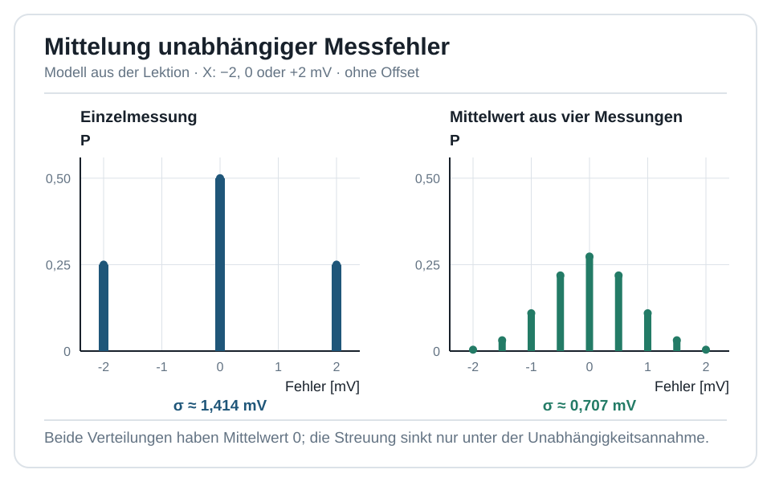

# M2-L6 – Wahrscheinlichkeit und statistische Modellierung {#L6}

**Kursbereich:** M2 – Bachelor: Mathematische, physikalische und rechnerische Grundlagen

**Niveau:** Bachelor

**Vorwissen:** Brüche, Summen und Quadrate. Die zugrunde liegenden Begriffe werden in [Universitätsmathematik M1-L7](index.html?course=university_mathematics&module=M1&lesson=L7&syslang=de&doclang=de&theme=light) vertieft.

**Lernziel:** Erwartungswert und Varianz eines diskreten Messmodells berechnen und entscheiden, welche Vereinfachungen bei unabhängigen Stichproben zulässig sind.

## Ein Messwert als Zufallsgröße {#S1}

Ein fiktiver Sensor liefert bei konstantem Eingang einen additiven Messfehler $X$. In einem kleinen diskreten Modell kann dieser Fehler nur $-2\,\mathrm{mV}$, $0\,\mathrm{mV}$ oder $2\,\mathrm{mV}$ annehmen. Die Wahrscheinlichkeiten seien $\tfrac14$, $\tfrac12$ und $\tfrac14$. Die Summe ist eins. Das Modell beschreibt eine gedachte Verteilung. Eine endliche Liste tatsächlich beobachteter Werte hätte eigene relative Häufigkeiten, die sich von diesen Wahrscheinlichkeiten unterscheiden können.

Für mögliche Werte $x_i$ und Wahrscheinlichkeiten $p_i$ ist der Erwartungswert das gewichtete Mittel und die Varianz die erwartete quadratische Abweichung davon

$$
\mu=\operatorname{E}[X]=\sum_i p_i x_i,\qquad
\operatorname{Var}(X)=\sum_i p_i(x_i-\mu)^2.
$$

Der Erwartungswert des Beispiels ist null, weil sich positive und negative Beiträge ausgleichen. Die Varianz beträgt $2\,\mathrm{mV}^2$. Die Standardabweichung ist ihre Wurzel und beträgt rund $1{,}414\,\mathrm{mV}$. Sie hat wie $X$ eine Spannungseinheit, während die Varianz eine quadrierte Spannungseinheit trägt.

## Mitteln und systematische Verschiebung {#S2}

Es werden vier Messfehler $X_1,\dots,X_4$ mit derselben Verteilung angenommen. Sind sie unabhängig, verschwinden die gegenseitigen Kovarianzen. Für den Mittelwert $\bar X=\tfrac14\sum_i X_i$ gilt deshalb $\operatorname{E}[\bar X]=0$ und $\operatorname{Var}(\bar X)=\operatorname{Var}(X)/4=0{,}5\,\mathrm{mV}^2$. Die Standardabweichung des Mittelwerts beträgt rund $0{,}707\,\mathrm{mV}$. Allgemein sinkt sie unter diesen Annahmen wie $1/\sqrt n$.

Ein nicht erfasster Offset von $1\,\mathrm{mV}$ verschiebt jeden Messfehler und damit den Erwartungswert des Mittelwerts auf $1\,\mathrm{mV}$. Zur Varianz um den eigenen Mittelwert trägt diese Konstante nichts bei. Mitteln reduziert also in diesem Modell die zufällige Streuung, der Offset bleibt bestehen. Treten die vier identischen Zufallsfehler dagegen vollständig synchron auf, ist ihr Mittelwert derselbe Fehler. Dann entsteht keine Verringerung der Streuung.

{alt="Zwei diskrete Wahrscheinlichkeitsverteilungen: Einzelmessung mit Standardabweichung 1,414 Millivolt und Mittel aus vier unabhängigen Messungen mit 0,707 Millivolt."}

Die rechte Verteilung ergibt sich aus allen Kombinationen von vier unabhängigen Messfehlern des beschriebenen Modells. Sie ist um null konzentrierter. Die senkrechten Striche stehen für Einzelwahrscheinlichkeiten, nicht für eine kontinuierliche Dichte.

## Ereignisse in Stichproben {#S3}

Ein zweites Modell zählt Warnungen. In jedem Versuch beträgt die Warnwahrscheinlichkeit $p=0{,}1$, und die Versuche sind unabhängig. Die Wahrscheinlichkeit für keine Warnung in fünf Versuchen ist $(1-p)^5=0{,}59049$. Für mindestens eine Warnung ist sie daher $0{,}40951$. Die Wahrscheinlichkeit für genau eine Warnung ist $5p(1-p)^4=0{,}32805$, weil ihr Zeitpunkt fünf verschiedene Positionen einnehmen kann.

Diese Produkte verwenden zwei verschiedene Annahmen. Die Unabhängigkeit erlaubt die Multiplikation der einzelnen Wahrscheinlichkeiten. Ein konstantes $p$ macht die Wahrscheinlichkeit jeder festen Anordnung mit gleich vielen Warnungen gleich. Beides sollte bei einer Messreihe gesondert begründet werden.

## Übung und Lösung {#S4}

**Aufgabe.** Bestimme die Standardabweichung des Mittels von acht unabhängigen Messungen im ersten Modell. Wie groß ist im Warnmodell die Wahrscheinlichkeit für mindestens eine Warnung bei $p=0{,}02$ in drei unabhängigen Versuchen?

**Lösung.** Die Varianz des Mittels beträgt $2/8=0{,}25\,\mathrm{mV}^2$. Seine Standardabweichung ist $0{,}5\,\mathrm{mV}$. Im zweiten Teil ist das Gegenereignis dreimal keine Warnung mit Wahrscheinlichkeit $0{,}98^3=0{,}941192$. Damit beträgt die gesuchte Wahrscheinlichkeit $0{,}058808$, also rund $5{,}88\,\%$.

## Modellgrenzen und Weiterlernen {#S5}

Drift, gemeinsame Störungen und zeitliche Filter können Abhängigkeiten zwischen aufeinanderfolgenden Messungen erzeugen. Gleiche Mittelwerte und Varianzen genügen insbesondere nicht zur Bestimmung seltener Ereignisse. Dafür wird eine geeignete Verteilung oder ein entsprechendes datenbasiertes Verfahren benötigt. In [M2-L7](M2-L7.md) legst du die Eingaben eines numerischen Rechenexperiments offen und kontrollierst seine Ergebnisse.

## Quellen {#S6}

- [OpenStax, Introductory Statistics 2e, Kapitel 4 – Formula Review](https://openstax.org/books/introductory-statistics-2e/pages/4-formula-review) · Abschnitt Ch. 4 Formula Review – Erwartungswert, Varianz und Binomialverteilung. · Zuletzt abgerufen: 2026-11-25
- [OpenStax, Introductory Statistics 2e, § 7.1 – The Central Limit Theorem for Sample Means](https://openstax.org/books/introductory-statistics-2e/pages/7-1-the-central-limit-theorem-for-sample-means-averages) · Abschnitt 7.1 – Lage und Streuung des Stichprobenmittels. · Zuletzt abgerufen: 2026-11-25
