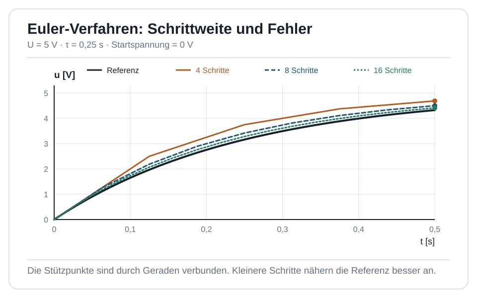

# M2-L7 – Rechenexperimente und Programmierung {#L7}

**Kursbereich:** M2 – Bachelor: Mathematische, physikalische und rechnerische Grundlagen

**Niveau:** Bachelor

**Vorwissen:** [Ableitungen und Differentialgleichungen](M2-L3.md), Schleifen und grundlegende Python-Ausdrücke.

**Lernziel:** Eine Differentialgleichung mit dem expliziten Euler-Verfahren berechnen und die Rechnung mit dem Anfangswert, einem Gleichgewichtsfall und einer analytischen Referenz prüfen.

## Was muss reproduzierbar sein? {#S1}

Ein Rechenexperiment besteht aus dem physikalischen Modell, den Eingaben, dem numerischen Verfahren und den Kriterien für die Auswertung. Hier wird ein idealer Kondensator über einen Widerstand an eine konstante Quellspannung $U$ angeschlossen. Für $\tau=RC$ gilt

$$
\frac{\mathrm d u}{\mathrm d t}=\frac{U-u}{\tau},\qquad
u(0)=u_0,\qquad
u_\mathrm{ref}(t)=U+(u_0-U)\exp(-t/\tau).
$$

Die Referenz ist die analytische Lösung desselben idealisierten Modells. Wir wählen $U=5\,\mathrm V$, $\tau=0{,}25\,\mathrm s$, $u_0=0$ und als festen Vergleichszeitpunkt $T=0{,}5\,\mathrm s$. Alle Zeiten werden als Zahlenwerte in Sekunden und die Spannungen in Volt eingesetzt. Dadurch bleiben Ursache und Wirkung nachvollziehbar, wenn sich ein Ergebnis bei geänderter Schrittweite verschiebt.

## Vom Modell zum Programm {#S2}

Der explizite Euler-Schritt nutzt die Steigung am Anfang jedes Schritts

$$
u_{n+1}=u_n+h\frac{U-u_n}{\tau}.
$$

Die Differenz zum Gleichgewicht erfüllt $u_{n+1}-U=(1-h/\tau)(u_n-U)$. Bei Schrittweiten mit $0<h<\tau$ nähert sich die diskrete Lösung ohne Vorzeichenwechsel dem Gleichgewicht. Für $\tau<h<2\tau$ springt sie abwechselnd darüber und darunter und konvergiert weiterhin. Bei $h=2\tau$ bleibt die Abweichung betragsmäßig gleich. Dieses Verhalten stammt aus der Diskretisierung und ist keine Schwingung im kontinuierlichen Kondensatormodell.

Der folgende Code verwendet nur die Python-Standardbibliothek. Die Schrittweite folgt aus der festen Endzeit und der Zahl der Schritte. Das vermeidet eine Verschiebung der Endzeit durch Rundung der Schrittanzahl.

```python
from math import exp, isclose


def euler_endpoint(u_start, supply, tau, duration, steps):
    h = duration / steps
    u = u_start
    for _ in range(steps):
        u += h * (supply - u) / tau
    return u


supply = 5.0       # V
tau = 0.25         # s
duration = 0.5     # s
u_start = 0.0      # V

reference = supply + (u_start - supply) * exp(-duration / tau)
print(f"Referenz: {reference:.6f} V")

errors = []
for steps in (4, 8, 16):
    endpoint = euler_endpoint(u_start, supply, tau, duration, steps)
    error = abs(endpoint - reference)
    errors.append(error)
    print(f"h={duration / steps:.5f} s, u(T)={endpoint:.6f} V, "
          f"Fehler={error:.6f} V")

assert 0 < reference < supply
assert errors[0] > errors[1] > errors[2]
assert isclose(euler_endpoint(u_start, supply, tau, 0.0, 8), u_start)
assert isclose(euler_endpoint(supply, supply, tau, duration, 8), supply)
```

## Vergleich der Ergebnisse {#S3}

Der Referenzwert bei $T$ beträgt $4{,}323324\,\mathrm V$. Bei $h=0{,}125\,\mathrm s$ erhält man $4{,}687500\,\mathrm V$, bei $h=0{,}0625\,\mathrm s$ etwa $4{,}499435\,\mathrm V$ und bei $h=0{,}03125\,\mathrm s$ etwa $4{,}409665\,\mathrm V$. Die absoluten Fehler sind rund $0{,}364176\,\mathrm V$, $0{,}176112\,\mathrm V$ und $0{,}086341\,\mathrm V$. Der Fehler halbiert sich annähernd, wenn die Schrittweite halbiert wird. Das ist bei diesem Beispiel mit dem globalen Fehler erster Ordnung vereinbar.

Die Prüfungen unterscheiden drei Fälle. Bei Endzeit null muss der Anfangswert erhalten bleiben. Bei $u_0=U$ muss der Zustand zeitlich konstant bleiben. Für den Übergang zwischen zwei verschiedenen Zuständen wird zusätzlich der Endwert mit der analytischen Lösung verglichen. Alle drei Tests beziehen sich auf das gewählte Modell. Ein Vergleich mit realen Messdaten wäre ein weiterer Schritt.

{alt="RC-Ladekurve als analytische Referenz sowie Euler-Stützpunkte mit vier, acht und sechzehn Schritten. Die Kurven nähern sich bei kleinerer Schrittweite der Referenz."}

Die Linien verbinden die diskreten Rechenpunkte. Je kleiner die Schrittweite in diesem Beispiel, desto näher liegt die numerische Lösung am dargestellten analytischen Verlauf.

## Übung und Lösung {#S4}

**Aufgabe.** Setze für die Beobachtungszeit $0{,}5\,\mathrm s$ nur einen Euler-Schritt ein. Berechne den Endwert und begründe, warum er für das idealisierte Lademodell unplausibel ist.

**Lösung.** Die Anfangssteigung ist $5\,\mathrm V/0{,}25\,\mathrm s=20\,\mathrm{V/s}$. Ein Schritt von $0{,}5\,\mathrm s$ führt damit zu $10\,\mathrm V$. Ab dem Anfangswert null nähert sich die exakte Ladekurve der konstanten Versorgung $5\,\mathrm V$ monoton von unten an. Das Überschießen um $5\,\mathrm V$ zeigt deshalb einen ungeeigneten numerischen Schritt. Hier ist $h=2\tau$ und der Abweichungsfaktor $-1$.

## Modellgrenzen und Weiterlernen {#S5}

Der Code simuliert einen idealen Speicher mit einer Zeitkonstante. Bei mehreren stark verschiedenen Zeitkonstanten kann ein explizites Verfahren besonders kleine Schritte erfordern. Eine Übereinstimmung an einem Zeitpunkt ersetzt weder eine Prüfung der gesamten Kurve noch die Prüfung des Modells gegen unabhängige Beobachtungen. Der [Studienweg](pages/studienweg.md) ordnet die Rechenverfahren in den weiteren Fachkurs ein.

## Quellen {#S6}

- [OpenStax, Calculus Volume 2, § 4.2 – Direction Fields and Numerical Methods](https://openstax.org/books/calculus-volume-2/pages/4-2-direction-fields-and-numerical-methods) · Abschnitt 4.2 – explizites Euler-Verfahren und Vergleich mit analytischen Lösungen. · Zuletzt abgerufen: 2026-11-25
- [OpenStax, University Physics Volume 2, § 10.5 – RC Circuits](https://openstax.org/books/university-physics-volume-2/pages/10-5-rc-circuits) · Abschnitt 10.5 – Kondensatorladung und Zeitkonstante. · Zuletzt abgerufen: 2026-11-25
