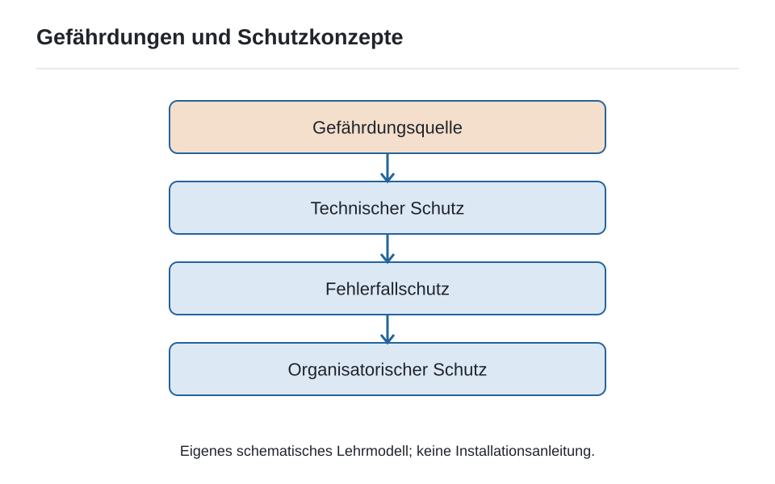

# M20-L1 – Gefährdungen und Schutzkonzepte {#L1}

**Kursbereich:** M20 – Bachelor: Elektrosicherheit und Anlagen

**Niveau:** Bachelor · Grundlagen

**Vorwissen:** [M19-L4](M19-L4.md).

**Lernziel:** Gefährdungsarten, gespeicherte Energie und unabhängige Schutzebenen unterscheiden.

## Gefahren und Exposition {#S1}

Elektrische Energie kann durch Körperdurchströmung, thermische Wirkung, Lichtbogen, Brand oder unerwartete Bewegung zu Verletzungen führen. Eine Gefährdung ist eine mögliche Schadensursache; das Risiko hängt zusätzlich von Exposition, Eintrittswahrscheinlichkeit und Schwere ab. Feuchtigkeit, beschädigte Isolierung und leitfähige Umgebung verändern die Randbedingungen. Eine abgeschaltete Anzeige ist kein Nachweis eines energiefreien Zustands: Kondensatoren, Batterien, Rückspeisung und mechanische Speicher können Energie enthalten.

## Schutzebenen {#S2}

Konstruktive Maßnahmen begrenzen die Gefährdung an der Quelle, etwa durch geeignete Isolierung, sichere Gehäuse und energiebegrenzte Systeme. Fehlerfallmaßnahmen sollen verhindern, dass ein einzelner Fehler einen gefährlichen Zustand hervorruft. Organisatorische Regeln, Qualifikation und Prüfungen ergänzen diese Ebenen. Persönliche Schutzausrüstung ersetzt keine technische Schutzmaßnahme. Mehrere Maßnahmen sind nur dann robust, wenn gemeinsame Ausfallursachen berücksichtigt werden, etwa Hitze, die gleichzeitig zwei Isolationsbarrieren schädigt.

*Abbildung: Eigenes schematisches Lehrmodell; keine Installationsanleitung.*

## Rechenmodell: gespeicherte Energie {#S3}

Für einen idealen Kondensator gilt $W=\tfrac12 CU^2$. Bei einem fiktiven Modell mit $C=100\,\mu\mathrm F$ und $U=20\,\mathrm V$ ergibt sich $W=0{,}020\,\mathrm J$. Bei gleicher Kapazität und halber Spannung beträgt die Energie 0,005 J. Das Beispiel zeigt die quadratische Spannungsabhängigkeit. Der Wert ist kein Grenzwert für Berührungssicherheit; die Wirkung hängt auch von Strompfad, Entladedauer und weiteren Quellen ab.

## Fallanalyse und Grenzen {#S4}

In einem Modellfall werden beschädigte Isolation und ein unvollständiger Wartungsnachweis beobachtet. Die Entscheidung lautet nicht, das Gerät durch einen Probebetrieb zu beurteilen, sondern es der qualifizierten Beurteilung zuzuführen. Die Untersuchung eines realen Systems erfordert Kenntnis aller Energiequellen, Verantwortlichkeiten und geltenden Regeln. Dieses Modul verwendet ausschließlich theoretische Beispiele und Simulationen; es qualifiziert nicht für Arbeiten an elektrischen Anlagen.

## Selbstkontrolle {#S5}

### Aufgaben

1. Wie verändert sich die Kondensatorenergie bei Verdopplung der Spannung?
2. Warum sind zwei Barrieren nicht automatisch unabhängig?
3. Warum reicht eine erloschene Anzeige nicht?

::: {.lc-solutions data-lc-section="S5"}
1. Sie vervierfacht sich bei gleichem C.
2. Eine gemeinsame Ausfallursache kann beide zugleich beeinträchtigen.
3. Weitere Energiequellen und gespeicherte Energie können vorhanden sein.
:::

## Quellen {#S6}

- [HSE – Introduction to electrical safety](https://www.hse.gov.uk/electricity/introduction.htm) · General hazards and risk reduction; HTML retrieved, lines 143–144 and hazard discussion · Zuletzt abgerufen: 2026-11-25 · Inhaltlich geprüft: 2026-11-25
- [HSE – Work using electrically powered equipment](https://www.hse.gov.uk/ELECTRICITY/electricequip.htm) · RCD limitations, lines 97–99 · Zuletzt abgerufen: 2026-11-25 · Inhaltlich geprüft: 2026-11-25
