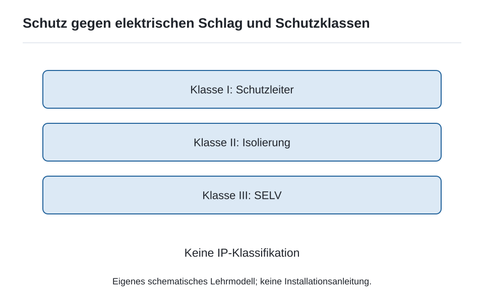

# M20-L2 – Schutz gegen elektrischen Schlag und Schutzklassen {#L2}

**Kursbereich:** M20 – Bachelor: Elektrosicherheit und Anlagen

**Niveau:** Bachelor · Grundlagen

**Vorwissen:** [M20-L1](M20-L1.md).

**Lernziel:** Basisschutz, Fehlerschutz und Geräte-Schutzklassen konzeptionell zuordnen.

## Normalbetrieb und Fehlerfall {#S1}

Basisschutz verhindert den Zugang zu gefährlich aktiven Teilen im Normalbetrieb. Fehlerschutz berücksichtigt einen Fehler, durch den ein zugängliches leitfähiges Gehäuse gefährliches Potential annehmen könnte. Zusätzlicher Schutz ergänzt das Schutzkonzept, ersetzt aber nicht automatisch die beiden anderen Ebenen. Schutz gegen Schlag muss für die tatsächliche Umgebung beurteilt werden; aus der Nennspannung allein folgt keine Freigabe.

## Schutzklassen {#S2}

Schutzklasse I kombiniert Basisisolierung mit einem Schutzleiterkonzept für berührbare leitfähige Teile und dem zugehörigen Anlagenschutz. Schutzklasse II beruht auf doppelter oder verstärkter Isolierung und verwendet für diesen Schutz keinen Schutzleiteranschluss. Schutzklasse III beruht auf Versorgung mit Schutzkleinspannung (SELV) und darf keine darüber hinausgehenden gefährlichen Spannungen erzeugen. Die genaue Einordnung setzt den einschlägigen Produktstandard voraus. Schutzklassen sind nicht mit IP-Schutzarten gegen Berührung und Eindringen zu verwechseln.

*Abbildung: Eigenes schematisches Lehrmodell; keine Installationsanleitung.*

## Rechenmodell: abstrakter Fehlerpfad {#S3}

In einem rein ohmschen, fiktiven Netzwerk ergibt sich bei $U=12\,\mathrm V$ und $R=120\,\Omega$ nach $I=U/R$ ein Strom von 0,10 A. Wird der Modellwiderstand verdoppelt, halbiert sich der Strom. Das Netzwerk steht nicht für den menschlichen Körper und erlaubt weder eine Abschätzung seiner Impedanz noch eine Bewertung zulässiger Berührungsspannungen. Bei Wechselstrom können Frequenz und komplexe Impedanzen entscheidend sein.

## Auswahl und Nachweis {#S4}

Eine Schutzklasse ist eine Entwurfseigenschaft, keine nachträglich frei wählbare Kennzeichnung. Ein beschädigtes Gehäuse kann den Schutz beeinträchtigen, selbst wenn ein Gerät noch funktioniert. Produktunterlagen, Herstellerangaben und qualifizierte Prüfungen müssen zusammenpassen. IEC 61140 ist ein grundlegender Bezug; die öffentlich einsehbare Zusammenfassung ersetzt weder den Normvolltext noch anwendungsbezogene Produkt- und Installationsnormen.

## Selbstkontrolle {#S5}

### Aufgaben

1. Worin unterscheidet sich Klasse I von Klasse II?
2. Ist eine IP-Angabe gleichbedeutend mit einer Schutzklasse?
3. Welcher Strom ergibt sich im Modell bei 240 Ω?

::: {.lc-solutions data-lc-section="S5"}
1. Klasse I nutzt ein Schutzleiterkonzept; Klasse II doppelte oder verstärkte Isolierung.
2. Nein, die Klassifikationen beschreiben unterschiedliche Eigenschaften.
3. 0,05 A.
:::

## Quellen {#S6}

- [Schneider Electric – Electrical Installation Guide](https://www.electrical-installation.org/enwiki/Protection_against_electric_shock) · Basic and fault protection, lines 83–121; manufacturer technical guide, not normative text (Prüfung auf belegten Teilumfang begrenzt) · Zuletzt abgerufen: 2026-11-25 · Inhaltlich geprüft: 2026-11-25
- [Schneider Electric – Class II equipment](https://www.electrical-installation.org/enwiki/Class_II_equipment) · Supplementary insulation and protective conductor, lines 48–59 · Zuletzt abgerufen: 2026-11-25 · Inhaltlich geprüft: 2026-11-25
- [IEC 61140:2016](https://webstore.iec.ch/en/publication/23997) · Public catalogue abstract only; full standard not reviewed (Prüfung auf belegten Teilumfang begrenzt) · Zuletzt abgerufen: 2026-11-25 · Inhaltlich geprüft: 2026-11-25
- [Schneider Electric – Extra Low Voltage](https://www.electrical-installation.org/enwiki/Extra_Low_Voltage_(ELV)) · SELV/PELV distinction, lines 78–108; secondary guide · Zuletzt abgerufen: 2026-11-25 · Inhaltlich geprüft: 2026-11-25
