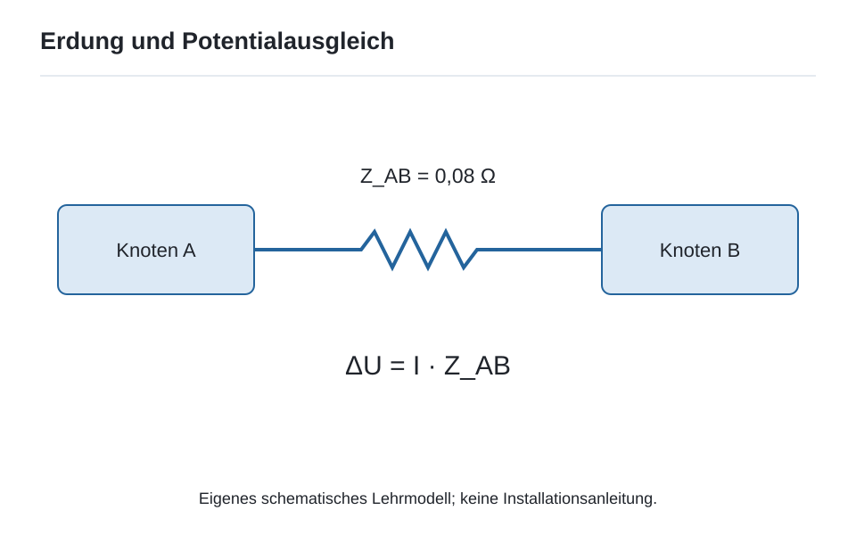

# M20-L3 – Erdung und Potentialausgleich {#L3}

**Kursbereich:** M20 – Bachelor: Elektrosicherheit und Anlagen

**Niveau:** Bachelor · Grundlagen

**Vorwissen:** [M20-L2](M20-L2.md).

**Lernziel:** Systemerdung, Schutzerdung und Potentialdifferenzen in Ersatzmodellen unterscheiden.

## Funktionen der Erdung {#S1}

Systemerdung definiert einen Bezug eines elektrischen Versorgungssystems zur Erde und beeinflusst das Verhalten im Fehlerfall. Schutzerdung betrifft die Sicherheit berührbarer leitfähiger Teile. Funktionserdung kann dagegen für Signalqualität oder elektromagnetische Verträglichkeit notwendig sein. Die Funktionen sind zu unterscheiden, auch wenn sie in einer Anlage miteinander koordiniert werden.

## Potentialausgleich und Impedanz {#S2}

Erde ist kein idealer Nullpotentialknoten. Bei Stromfluss entstehen an Leitern und im Erdreich Potentialunterschiede; relevant sind auch induktive Anteile bei schnellen Stromänderungen. Schutzpotentialausgleich dient der Begrenzung gefährlicher Potentialdifferenzen zwischen leitfähigen Teilen. Ein niedriger Gleichstromwiderstand allein garantiert keine ausreichende Hochfrequenzwirkung oder Fehlerstromtragfähigkeit.

*Abbildung: Eigenes schematisches Lehrmodell; keine Installationsanleitung.*

## Rechenmodell: zwei Knoten {#S3}

Für zwei abstrakte Knoten A und B mit einer Verbindungsimpedanz $Z_{AB}$ gilt im linearen Wechselstrommodell $\underline U_{AB}=\underline I\,Z_{AB}$. Für einen rein ohmschen Modellwert von 0,08 Ω bei 2 A beträgt der Spannungsabfall 0,16 V. Bei gleicher Stromstärke und 0,20 Ω sind es 0,40 V. Das Rechenmodell ist keine Dimensionierung von Schutzleitern oder Erdungsanlagen; in realen Fehlernetzen verändert die Impedanz auch die Stromverteilung.

## Netzformen und Bewertung {#S4}

TN-, TT- und IT-Systeme unterscheiden sich in der Beziehung von Stromquelle und leitfähigen Körpern zur Erde. Daraus folgen unterschiedliche Fehlerschleifen und Schutzkonzepte; sie sind nicht beliebig austauschbar. Für eine Anlagenbewertung sind die tatsächliche Netzform, Stromquelle, Fehlerfälle, Schaltgeräte, Leiter und Umweltbedingungen zu erfassen. Die US-amerikanische OSHA-Quelle erläutert Potentialausgleich in ihrem eigenen Anwendungsbereich; sie ist keine deutsche Errichtungsnorm.

## Selbstkontrolle {#S5}

### Aufgaben

1. Warum ist Erde kein idealer Nullpotentialknoten?
2. Berechne den Modellspannungsabfall bei 3 A und 0,08 Ω.
3. Warum reicht ein niedriger DC-Widerstand nicht als Gesamtnachweis?

::: {.lc-solutions data-lc-section="S5"}
1. Stromfluss erzeugt Spannungsabfälle in endlichen Impedanzen.
2. 0,24 V.
3. Dynamische Impedanz, Stromtragfähigkeit und andere Schutzanforderungen bleiben offen.
:::

## Quellen {#S6}

- [HSE – Earthing](https://www.hse.gov.uk/comah/sragtech/techmeasearthing.htm) · System and equipment earthing, line 64 · Zuletzt abgerufen: 2026-11-25 · Inhaltlich geprüft: 2026-11-25
- [OSHA – Protective Grounding and Bonding](https://www.osha.gov/etools/electric-power/hazardous-energy-control/protective-grounding-bonding) · Potential differences and equipotential zone, lines 62–70; US context, not local installation requirements · Zuletzt abgerufen: 2026-11-25 · Inhaltlich geprüft: 2026-11-25
