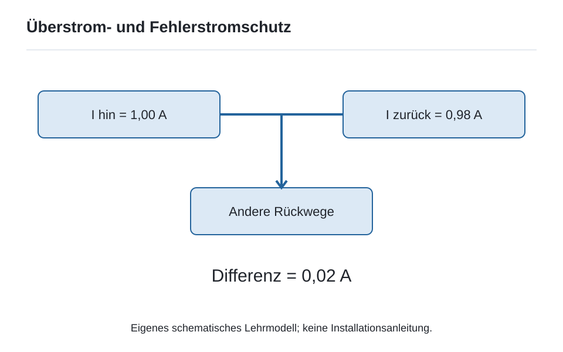

# M20-L4 – Überstrom- und Fehlerstromschutz {#L4}

**Kursbereich:** M20 – Bachelor: Elektrosicherheit und Anlagen

**Niveau:** Bachelor · Grundlagen

**Vorwissen:** [M20-L3](M20-L3.md).

**Lernziel:** Überlast, Kurzschluss und Differenzstrom unterscheiden und Schutzkennlinien einordnen.

## Unterschiedliche Fehlergrößen {#S1}

Überlast ist eine zu hohe Strombeanspruchung eines ansonsten vorgesehenen Strompfades; ein Kurzschluss entsteht durch eine unbeabsichtigte niederimpedante Verbindung. Sicherungen und Leitungsschutzschalter reagieren auf Überstrom mit charakteristischen Zeit-Strom-Verläufen. Ausschaltvermögen und thermische Belastbarkeit sind eigenständige Größen. Ein Schutzgerät ist nur im Zusammenspiel mit Netz und Betriebsmitteln sinnvoll bewertbar.

## Differenzstrom {#S2}

Eine Fehlerstrom-Schutzeinrichtung erfasst die Summe der durch ihren Sensor geführten aktiven Leiterströme. Im idealen fehlerfreien einphasigen Modell sind Hin- und Rückstrom gleich groß und entgegengesetzt. Ein Teilstrom über einen anderen Rückweg führt zu einer Differenz. Ein RCD erkennt nicht jeden elektrischen Fehler, insbesondere kann eine Belastung zwischen aktiven Leitern ohne Differenzstrom unentdeckt bleiben. Nicht jeder RCD besitzt integrierten Überstromschutz.

*Abbildung: Eigenes schematisches Lehrmodell; keine Installationsanleitung.*

## Rechenmodell: Verlust und Strombilanz {#S3}

Ein abstrakter Widerstand von 0,5 Ω setzt bei 2 A die Leistung $P=I^2R=2$ W um, bei 4 A bereits 8 W. Im zweiten, unabhängigen Simulationsmodell sind Hin- und Rückstrom 1,00 A und 0,98 A; der Betrag der Differenz ist 0,02 A. Das sind mathematische Übungsdaten, keine Auslösewerte und keine Auswahlvorschrift. Eine reale Auslösung hängt unter anderem von Geräteart, Signalform und Zeitverlauf ab.

## Koordination und Selektivität {#S4}

Selektivität bezeichnet das Ziel, einen Fehler möglichst lokal abzuschalten, ohne unnötig weitere Anlagenteile zu verlieren. Dazu müssen Kennlinien, verfügbare Fehlerströme und Hersteller-Koordinationsdaten zusammen betrachtet werden. Eine einfache Reihenfolge von Bemessungsströmen garantiert keine Selektivität. Der Nachweis ist eine fachkundige Entwurfs- und Prüfaufgabe; aus diesem Lernmodell dürfen keine realen Sicherungs- oder RCD-Einstellungen abgeleitet werden.

## Selbstkontrolle {#S5}

### Aufgaben

1. Wie ändert sich die Verlustleistung bei doppeltem Strom?
2. Welche Differenz ergibt sich bei 2,00 A und 1,99 A?
3. Kann ein RCD jeden Überstrom erkennen?

::: {.lc-solutions data-lc-section="S5"}
1. Sie vervierfacht sich bei konstantem R.
2. 0,01 A.
3. Nein; ein RCD überwacht Differenzstrom, nicht grundsätzlich Überstrom.
:::

## Quellen {#S6}

- [HSE – Work using electrically powered equipment](https://www.hse.gov.uk/ELECTRICITY/electricequip.htm) · RCD limitations, lines 97–99 · Zuletzt abgerufen: 2026-11-25 · Inhaltlich geprüft: 2026-11-25
- [OSHA – Subpart S Electrical Standard eTool](https://www.osha.gov/etools/subpart-s) · Coordination of protective devices, impedance and short-circuit ratings, line 81; US context · Zuletzt abgerufen: 2026-11-25 · Inhaltlich geprüft: 2026-11-25
