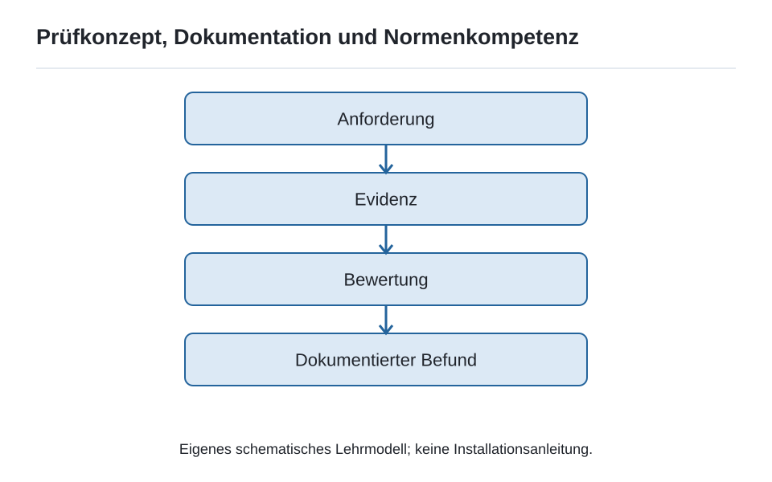

# M20-L5 – Prüfkonzept, Dokumentation und Normenkompetenz {#L5}

**Kursbereich:** M20 – Bachelor: Elektrosicherheit und Anlagen

**Niveau:** Bachelor · Grundlagen

**Vorwissen:** [M20-L4](M20-L4.md).

**Lernziel:** Prüfnachweise, Messunsicherheit und Geltungsbereich technischer Regeln bewerten.

## Prüfkonzept und Verantwortlichkeit {#S1}

Prüfung ist ein Nachweis gegen definierte Anforderungen, nicht bloß eine Funktionsprobe. Sie muss zum Betriebsmittel, zur Umgebung, zur Gefährdungsbeurteilung und zur Lebensphase passen. Bei wiederkehrenden Prüfungen ist die Beanspruchung relevant. Qualifizierte Prüfpersonen beurteilen Befunde; organisatorische Verantwortung und technische Prüfung sind zu unterscheiden. Dieses Selbststudium ersetzt weder Fachqualifikation noch Beauftragung.

## Evidenz und Prüfbericht {#S2}

Ein belastbarer Prüfbericht identifiziert das Objekt und seinen Konfigurationsstand, die angewandten Anforderungen mit Ausgabe, Prüfbedingungen, Messmittel, Ergebnisse, Abweichungen, Bewertungsregel und Verantwortliche. Sichtbefund, Funktionsnachweis und quantitative Messung sind unterschiedliche Evidenztypen. Fehlende Evidenz ist ausdrücklich zu kennzeichnen. Ein Dokument, das nur einen Gesamtstatus nennt, erlaubt keine nachvollziehbare Ursachenanalyse.

*Abbildung: Eigenes schematisches Lehrmodell; keine Installationsanleitung.*

## Rechenmodell: Entscheidungsregel {#S3}

Ein fiktives, nicht sicherheitsbezogenes Laborobjekt hat einen vereinbarten oberen Modellgrenzwert von 10,0 Ω. Ein Messwert von 9,8 Ω mit erweiterter Unsicherheit 0,4 Ω ergibt das Intervall $[9{,}4;10{,}2]$ Ω. Bei der hier vereinbarten konservativen Regel wird nur akzeptiert, wenn $x+U\leq L$. Der Befund ist nicht eindeutig akzeptabel; er ist nicht automatisch ein nachgewiesener physikalischer Grenzwertverstoß. Die Entscheidungsregel ist ausdrücklich vereinbart und kein allgemeiner elektrotechnischer Normgrenzwert.

## Normenkompetenz {#S4}

Eine Normnummer allein genügt nicht: Ausgabe, Änderungsstand, nationaler Geltungsbereich, Produkttyp, Anwendungsbereich und vertragliche oder rechtliche Bezugnahme sind zu prüfen. IEC-Katalogseiten belegen Titel und Scope, nicht sämtliche Anforderungen. Technische Leitfäden und ausländische Arbeitsschutzquellen sind nützliche Erläuterungen, aber keine automatische Rechtsgrundlage für eine deutsche Anlage. Ein reales Prüfkonzept verlangt die zuständige Fachperson und die vollständigen anwendbaren Dokumente.

## Selbstkontrolle {#S5}

### Aufgaben

1. Warum genügt eine Funktionsprobe nicht?
2. Ist 9,5 Ω ± 0,3 Ω nach der Modellregel akzeptabel?
3. Was fehlt bei einem Prüfbericht ohne Normausgabe?

::: {.lc-solutions data-lc-section="S5"}
1. Sie belegt nicht alle Schutzanforderungen oder den Fehlerfall.
2. Ja, 9,8 Ω liegt unter 10,0 Ω.
3. Die konkrete Bezugsgrundlage ist nicht eindeutig nachvollziehbar.
:::

## Quellen {#S6}

- [DGUV – Gefahren durch Strom vermeiden](https://aug.dguv.de/arbeitssicherheit/sicherheitscheck-kleine-elektrogeraete/) · Qualified testing, records and intervals, lines 33–36 and 49–52 · Zuletzt abgerufen: 2026-11-25 · Inhaltlich geprüft: 2026-11-25
- [DGUV Information 203-071](https://publikationen.dguv.de/regelwerk/dguv-informationen/787/wiederkehrende-pruefungen-elektrischer-anlagen-und-betriebsmittel-organisation-durch-den-unternehme?c=15) · Public description of recurring test organisation, line 113; not full publication · Zuletzt abgerufen: 2026-11-25 · Inhaltlich geprüft: 2026-11-25
- [IEC 61140:2016](https://webstore.iec.ch/en/publication/23997) · Public catalogue abstract only; full standard not reviewed (Prüfung auf belegten Teilumfang begrenzt) · Zuletzt abgerufen: 2026-11-25 · Inhaltlich geprüft: 2026-11-25
