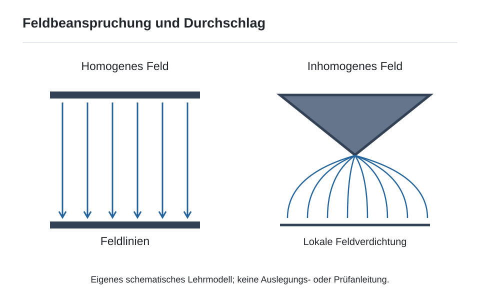

# M21-L1 – Feldbeanspruchung und Durchschlag {#L1}

**Kursbereich:** M21 – Bachelor: Hochspannungstechnik und Schaltanlagen

**Niveau:** Bachelor · Grundlagen

**Vorwissen:** [M20-L5](M20-L5.md).

**Lernziel:** Lokale Feldstärke und unterschiedliche Entladungsmechanismen unterscheiden.

## Elektrisches Feld {#S1}

In einem idealen homogenen Plattenfeld gilt $E=U/d$. Allgemein folgt das elektrostatische Feld aus $\vec E=-\nabla\varphi$. Randfelder, Krümmung und Materialgrenzen verändern die lokale Beanspruchung. Die mittlere Feldstärke allein genügt daher nicht zur Bewertung eines Isoliersystems. In einem ladungsfreien Grenzflächenmodell ist die normale Komponente der elektrischen Flussdichte stetig; ein Stoff mit kleinerer Permittivität kann deshalb stärker beansprucht werden.

## Entladungsmechanismen {#S2}

In Gasen können beschleunigte Ladungsträger weitere Teilchen ionisieren. Lawinen und Raumladung verändern das Feld und können in eine leitfähige Entladungsstrecke übergehen. Korona ist eine lokal begrenzte Gasentladung, Teilentladung überbrückt nicht die gesamte Isolation. Ein Überschlag verläuft typischerweise durch das umgebende Medium entlang einer Oberfläche; ein Durchschlag im Feststoff kann einen bleibenden leitfähigen Kanal hinterlassen. Die Mechanismen sind abhängig von Geometrie, Temperatur, Druck und Spannungsverlauf.

*Abbildung: Eigenes schematisches Lehrmodell; keine Auslegungs- oder Prüfanleitung.*

## Rechenmodell: lokale Feldverstärkung {#S3}

Ein dimensionsloser Feldfaktor $k=E_\mathrm{max}/E_\mathrm{mittel}$ charakterisiert eine vorgegebene Simulation. Bei $E_\mathrm{mittel}=0{,}20\,\mathrm{MV/m}$ und $k=2{,}5$ ergibt sich $E_\mathrm{max}=0{,}50\,\mathrm{MV/m}$. Zwei Modelle mit identischer mittlerer Feldstärke können unterschiedliche Maxima besitzen. Der Faktor ist kein universeller Materialwert; das Ergebnis ist kein Nachweis einer zulässigen Betriebsspannung.

## Modellgrenzen {#S4}

Die elektrische Festigkeit ist kein unveränderlicher Tabellenwert. Defekte, statistische Streuung, Oberflächenzustand und Impulsdauer beeinflussen das Ergebnis. Bei einer Simulation muss insbesondere die Netzauflösung in Bereichen hoher Feldgradienten untersucht werden. Ein ideal scharfer leitender Rand kann eine mathematische Singularität erzeugen. Es werden ausschließlich virtuelle Modelle betrachtet, keine realen Hochspannungsversuche.

## Selbstkontrolle {#S5}

### Aufgaben

1. Was bedeutet k = 3 bei gleicher mittlerer Feldstärke?
2. Warum kann ein Hohlraum in einem Feststoff kritisch sein?
3. Ist eine Teilentladung mit vollständigem Durchschlag gleichzusetzen?

::: {.lc-solutions data-lc-section="S5"}
1. Das lokale Maximum ist dreimal so groß wie der Mittelwert.
2. Die unterschiedliche Permittivität und die Geometrie können die lokale Gasfeldstärke erhöhen.
3. Nein; sie überbrückt nur einen Teil der Isolation.
:::

## Quellen {#S6}

- [OpenStax – Molecular Model of a Dielectric](https://openstax.org/books/university-physics-volume-2/pages/8-5-molecular-model-of-a-dielectric) · § 8.5; search extract only, dielectric strength and uniform-field model; full page review pending · Zuletzt abgerufen: 2026-11-25
- [IEC 60270:2025](https://webstore.iec.ch/en/publication/65087) · HTML 55–76; public scope of charge-based partial discharge measurement, not full standard (Prüfung auf belegten Teilumfang begrenzt) · Zuletzt abgerufen: 2026-11-25 · Inhaltlich geprüft: 2026-11-25
