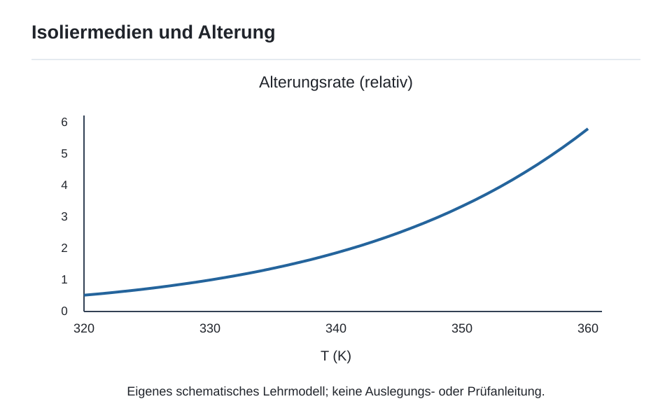

# M21-L2 – Isoliermedien und Alterung {#L2}

**Kursbereich:** M21 – Bachelor: Hochspannungstechnik und Schaltanlagen

**Niveau:** Bachelor · Grundlagen

**Vorwissen:** [M21-L1](M21-L1.md).

**Lernziel:** Isoliermedien nach elektrischen, thermischen und lebenszyklusbezogenen Eigenschaften vergleichen.

## Medien und Funktionen {#S1}

Gase dienen als Isolation und teilweise als Schaltmedium, Flüssigkeiten zugleich als Dielektrikum und Kühlmedium. Feststoffe tragen mechanische Lasten und trennen Potentiale. Verbundsysteme nutzen mehrere Funktionen gleichzeitig: Papier und Öl in Transformatoren, Polymer und Halbleiterschichten in Kabeln. Eine Vakuumschaltstrecke ist kein materielles Dielektrikum; das umgebende Gehäuse benötigt weiterhin Isolation.

## Alterungsmechanismen {#S2}

Thermische Beanspruchung kann Polymerketten abbauen, Feuchtigkeit verändert Leitfähigkeit und Verluste, mechanische Belastung erzeugt Risse und elektrische Teilentladungen können lokal Material erodieren. Bei Öl-Papier-Systemen sind flüssige und feste Isolation getrennt zu beurteilen: Eine Verbesserung der Flüssigkeit stellt den ursprünglichen Zustand gealterter Zellulose nicht wieder her.

*Abbildung: Eigenes schematisches Lehrmodell; keine Auslegungs- oder Prüfanleitung.*

## Rechenmodell: temperaturabhängige Rate {#S3}

Ein vereinfachtes Arrhenius-Modell beschreibt eine einzelne Reaktion durch $r=A\exp[-E_a/(k_B T)]$. Für eine fiktive Aktivierungsenergie von $0{,}6\,\mathrm{eV}$ und $k_B=8{,}617\cdot10^{-5}\,\mathrm{eV/K}$ ergibt sich zwischen 330 K und 350 K das Ratenverhältnis $r_{350}/r_{330}\approx3{,}34$. Das ist eine relative Modellrate, keine prognostizierte Restlebensdauer einer realen Anlage.

## Auswahl und Zustandsbewertung {#S4}

Die Auswahl berücksichtigt Feldbeanspruchung, Verlustleistung, Wärmeleitung, Brandverhalten, Umweltwirkung, mechanische Festigkeit und Wartbarkeit. Ein Diagnosebefund ist mit Belastungsverlauf, Temperatur und Materialhistorie zu verbinden. Ein einzelner guter Messwert kann andere Alterungsmechanismen nicht ausschließen.

## Selbstkontrolle {#S5}

### Aufgaben

1. Welche Zusatzfunktion kann eine Isolierflüssigkeit erfüllen?
2. Warum ist eine Ölaufbereitung keine Verjüngung des Papiers?
3. Was beschreibt das berechnete Ratenverhältnis?

::: {.lc-solutions data-lc-section="S5"}
1. Wärmetransport.
2. Die Zellulosealterung ist nicht dadurch umkehrbar.
3. Die relative Geschwindigkeit einer angenommenen Einzelreaktion.
:::

## Quellen {#S6}

- [Hitachi Energy – Component Upgrades](https://www.hitachienergy.com/products-and-solutions/transformers/transformer-service/upgrade-repair-and-extend/component-upgrade) · HTML 174–177; manufacturer example of thermal and moisture-related aging of oil-paper insulation (Prüfung auf belegten Teilumfang begrenzt) · Zuletzt abgerufen: 2026-11-25 · Inhaltlich geprüft: 2026-11-25
- [Hitachi Energy – Inspection and diagnostics](https://www.hitachienergy.com/products-and-solutions/transformers/transformer-service/assess-and-secure/inspection-and-diagnostics) · HTML 176–190; oil contamination and diagnostic indicators · Zuletzt abgerufen: 2026-11-25 · Inhaltlich geprüft: 2026-11-25
