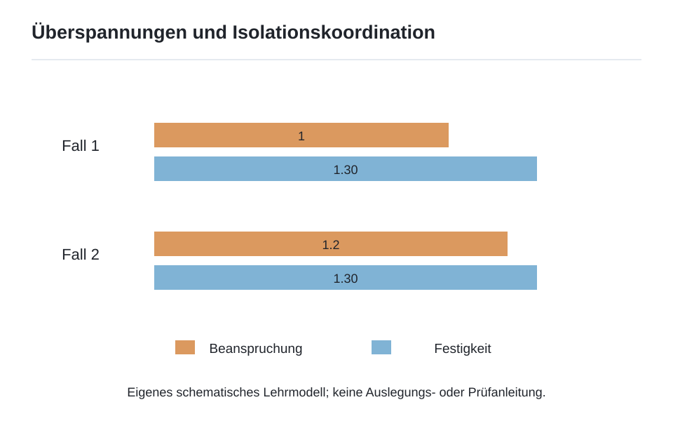

# M21-L3 – Überspannungen und Isolationskoordination {#L3}

**Kursbereich:** M21 – Bachelor: Hochspannungstechnik und Schaltanlagen

**Niveau:** Bachelor · Grundlagen

**Vorwissen:** [M21-L2](M21-L2.md).

**Lernziel:** Überspannungskategorien und die logische Zuordnung von Beanspruchung und Festigkeit erklären.

## Beanspruchungen {#S1}

Neben der dauernden Betriebsspannung treten zeitweilige Überspannungen etwa bei Netzfehlern und transiente Überspannungen durch Schalthandlungen oder Blitzereignisse auf. Dauer, Wellenform, Polarität und Wiederholrate beeinflussen die Beanspruchung. Effektivwert, Scheitelwert und Stoßspannungskennwerte dürfen nicht direkt ohne Definition verglichen werden.

## Koordinationsprinzip {#S2}

Isolationskoordination ordnet dem erwarteten Beanspruchungskollektiv geeignete Festigkeitsanforderungen zu. Dabei werden Netztopologie, Schutzgeräte, Umgebungsbedingungen und Unsicherheiten berücksichtigt. Überspannungsableiter begrenzen transiente Spannungen durch nichtlineares Verhalten; Anschlusswege und dynamisches Verhalten beeinflussen die tatsächliche Spannung am Betriebsmittel. IEC 60071-2 behandelt die Auswahl von Isolationspegeln für Drehstromnetze, nicht den Personenschutz.

*Abbildung: Eigenes schematisches Lehrmodell; keine Auslegungs- oder Prüfanleitung.*

## Rechenmodell: normierter Vergleich {#S3}

Für zwei dimensionslose Modellfälle sei die Festigkeit $w=1{,}30$ und die beanspruchende Größe $s_1=1{,}00$, $s_2=1{,}20$, jeweils auf denselben Bezugswert und dieselbe Wellenform normiert. Der Quotient $w/s$ sinkt von 1,30 auf 1,083. Die rechnerische Reserve nimmt ab. Diese Quotienten sind keine IEC-Koordinationsfaktoren und erlauben keine Betriebsmittelauswahl.

## Statistik und Grenzen {#S4}

Bei einer statistischen Betrachtung hängt die Ausfallwahrscheinlichkeit von der Überlappung der Verteilungen für Beanspruchung und Festigkeit ab. Ein fester Quotient bildet weder seltene Ereignisse noch Streuung ab. Die konkrete Koordination benötigt vollständige Produkt- und Systemdaten, anwendbare Normausgaben sowie fachkundige Auswertung.

## Selbstkontrolle {#S5}

### Aufgaben

1. Welche drei Spannungsbeanspruchungen werden unterschieden?
2. Warum reicht ein Vergleich von Effektiv- und Scheitelwert nicht?
3. Warum ist ein Quotient größer eins kein vollständiger Nachweis?

::: {.lc-solutions data-lc-section="S5"}
1. Dauerbetrieb, zeitweilige und transiente Überspannung.
2. Sie beschreiben verschiedene Kenngrößen und gegebenenfalls verschiedene Wellenformen.
3. Streuung, Zeitverlauf, Schutzwirkung und Normanforderungen fehlen.
:::

## Quellen {#S6}

- [IEC 60071-2:2023](https://webstore.iec.ch/en/publication/64145) · HTML 60–68; public scope of insulation coordination; no full standard (Prüfung auf belegten Teilumfang begrenzt) · Zuletzt abgerufen: 2026-11-25 · Inhaltlich geprüft: 2026-11-25
- [IEC 60060-1:2025](https://webstore.iec.ch/en/publication/65088) · HTML 60–69; public scope of dielectric tests with AC, DC, impulse and combined voltages, not full standard (Prüfung auf belegten Teilumfang begrenzt) · Zuletzt abgerufen: 2026-11-25 · Inhaltlich geprüft: 2026-11-25
