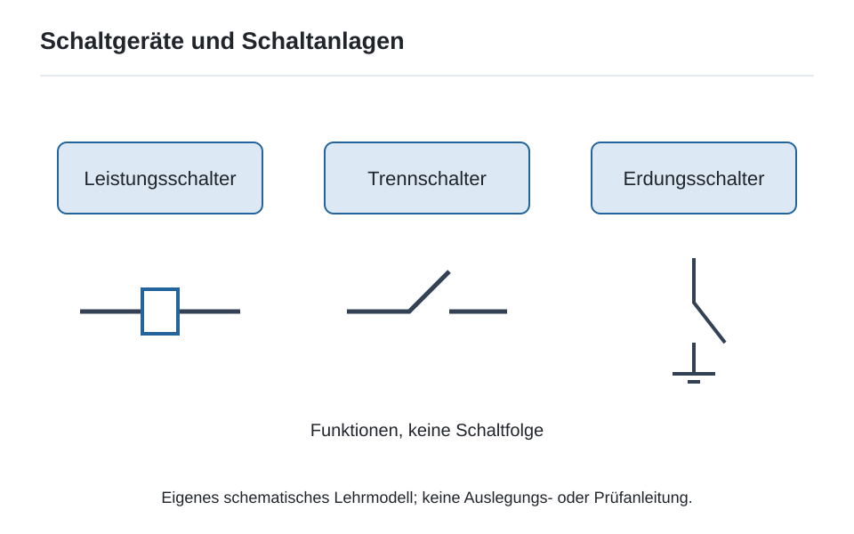

# M21-L4 – Schaltgeräte und Schaltanlagen {#L4}

**Kursbereich:** M21 – Bachelor: Hochspannungstechnik und Schaltanlagen

**Niveau:** Bachelor · Grundlagen

**Vorwissen:** [M21-L3](M21-L3.md).

**Lernziel:** Funktionen von Leistungsschalter, Trennschalter und Erdungsschalter unterscheiden.

## Funktionale Abgrenzung {#S1}

Ein Leistungsschalter kann Betriebsströme und spezifizierte Fehlerströme unter definierten Bedingungen schalten. Ein Trennschalter stellt eine Isolierstrecke her und hat nur begrenzte spezifizierte Schaltaufgaben. Ein Erdungsschalter verbindet einen vorgesehenen Anlagenteil mit Erde; seine konkreten Schalt- und Kurzschlussfestigkeiten sind gerätespezifisch. Ein Lastschalter ist nicht automatisch ein Leistungsschalter.

## Lichtbogen und Wiederkehrspannung {#S2}

Beim Öffnen eines stromführenden Kontakts kann ein Lichtbogen entstehen. In Wechselstromsystemen ist der natürliche Stromnulldurchgang für die Unterbrechung wichtig. Danach steigt die Spannung über der Schaltstrecke wieder an. Die dielektrische Erholung muss der Beanspruchung durch die transiente Wiederkehrspannung standhalten. Vakuum- und Gaslöschprinzipien unterscheiden sich in ihrer Physik.

*Abbildung: Eigenes schematisches Lehrmodell; keine Auslegungs- oder Prüfanleitung.*

## Rechenmodell: Beanspruchungsdauer {#S3}

In einem rein mathematischen Modell beträgt der konstante normierte Strom $i=2$ während einer normierten Zeit von $t=0{,}1$. Damit ist $\int i^2\,dt=0{,}4$ in normierten Einheiten. Bei doppelter Dauer ergibt sich 0,8. Diese Größe illustriert eine thermische Beanspruchungskennzahl, nicht die Ausschaltfähigkeit eines realen Schaltgeräts; Lichtbogenenergie und Wiederkehrspannung erfordern weitere Modelle.

## Anlagenarchitektur {#S4}

Luftisolierte Anlagen und gasisolierte Anlagen unterscheiden sich insbesondere in Isolationskonzept, Platzbedarf und Instandhaltung. Vakuumunterbrechung und Luftisolation sind auch in kombinierten Systemen möglich. Verriegelungen unterstützen die Vermeidung unzulässiger Gerätezustände; sie ersetzen keine qualifizierte Anlagenführung. Die Grafik stellt Funktionen, keine Schaltfolge, dar.

## Selbstkontrolle {#S5}

### Aufgaben

1. Welches Gerät ist für spezifizierte Fehlerstromunterbrechung vorgesehen?
2. Was ist Wiederkehrspannung?
3. Warum reicht die thermische Kennzahl allein nicht?

::: {.lc-solutions data-lc-section="S5"}
1. Der entsprechend bemessene Leistungsschalter.
2. Die nach einer Stromunterbrechung an der Schaltstrecke anliegende Spannung.
3. Die elektrische und dynamische Unterbrechungsbeanspruchung fehlt.
:::

## Quellen {#S6}

- [IEC 62271-100:2021+AMD1:2024](https://webstore.iec.ch/en/publication/99635) · HTML 56–66; public scope of AC circuit breakers; no full standard (Prüfung auf belegten Teilumfang begrenzt) · Zuletzt abgerufen: 2026-11-25 · Inhaltlich geprüft: 2026-11-25
- [Hitachi Energy – Disconnectors](https://www.hitachienergy.com/products-and-solutions/disconnectors) · HTML 196–202; isolation and restricted switching duties · Zuletzt abgerufen: 2026-11-25 · Inhaltlich geprüft: 2026-11-25
- [Siemens Energy – High-voltage circuit breakers](https://www.siemens-energy.com/global/en/home/products-services/product-offerings/circuit-breakers.html) · HTML 146–170; vacuum interruption and clean air; manufacturer examples, not universal performance claims (Prüfung auf belegten Teilumfang begrenzt) · Zuletzt abgerufen: 2026-11-25 · Inhaltlich geprüft: 2026-11-25
