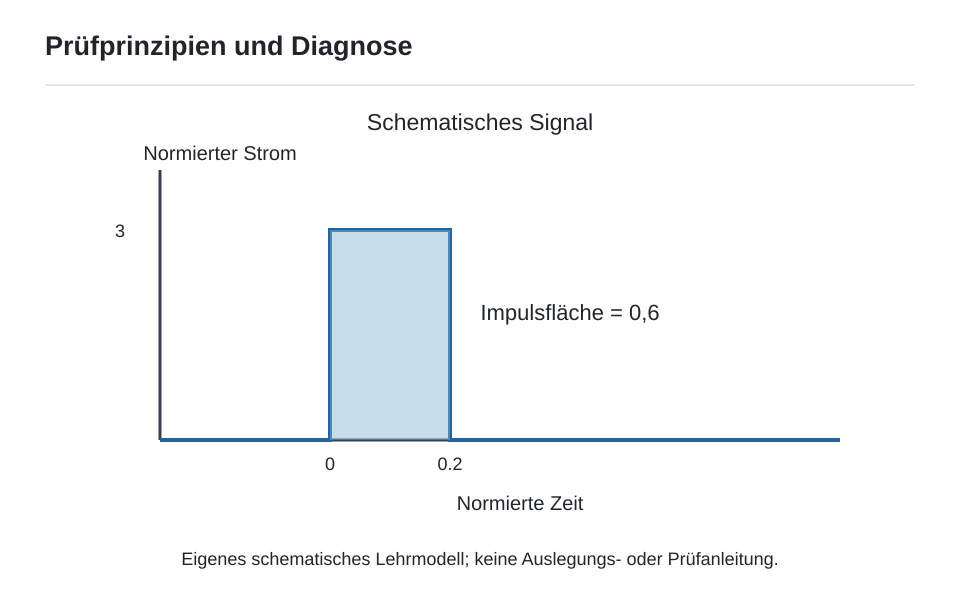

# M21-L5 – Prüfprinzipien und Diagnose {#L5}

**Kursbereich:** M21 – Bachelor: Hochspannungstechnik und Schaltanlagen

**Niveau:** Bachelor · Grundlagen

**Vorwissen:** [M21-L4](M21-L4.md).

**Lernziel:** Prüfziel, Teilentladungsmessung und Zustandsdiagnose voneinander abgrenzen.

## Prüfarten {#S1}

Eine dielektrische Prüfung untersucht die Eignung eines Isoliersystems unter definierten Bedingungen. Wechsel-, Gleich- und Stoßspannungsprüfungen bilden unterschiedliche Beanspruchungen ab. Typprüfungen charakterisieren ein Produktdesign, Stückprüfungen einzelne gefertigte Einheiten; Zustandsdiagnostik verfolgt Veränderungen im Lebenszyklus. Die konkreten Anforderungen hängen vom Produkt und der Norm ab.

## Teilentladungsdiagnostik {#S2}

Eine Teilentladung erzeugt einen kurzen Stromimpuls. Die scheinbare Ladung ist die äquivalente Ladungsgröße, die am Messanschluss die gleiche Anzeige hervorrufen würde; sie ist nicht unmittelbar die physische Ladung im Defekt. Störungen, Übertragungsweg und Kalibrierung beeinflussen den Messwert. Phasenaufgelöste Muster können Hinweise auf Entladungsarten liefern, beweisen aber allein nicht die Fehlerursache.

*Abbildung: Eigenes schematisches Lehrmodell; keine Auslegungs- oder Prüfanleitung.*

## Rechenmodell: Impulsfläche {#S3}

Ein fiktiver, rechteckiger Signalimpuls mit normierter Amplitude 3 und normierter Breite 0,2 besitzt die Fläche 0,6. Eine doppelte Breite bei gleicher Amplitude verdoppelt die Fläche. In einem idealen Strommodell gilt $q=\int i(t)\,dt$. Das Modell erklärt die Integration, ersetzt aber weder Kalibrierung noch normgerechte Teilentladungsmessung.

## Befund und Unsicherheit {#S4}

Bei Zustandsdiagnosen werden Messreihen unter vergleichbaren Bedingungen, Messunsicherheit, Veränderungen im Betrieb und unabhängige Indikatoren kombiniert. Beispielsweise ergänzen sich bei Transformatoren elektrische und chemische Befunde, ohne dass ein einzelner Indikator die gesamte Isolationsqualität beschreibt. Hochspannungsprüfungen erfordern spezialisierte Prüfeinrichtungen und Fachpersonal. Hier werden ausschließlich Datenmodelle ausgewertet.

## Selbstkontrolle {#S5}

### Aufgaben

1. Warum ist scheinbare Ladung nicht gleich Defektladung?
2. Wie groß ist die Modellimpulsfläche bei Amplitude 3 und Breite 0,4?
3. Warum sind vergleichbare Messbedingungen wichtig?

::: {.lc-solutions data-lc-section="S5"}
1. Der Übertragungsweg vom Defekt zum Anschluss beeinflusst das Signal.
2. 1,2 in normierten Einheiten.
3. Nur so lassen sich Veränderungen vom Einfluss wechselnder Bedingungen unterscheiden.
:::

## Quellen {#S6}

- [IEC 60060-1:2025](https://webstore.iec.ch/en/publication/65088) · HTML 60–69; public scope of dielectric tests with AC, DC, impulse and combined voltages, not full standard (Prüfung auf belegten Teilumfang begrenzt) · Zuletzt abgerufen: 2026-11-25 · Inhaltlich geprüft: 2026-11-25
- [IEC 60270:2025](https://webstore.iec.ch/en/publication/65087) · HTML 55–76; public scope of charge-based partial discharge measurement, not full standard (Prüfung auf belegten Teilumfang begrenzt) · Zuletzt abgerufen: 2026-11-25 · Inhaltlich geprüft: 2026-11-25
- [Hitachi Energy – Inspection and diagnostics](https://www.hitachienergy.com/products-and-solutions/transformers/transformer-service/assess-and-secure/inspection-and-diagnostics) · HTML 176–190; oil contamination and diagnostic indicators · Zuletzt abgerufen: 2026-11-25 · Inhaltlich geprüft: 2026-11-25
