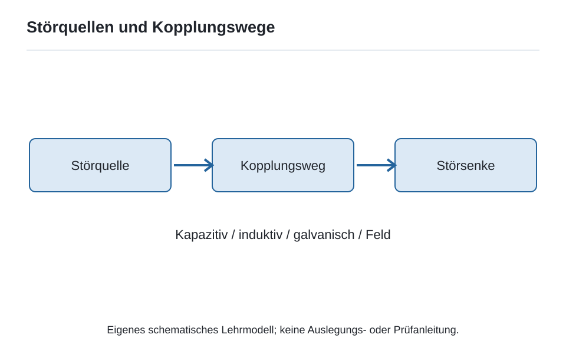

# M22-L1 – Störquellen und Kopplungswege {#L1}

**Kursbereich:** M22 – Bachelor: Elektromagnetische Verträglichkeit

**Niveau:** Bachelor · Grundlagen

**Vorwissen:** [M21-L5](M21-L5.md).

**Lernziel:** Störquelle, Kopplungspfad und Störsenke anhand physikalischer Modelle unterscheiden.

## EMV als Systemeigenschaft {#S1}

Elektromagnetische Verträglichkeit verlangt, dass ein Gerät in seiner vorgesehenen Umgebung funktioniert, ohne andere Systeme unzulässig zu stören. Störaussendung und Störfestigkeit sind getrennte Eigenschaften. Ein Frequenzumrichter kann etwa durch schnelle Schaltflanken Störströme erzeugen, während ein benachbarter Sensor auf kleine Fehlerpotentiale reagiert. Entscheidend sind Spektrum, Geometrie, Impedanzen und Betriebszustand. Eine hohe Schaltfrequenz ist nicht die einzige Ursache: Auch kurze Anstiegszeiten erzeugen hochfrequente Spektralanteile.

## Vier Kopplungsmodelle {#S2}

Galvanische Kopplung entsteht durch gemeinsame Impedanzen: $u_s=Z_s i_s$ im sinusförmigen Modell. Kapazitive Kopplung folgt für konstante Koppelkapazität aus $i_C=C_k\,\mathrm{d}u/\mathrm{d}t$. Induktive Kopplung erzeugt bei konstanter Gegeninduktivität $M$ eine Spannung mit Betrag $|u_M|=|M\,\mathrm{d}i/\mathrm{d}t|$. Strahlungskopplung beschreibt die Übertragung durch elektromagnetische Felder; für elektrisch große Strukturen sind konzentrierte Ersatzschaltungen oft unzureichend. Die Modelle können gleichzeitig wirksam sein.

*Abbildung: Eigenes schematisches Lehrmodell; keine Auslegungs- oder Prüfanleitung.*

## Rechenbeispiel {#S3}

Eine fiktive Koppelkapazität von 5 pF verbindet zwei Schaltungsknoten. Eine Spannungsänderung von 20 V in 100 ns liefert bei linearer Flanke $i_C=5\cdot10^{-12}\cdot20/(100\cdot10^{-9})=1\,\mathrm{mA}$. Eine Gegeninduktivität von 20 nH bei einer Stromänderung von 2 A in 100 ns ergibt 0,4 V induzierte Spannung. Diese Größen beschreiben unterschiedliche Modellpfade; sie dürfen nicht direkt addiert werden.

## Analyse und Grenzen {#S4}

Bei einer virtuellen Diagnose wird zuerst der zeitliche Zusammenhang zwischen Störereignis und Funktionsfehler ermittelt. Anschließend werden mögliche Stromschleifen, Potentialdifferenzen und Feldkopplungen getrennt modelliert. Die Änderung jeweils eines Modellparameters ermöglicht eine Hypothesenprüfung. Eine Störung kann mehrere Pfade besitzen; die Beseitigung eines Pfades garantiert daher keine vollständige Verträglichkeit.

## Selbstkontrolle {#S5}

### Aufgaben

1. Wie groß ist der kapazitive Strom bei halbierter Flankendauer?
2. Welche Kopplung entsteht an einer gemeinsam genutzten Rückleitung?
3. Warum sind Leitungs- und Feldmodelle nicht immer austauschbar?

::: {.lc-solutions data-lc-section="S5"}
1. 2 mA bei gleicher Spannungsänderung und Kapazität.
2. Kopplung über gemeinsame Impedanz.
3. Bei elektrisch großen Strukturen sind Laufzeit und räumliche Feldverteilung relevant.
:::

## Quellen {#S6}

- [Analog Devices – Proper Layout and Component Selection Controls EMI](https://www.analog.com/en/resources/technical-articles/proper-layout-and-component-selection-controls-emi.html) · HTML 78–96, 139–161; coupling, filtering and layout · Zuletzt abgerufen: 2026-11-25 · Inhaltlich geprüft: 2026-11-25
- [Analog Devices – AN-139: Power Supply Layout and EMI](https://www.analog.com/en/resources/app-notes/an-139.html) · HTML 127–162; return paths and parasitics · Zuletzt abgerufen: 2026-11-25 · Inhaltlich geprüft: 2026-11-25
