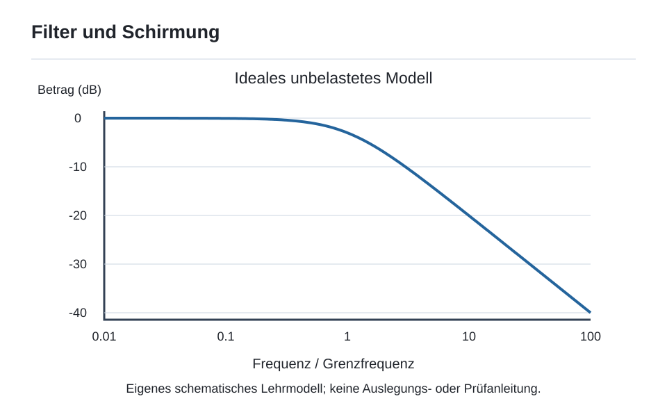

# M22-L2 – Filter und Schirmung {#L2}

**Kursbereich:** M22 – Bachelor: Elektromagnetische Verträglichkeit

**Niveau:** Bachelor · Grundlagen

**Vorwissen:** [M22-L1](M22-L1.md).

**Lernziel:** Gegen- und Gleichtaktstörungen unterscheiden und Filterwirkung quantitativ bewerten.

## Modale Zerlegung {#S1}

Für zwei Leiter mit gleich orientierten Strompfeilen gilt $i_{CM}=(i_1+i_2)/2$ und $i_{DM}=(i_1-i_2)/2$. Gegentaktströme fließen auf Hin- und Rückleiter entgegengesetzt; Gleichtaktanteile benötigen einen weiteren Rückweg, etwa über parasitäre Kapazitäten zum Gehäuse. Eine stromkompensierte Drossel bietet ideal eine hohe Impedanz für Gleichtaktströme, während die magnetischen Wirkungen des normalen Gegentaktstroms weitgehend kompensiert werden. Streuinduktivität und Sättigung begrenzen dieses Ideal.

## Filter und Schirme {#S2}

Ein idealer unbelasteter RC-Tiefpass hat die Übertragungsfunktion $H(j\omega)=1/(1+j\omega RC)$. Reale Filter benötigen eine Betrachtung von Quellen- und Lastimpedanz, Bauteilparasiten und möglichen Resonanzen. Schirme beeinflussen elektrische und magnetische Felder unterschiedlich. Leitfähige Gehäuse können durch Oberflächenströme und Ladungsumverteilung abschirmen; Öffnungen, Fugen und Anschlüsse können die Wirkung begrenzen. Niederfrequente Magnetfelder sind mit dünnen nichtmagnetischen Leitern häufig schwer abzuschirmen.

*Abbildung: Eigenes schematisches Lehrmodell; keine Auslegungs- oder Prüfanleitung.*

## Rechenbeispiel {#S3}

Für $R=100\,\Omega$ und $C=100\,\mathrm{nF}$ ist $f_c=1/(2\pi RC)=15{,}9\,\mathrm{kHz}$. Bei $f=10f_c$ gilt $|H|=1/\sqrt{101}\approx0{,}0995$ und $20\log_{10}|H|\approx-20{,}04\,\mathrm{dB}$. Diese Dämpfung gilt nur für das ideale Modell mit hochohmiger Last. Die Einfügedämpfung realer EMV-Filter ist nicht allein aus der Grenzfrequenz abzuleiten.

## Entwurfsabwägung {#S4}

Ein Filter kann mit einem geregelten Wandler wechselwirken; seine Ausgangsimpedanz und die Eingangsimpedanz der Last beeinflussen Stabilität und Resonanzen. Abschirmung und Filter müssen gemeinsam mit Rückwegen und Gehäusegrenzen betrachtet werden. Die Beispielwerte sind reine Lernwerte, keine Dimensionierung von Netzfiltern oder sicherheitsrelevanten Kondensatoren.

## Selbstkontrolle {#S5}

### Aufgaben

1. Zwei Leiter führen +3 A und −1 A: Wie groß sind CM und DM?
2. Wie groß ist die Amplitude bei der Grenzfrequenz?
3. Warum kann eine Gehäusefuge problematisch sein?

::: {.lc-solutions data-lc-section="S5"}
1. CM = 1 A; DM = 2 A.
2. 1/√2 bzw. ungefähr −3,01 dB.
3. Sie kann Schirmströme unterbrechen und elektromagnetische Kopplung ermöglichen.
:::

## Quellen {#S6}

- [Analog Devices – Proper Layout and Component Selection Controls EMI](https://www.analog.com/en/resources/technical-articles/proper-layout-and-component-selection-controls-emi.html) · HTML 78–96, 139–161; coupling, filtering and layout · Zuletzt abgerufen: 2026-11-25 · Inhaltlich geprüft: 2026-11-25
- [Analog Devices – AN-139: Power Supply Layout and EMI](https://www.analog.com/en/resources/app-notes/an-139.html) · HTML 127–162; return paths and parasitics · Zuletzt abgerufen: 2026-11-25 · Inhaltlich geprüft: 2026-11-25
