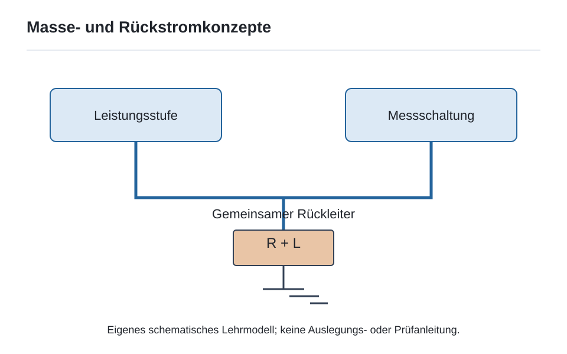

# M22-L3 – Masse- und Rückstromkonzepte {#L3}

**Kursbereich:** M22 – Bachelor: Elektromagnetische Verträglichkeit

**Niveau:** Bachelor · Grundlagen

**Vorwissen:** [M22-L2](M22-L2.md).

**Lernziel:** Rückstrompfade und gemeinsame Impedanzen bei Gleich- und Wechselstrom analysieren.

## Bezugsmasse und Schutzleiter {#S1}

Eine Schaltungsmasse ist ein gewähltes Bezugspotential, aber kein überall ideales Nullpotential. Schutzleiter, Gehäuse und funktionaler Bezug erfüllen verschiedene Aufgaben; ihre Verbindung richtet sich nach dem Systementwurf und den einschlägigen Sicherheitsanforderungen. Der Rückstrom schließt immer einen Stromkreis. Bei wechselnden Strömen bestimmt die gesamte frequenzabhängige Impedanz, nicht allein der Gleichstromwiderstand, seine Verteilung. Eine durchgehende Referenzfläche ermöglicht bei geeigneter Geometrie einen nahen Hochfrequenz-Rückstrompfad.

## Gemeinsame Impedanz {#S2}

Die Spannung an einem konzentrierten Rückleiter mit $R$ und $L$ ist $u=Ri+L\,\mathrm{d}i/\mathrm{d}t$. Nutzen Leistungsstufe und Messverstärker einen gemeinsamen Abschnitt, erscheint dessen Spannungsabfall als Fehler im Signalbezug. Eine Unterbrechung einer Referenzfläche kann den Rückstrom zu einem Umweg zwingen, die Schleifenfläche vergrößern und Kopplungen verstärken. Sternförmige Verbindungen können bei niedrigen Frequenzen nützlich sein, sind jedoch keine universelle Hochfrequenzlösung.

*Abbildung: Eigenes schematisches Lehrmodell; keine Auslegungs- oder Prüfanleitung.*

## Rechenbeispiel {#S3}

Ein Modell-Rückleiter hat 20 mΩ und 10 nH. Während einer linearen Stromrampe erreicht der Strom 2 A nach 100 ns. Unmittelbar vor dem Rampenende ergeben sich $Ri=40\,\mathrm{mV}$ und $L\,\mathrm{d}i/\mathrm{d}t=200\,\mathrm{mV}$, zusammen 240 mV bei gleicher Polarität. Nach Ende der Rampe entfällt der idealisierte induktive Anteil. Bei einer Messung im Millivoltbereich kann selbst dieser kleine Rückleiter erheblich stören.

## Virtuelle Layoutanalyse {#S4}

In einer Simulation können Hin- und Rückstrom als geschlossene Schleifen dargestellt werden. Verglichen werden gemeinsam genutzte Abschnitte, Schleifenflächen, Übergänge zwischen Lagen und lokale Entkopplung. Die Trennung von Funktionsmasse und Schutzfunktion ist dabei zwingend: Ein Störproblem rechtfertigt niemals das Entfernen einer vorgeschriebenen Schutzleiterverbindung. Die Fallstudie betrifft ausschließlich hypothetische Leiterplattenmodelle.

## Selbstkontrolle {#S5}

### Aufgaben

1. Welcher Spannungsanteil bleibt bei konstanten 2 A?
2. Was verändert ein Umweg des Rückstroms?
3. Warum ist ein Sternpunkt nicht immer optimal?

::: {.lc-solutions data-lc-section="S5"}
1. 40 mV im Modell.
2. Er kann Schleifenfläche und Induktivität erhöhen.
3. Bei hohen Frequenzen zählen kurze, niederinduktive Rückpfade und die räumliche Geometrie.
:::

## Quellen {#S6}

- [Analog Devices – Staying Well Grounded](https://www.analog.com/en/resources/analog-dialogue/articles/staying-well-grounded.html) · HTML 37–48, 79–80, 119–122; grounding depends on system topology · Zuletzt abgerufen: 2026-11-25 · Inhaltlich geprüft: 2026-11-25
- [Analog Devices – AN-139: Power Supply Layout and EMI](https://www.analog.com/en/resources/app-notes/an-139.html) · HTML 127–162; return paths and parasitics · Zuletzt abgerufen: 2026-11-25 · Inhaltlich geprüft: 2026-11-25
