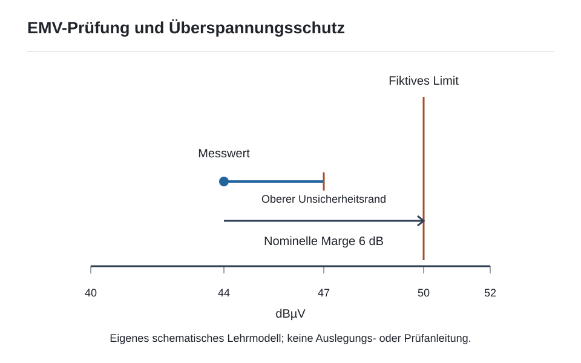

# M22-L4 – EMV-Prüfung und Überspannungsschutz {#L4}

**Kursbereich:** M22 – Bachelor: Elektromagnetische Verträglichkeit

**Niveau:** Bachelor · Grundlagen

**Vorwissen:** [M22-L3](M22-L3.md).

**Lernziel:** Aussendungs- und Störfestigkeitsprüfungen abgrenzen und Messmargen beurteilen.

## Prüfziele und Aufbau {#S1}

Aussendungsprüfungen quantifizieren leitungsgebundene und abgestrahlte Störgrößen mit definierten Messbedingungen. Störfestigkeitsprüfungen bewerten die Funktion bei definierten Einwirkungen. Ein Prüfplan muss den Prüfling, Betriebszustände, Kabelkonfiguration, Messgrößen und Funktionskriterien dokumentieren. Eine Vorprüfung ist eine Entwicklungsdiagnose; sie ersetzt keinen erforderlichen Konformitätsnachweis.

## Transiente Beanspruchungen {#S2}

Elektrostatische Entladung (ESD) und Stoßspannungen (Surge) besitzen unterschiedliche zeitliche Verläufe und Kopplungspfade. IEC 61000-4-2:2025 beschreibt ESD-Störfestigkeitsprüfungen; IEC 61000-4-5:2014 mit Änderung 1:2017 behandelt Surge-Prüfungen. Diese Grundnormen sind keine universelle Vorgabe von Prüfpegeln für jedes Produkt. Schutzbauteile können transiente Ströme umleiten oder Spannungen begrenzen; ihre Wirkung hängt von Impedanzen, Pulsenergie, Restspannung und Koordination ab. Schutzelemente ersetzen keine grundlegende Isolation.

*Abbildung: Eigenes schematisches Lehrmodell; keine Auslegungs- oder Prüfanleitung.*

## Rechenbeispiel: Messmarge {#S3}

Ein fiktives Emissionslimit beträgt 50 dBµV und ein Messwert 44 dBµV. Die nominelle Marge beträgt 6 dB, entsprechend einem Spannungsverhältnis $10^{6/20}\approx2$. Bei einer angenommenen erweiterten Messunsicherheit von 3 dB verbleiben im bewusst konservativen Lernmodell 3 dB Abstand, wenn der obere Unsicherheitsrand herangezogen wird. Eine reale Konformitätsentscheidung erfordert die jeweils gültige Entscheidungsregel; das Beispiel definiert keine normative Regel.

## Prüfbericht und Grenzen {#S4}

Ein nachvollziehbarer Bericht verknüpft Messkurven mit Konfiguration, Instrumenteneinstellungen, Kalibrierstatus, Unsicherheit und Bewertung. Fehler während einer Störfestigkeitsprüfung werden nach Funktionskriterien klassifiziert, nicht anhand eines Emissionslimits. Die hier genannten Normen wurden anhand ihrer öffentlichen Geltungsbereiche geprüft, nicht als Volltexte. Praktische ESD- und Surge-Prüfungen erfordern geeignete Einrichtungen und qualifiziertes Personal; Selbststudium nutzt ausschließlich Datensätze und Simulationen.

## Selbstkontrolle {#S5}

### Aufgaben

1. Wie groß ist die nominelle Marge bei 47 dBµV?
2. Warum ist ein bestandener ESD-Test kein Nachweis niedriger Emissionen?
3. Welche Angaben machen einen Messbericht reproduzierbar?

::: {.lc-solutions data-lc-section="S5"}
1. 3 dB bei demselben fiktiven Limit.
2. ESD untersucht Störfestigkeit, nicht Störaussendung.
3. Unter anderem Betriebszustand, Konfiguration, Einstellungen, Kalibrierung und Unsicherheit.
:::

## Quellen {#S6}

- [IEC 61000-4-2:2025](https://webstore.iec.ch/en/publication/68954) · HTML 54–77; public scope of ESD immunity test, not full standard (Prüfung auf belegten Teilumfang begrenzt) · Zuletzt abgerufen: 2026-11-25 · Inhaltlich geprüft: 2026-11-25
- [IEC 61000-4-5:2014+AMD1:2017](https://webstore.iec.ch/en/publication/61166) · HTML 54–70; public scope of surge immunity test, not full standard (Prüfung auf belegten Teilumfang begrenzt) · Zuletzt abgerufen: 2026-11-25 · Inhaltlich geprüft: 2026-11-25
