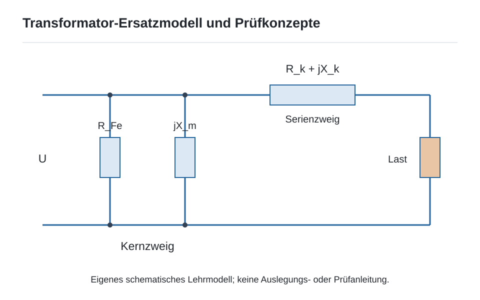

# M23-L1 – Transformator-Ersatzmodell und Prüfkonzepte {#L1}

**Kursbereich:** M23 – Bachelor: Elektrische Maschinen und Transformatoren

**Niveau:** Bachelor · Grundlagen

**Vorwissen:** [M7-L3](M7-L3.md).

**Lernziel:** Aus Messdatensätzen ein angenähertes Ersatzschaltbild bestimmen und seine Grenzen erläutern.

## Vom idealen zum realen Transformator {#S1}

Die Grundlagen aus M7-L3 werden hier zur Parameteridentifikation erweitert. Für ein sinusförmiges Modell mit Übersetzungsverhältnis $a=N_1/N_2$ gilt ideal $U_1/U_2=a$ und betragsmäßig $I_1/I_2=1/a$. Eine sekundäre Impedanz erscheint primär als $Z_2\prime=a^2 Z_2$. Im realen Gerät gehen Wicklungsverluste, Streufluss und endliche Kernpermeabilität ein. Das angenäherte, auf eine Seite bezogene Modell enthält $R_k+jX_k$ in Serie sowie $R_{Fe}$ parallel zu $jX_m$ am Eingang. Die Parallelzweige bilden Kernverluste und Magnetisierung ab.

## Parameter aus virtuellen Messdaten {#S2}

Alle Spannungen und Ströme sind Effektivwerte; die folgenden Beziehungen gelten einphasig. Für den Leerlaufdatensatz gilt angenähert $I_w=P_0/U_0$, $I_m=\sqrt{I_0^2-I_w^2}$, $R_{Fe}=U_0/I_w$ und $X_m=U_0/I_m$. Die Verluste der stromdurchflossenen Wicklung werden dabei vernachlässigt. Aus einem Kurzschlussdatensatz ergeben sich $Z_k=U_k/I_k$, $R_k=P_k/I_k^2$ und $X_k=\sqrt{Z_k^2-R_k^2}$, wenn der Magnetisierungszweig vernachlässigbar ist. Messdaten verschiedener Bezugsseiten müssen erst umgerechnet werden.

*Abbildung: Eigenes schematisches Lehrmodell; keine Auslegungs- oder Prüfanleitung.*

## Rechenbeispiel {#S3}

Ein fiktiver Leerlaufdatensatz enthält 100 V, 0,5 A und 30 W. Daraus folgen $I_w=0,3$ A, $I_m=0,4$ A, $R_{Fe}=333,3\,\Omega$ und $X_m=250\,\Omega$. Ein zweiter, auf dieselbe Seite bezogener Datensatz enthält 10 V, 5 A und 30 W. Hieraus ergeben sich $Z_k=2\,\Omega$, $R_k=1,2\,\Omega$ und $X_k=1,6\,\Omega$. Die beiden Datensätze bestimmen unterschiedliche Zweige des Modells.

## Validierung und Grenzen {#S4}

Mit dem Ersatzmodell lassen sich Spannungsänderung und Verluste unter variierender Last abschätzen. Sättigung, Einschaltstrom, Frequenzabhängigkeit und temperaturabhängige Wicklungswiderstände erfordern weitere Modelle. Unplausible Daten, etwa Wirkleistung oberhalb der Scheinleistung, müssen vor der Parameterschätzung geklärt werden. Das Selbststudium arbeitet ausschließlich mit simulierten Datensätzen; reale Transformatorprüfungen gehören in ein beaufsichtigtes Fachlabor.

## Selbstkontrolle {#S5}

### Aufgaben

1. Wie groß ist die primär bezogene Last bei a=2 und einer sekundären Last von 5 Ω?
2. Welche Zweige beschreibt der Leerlaufdatensatz?
3. Warum ist P größer als U I im sinusförmigen Einphasenmodell unplausibel?

::: {.lc-solutions data-lc-section="S5"}
1. 20 Ω.
2. Kernverlust- und Magnetisierungszweig.
3. Der Betrag der Wirkleistung kann die Scheinleistung nicht überschreiten.
:::

## Quellen {#S6}

- [NJIT ECE 342 – Power Transformer Open and Short Circuit Tests](https://ecelabs.njit.edu/ece342/lab3.php) · HTML lines 42–52, 69–81, 98–100; equivalent circuit and parameter identification · Zuletzt abgerufen: 2026-11-25 · Inhaltlich geprüft: 2026-11-25
