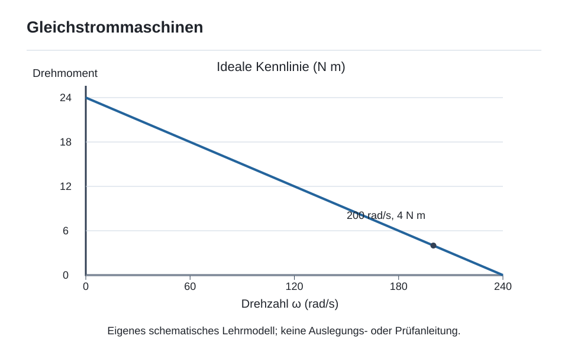

# M23-L2 – Gleichstrommaschinen {#L2}

**Kursbereich:** M23 – Bachelor: Elektrische Maschinen und Transformatoren

**Niveau:** Bachelor · Grundlagen

**Vorwissen:** [M23-L1](M23-L1.md).

**Lernziel:** Drehmoment, Gegen-EMK und Leistungsfluss einer fremderregten Gleichstrommaschine berechnen.

## Aufbau und Kommutierung {#S1}

Bei einer klassischen Gleichstrommaschine erzeugt der Stator das Erregerfeld; der Rotor trägt die Ankerwicklung. Bürsten und Kommutator vermitteln den Stromübergang und die passende Stromrichtung in den Rotorleitern. Die mechanische Kommutierung verursacht Verschleiß. Bürstenlose Motoren mit elektronischer Kommutierung sind dagegen typischerweise Synchronmaschinen. Fremd-, Neben- und Reihenschluss unterscheiden sich durch die Erregerschaltung.

## Stationäres Modell {#S2}

Für konstante Erregung, vernachlässigten Bürstenspannungsfall und Motorzählrichtung gilt $E=k\omega$, $U=E+R_a I_a$ und $T_e=k I_a$. In SI besitzt $k$ denselben Zahlenwert in V s/rad und N m/A. Damit ist die umgesetzte Leistung $P_{em}=EI_a=T_e\omega$. Die Ankerkupferverluste betragen $I_a^2 R_a$. Das elektromagnetische Drehmoment ist nicht das verfügbare Wellendrehmoment, wenn Reibung oder andere Verluste auftreten.

*Abbildung: Eigenes schematisches Lehrmodell; keine Auslegungs- oder Prüfanleitung.*

## Rechenbeispiel {#S3}

Bei $U=48$ V, $R_a=0,4\,\Omega$, $k=0,2$ V s/rad und $\omega=200$ rad/s erhält man $E=40$ V, $I_a=20$ A und $T_e=4$ N m. Die Ankeraufnahme beträgt 960 W, der Ankerverlust 160 W und die elektromagnetisch umgesetzte Leistung 800 W. Die Erregungsaufnahme und mechanische Verluste sind in dieser Teilbilanz nicht enthalten.

## Kennlinie und Betriebsgrenzen {#S4}

Die ideale Drehmoment-Drehzahl-Gerade lautet $T_e=k(U-k\omega)/R_a$. Bei positivem $\omega$ und $E>U$ wird der Ankerstrom negativ; der elektrische Leistungsfluss kann sich umkehren. Das setzt eine geeignete Quelle bzw. Umrichtertopologie voraus. Ein Reihenschlussmotor besitzt keine konstante Erregung, weshalb diese Gerade nicht übertragbar ist. Stromgrenze, Kommutierung, Erwärmung und mechanische Drehzahlgrenze beschränken alle realen Betriebspunkte.

## Selbstkontrolle {#S5}

### Aufgaben

1. Wie groß ist E bei 150 rad/s im Beispiel?
2. Wie groß ist dann der Ankerstrom?
3. Welche Verlustleistung bleibt bei I=0 im idealen Ankerwiderstand?

::: {.lc-solutions data-lc-section="S5"}
1. 30 V.
2. 45 A; lediglich ein Modellwert ohne Strombegrenzung.
3. 0 W.
:::

## Quellen {#S6}

- [J. L. Kirtley, MIT 6.685 – DC (Commutator) and Permanent Magnet Machines](https://ocw.mit.edu/courses/6-685-electric-machines-fall-2013/2aec052d0c82b73a7b6c72d78f3a796d_MIT6_685F13_chapter6.pdf) · PDF text lines 130–174, 217–228; first page screenshot available; DC model and excitation · Zuletzt abgerufen: 2026-11-25 · Inhaltlich geprüft: 2026-11-25
