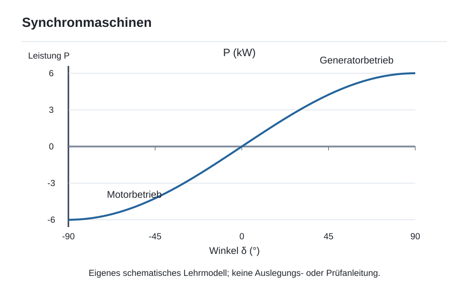

# M23-L3 – Synchronmaschinen {#L3}

**Kursbereich:** M23 – Bachelor: Elektrische Maschinen und Transformatoren

**Niveau:** Bachelor · Grundlagen

**Vorwissen:** [M23-L2](M23-L2.md).

**Lernziel:** Synchrondrehzahl und Leistungswinkelmodell einer symmetrischen Vollpolmaschine anwenden.

## Drehfeld und Erregung {#S1}

Drei räumlich versetzte, symmetrisch gespeiste Statorwicklungen erzeugen ein umlaufendes Feld. Der Rotor einer Synchronmaschine folgt diesem Feld im stationären Betrieb. Bei $p$ Polpaaren und Frequenz $f$ gilt $n_s=60f/p$ in min⁻¹ und $\omega_s=2\pi f/p$ in rad/s. Das Rotorfeld kann elektrisch erregt oder permanentmagnetisch erzeugt sein. Reluktanzmaschinen nutzen richtungsabhängige magnetische Eigenschaften.

## Vereinfachtes Leistungswinkelmodell {#S2}

Für den symmetrischen Vollpolgenerator mit vernachlässigtem Statorwiderstand gilt pro Phase $E=V+jX_s I$. Dabei sind $E,V$ Effektivwert-Zeiger, $I$ ist zum Netz positiv und $X_s$ die Synchronreaktanz. Mit $\delta=\arg(E)-\arg(V)$ ergibt sich die dreiphasige Wirkleistung $P=3|E||V|\sin\delta/X_s$. Ein negatives $\delta$ bedeutet in dieser Konvention Motorbetrieb. Für eine Schenkelpolmaschine oder gesättigte Maschine reicht das Modell im Allgemeinen nicht aus.

*Abbildung: Eigenes schematisches Lehrmodell; keine Auslegungs- oder Prüfanleitung.*

## Rechenbeispiel {#S3}

Bei 50 Hz und zwei Polpaaren beträgt die Drehzahl 1500 min⁻¹. Mit $|E|=|V|=100$ V pro Phase, $X_s=5\,\Omega$ und $\delta=30^\circ$ erhält man $P=3000$ W. Die mechanische Winkelgeschwindigkeit ist etwa 157,08 rad/s; ohne Verluste entspricht dies einem abgegebenen elektrischen Leistungsbetrag bei einem antreibenden Drehmoment von rund 19,1 N m. Bei $\delta=0$ verschwindet die Wirkleistung im idealisierten Modell.

## Stabilität und Anwendungen {#S4}

Im einfachen Modell wächst die Wirkleistung für positive Winkel unter 90° mit dem Winkel. Der Maximalwert allein ist keine zulässige Betriebsgrenze: Strom, thermische Auslegung, Erregung und dynamische Stabilität müssen berücksichtigt werden. Synchronmaschinen finden sich in Generatoren und geregelten Antrieben. Das Verhalten bei Störungen benötigt ein dynamisches Modell mit mechanischer Trägheit und elektrischen Zuständen.

## Selbstkontrolle {#S5}

### Aufgaben

1. Welche Drehzahl ergibt sich bei 50 Hz und drei Polpaaren?
2. Wie groß ist P bei 30° und doppeltem X_s?
3. Warum ist der Leistungswinkel nicht der mechanische Rotorwinkel?

::: {.lc-solutions data-lc-section="S5"}
1. 1000 min⁻¹.
2. 1500 W bei sonst unveränderten Daten.
3. Der Leistungswinkel beschreibt elektrische Zeiger; die elektrische Winkeländerung ist p-mal die mechanische.
:::

## Quellen {#S6}

- [J. L. Kirtley, MIT 6.685 – Elementary Synchronous Machine Models](https://ocw.mit.edu/courses/6-685-electric-machines-fall-2013/a10eb941769a0f5fa6a7460a8a7bb201_MIT6_685F13_chapter4.pdf) · PDF text lines 299–378; balanced operation; screenshot failed · Zuletzt abgerufen: 2026-11-25 · Inhaltlich geprüft: 2026-11-25
