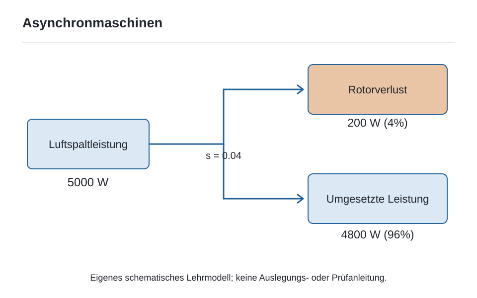

# M23-L4 – Asynchronmaschinen {#L4}

**Kursbereich:** M23 – Bachelor: Elektrische Maschinen und Transformatoren

**Niveau:** Bachelor · Grundlagen

**Vorwissen:** [M23-L3](M23-L3.md).

**Lernziel:** Schlupf, Rotorfrequenz und Leistungsbilanz einer Asynchronmaschine bestimmen.

## Induktion und Schlupf {#S1}

Beim Käfigläufer entstehen Rotorströme durch die Relativbewegung zwischen Statorfeld und Rotor. Für die Synchrondrehzahl $n_s$ und die Rotordrehzahl $n$ gilt $s=(n_s-n)/n_s$. Die Rotorstromfrequenz beträgt $f_r=|s|f$. Beim motorischen Betrieb in Feldrichtung liegt $0<s<1$; bei $s=1$ steht der Rotor und bei $s=0$ verschwindet im idealen Käfigmodell die induzierte Rotorspannung.

## Ersatzschaltung und Leistung {#S2}

Der auf die Statorseite bezogene Rotorzweig lautet im stationären symmetrischen Modell $R_2\prime/s+jX_2\prime$ für $s\ne0$. Bei motorischem Betrieb beträgt die Luftspaltleistung $P_\delta=3I_2\prime^2 R_2\prime/s$. Der Rotor-Kupferverlust ist $P_{Cu2}=sP_\delta$, die umgesetzte mechanische Leistung $P_{em}=(1-s)P_\delta$. Nach Abzug mechanischer Verluste bleibt die Wellenleistung. Das Drehmoment ist $T_e=P_\delta/\omega_s$.

*Abbildung: Eigenes schematisches Lehrmodell; keine Auslegungs- oder Prüfanleitung.*

## Rechenbeispiel {#S3}

Ein vierpoliger 50-Hz-Motor dreht mit 1440 min⁻¹. Es ergeben sich $n_s=1500$ min⁻¹, $s=0,04$ und $f_r=2$ Hz. Bei 5 kW Luftspaltleistung entfallen 200 W auf Rotor-Kupferverluste und 4,8 kW auf die umgesetzte mechanische Leistung. Das elektromagnetische Drehmoment beträgt rund 31,8 N m. Statorverluste sind vor, mechanische Verluste nach dem Luftspaltmodell zu bilanzieren.

## Kennlinie und Regelung {#S4}

Mit wachsendem Schlupf steigt das Drehmoment zunächst, erreicht ein Kippmoment und sinkt im vereinfachten Modell bei weiter steigendem Schlupf. Frequenzumrichter können die Drehfelddrehzahl verändern; bei konstantem Verhältnis Spannung zu Frequenz bleibt der Fluss im geeigneten Frequenzbereich näherungsweise konstant. Bei kleinen Frequenzen wird der Spannungsabfall am Statorwiderstand wichtig. Anlauf, Kühlung, Strom und Drehmoment sind getrennte Auslegungsgrenzen.

## Selbstkontrolle {#S5}

### Aufgaben

1. Wie groß ist der Schlupf bei 1470 min⁻¹ und 1500 min⁻¹ synchron?
2. Wie groß sind Rotorverluste bei 5 kW Luftspaltleistung und 2 % Schlupf?
3. Was bedeutet negativer Schlupf bei positiver Drehrichtung?

::: {.lc-solutions data-lc-section="S5"}
1. 0,02 bzw. 2 %.
2. 100 W.
3. Der Rotor läuft übersynchron; generatorischer Betrieb ist möglich.
:::

## Quellen {#S6}

- [J. L. Kirtley, MIT 6.061 – Analytic Design Evaluation of Induction Machines](https://www.ocw.mit.edu/courses/6-061-introduction-to-electric-power-systems-spring-2011/01f878366fe651f1b95e9ed7fc24c644_MIT6_061S11_ch10.pdf) · PDF text lines 517–539, 2357–2419; slip and air-gap power; screenshot failed · Zuletzt abgerufen: 2026-11-25 · Inhaltlich geprüft: 2026-11-25
