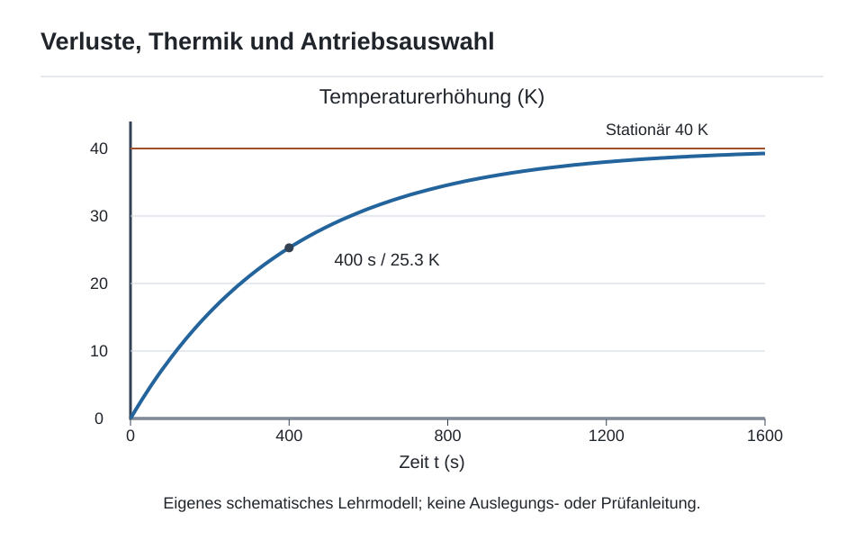

# M23-L5 – Verluste, Thermik und Antriebsauswahl {#L5}

**Kursbereich:** M23 – Bachelor: Elektrische Maschinen und Transformatoren

**Niveau:** Bachelor · Grundlagen

**Vorwissen:** [M23-L4](M23-L4.md).

**Lernziel:** Wirkungsgrad und thermische Belastung modellieren und Antriebe anhand eines Lastprofils vergleichen.

## Energiefluss und Verlustarten {#S1}

Im stationären Motorbetrieb gilt $P_{in}=P_{shaft}+P_v$ und $\eta=P_{shaft}/P_{in}$. Zu $P_v$ gehören Wicklungs-, Kern-, mechanische und zusätzliche lastabhängige Verluste. Bei einem Drehstrommotor mit gleichen Phasenwiderständen ist $P_{Cu}=3I^2R$ für sinusförmige Phasenströme. Die Bilanz eines Antriebssystems umfasst zusätzlich Umrichter und gegebenenfalls Getriebe. Wirkungsgrade werden bei gemeinsamem Betriebspunkt multipliziert, nicht addiert.

## Thermisches Ersatzmodell {#S2}

Für ein konzentriertes Modell mit Wärmewiderstand $R_\theta$, Wärmekapazität $C_\theta$ und Temperaturerhöhung $\Delta T$ gilt $C_\theta\,\mathrm d\Delta T/\mathrm dt=P_v-\Delta T/R_\theta$. Bei konstantem Verlust und anfänglicher Umgebungstemperatur folgt $\Delta T(t)=P_vR_\theta(1-e^{-t/\tau})$, $\tau=R_\theta C_\theta$. Lokale Heißpunkte, veränderliche Kühlung und temperaturabhängige Verluste sind nicht enthalten.

*Abbildung: Eigenes schematisches Lehrmodell; keine Auslegungs- oder Prüfanleitung.*

## Rechenbeispiel {#S3}

Ein Modellmotor liefert 4,5 kW bei 5 kW Aufnahme, also $\eta=90\%$ und $P_v=500$ W. Mit $R_\theta=0,08$ K/W und $C_\theta=5000$ J/K ergeben sich 40 K stationäre Temperaturerhöhung und $\tau=400$ s. Nach 400 s sind es rund 25,3 K. Bei 25 °C Umgebung entspricht die stationäre Modelltemperatur 65 °C, nicht zwingend der Wicklungs-Hotspottemperatur.

## Lastprofil und Auswahl {#S4}

Für eine virtuelle Auswahl werden Drehmoment, Drehzahl, Beschleunigung, Einschaltdauer und Kühlbedingungen als Zeitprofil erfasst. Über $P=T\omega$ folgt der mechanische Leistungsbedarf. Ein Vergleich integriert die elektrische Aufnahme über den gesamten Zyklus und prüft Spitzenmoment, thermische Grenzen und mögliche Rückspeisung. Nennwirkungsgrad oder Nennleistung allein reichen nicht. Reale Auswahl und Installation erfordern Herstellerdaten, Sicherheitsbewertung und geltende Anforderungen; der historische DOE-Leitfaden dient hier nur als technische Hintergrundquelle.

## Selbstkontrolle {#S5}

### Aufgaben

1. Wie hoch ist die Verlustleistung bei 6 kW Aufnahme und 5,4 kW Wellenleistung?
2. Wie groß ist die stationäre Temperaturerhöhung bei 600 W und 0,08 K/W?
3. Wie groß ist der Gesamtwirkungsgrad für Motor 90 % und Umrichter 95 %?

::: {.lc-solutions data-lc-section="S5"}
1. 600 W.
2. 48 K.
3. 85,5 % am gemeinsamen Betriebspunkt.
:::

## Quellen {#S6}

- [US DOE – Premium Efficiency Motor Selection and Application Guide](https://www.energy.gov/sites/default/files/2014/04/f15/amo_motors_handbook_web.pdf) · PDF text lines 1145–1156; loss categories; screenshot failed; historical guide, not current regulation · Zuletzt abgerufen: 2026-11-25 · Inhaltlich geprüft: 2026-11-25
- [US DOE – Motor Systems](https://www.energy.gov/cmei/ito/motor-systems) · HTML lines 74–91; system efficiency resources and cases · Zuletzt abgerufen: 2026-11-25 · Inhaltlich geprüft: 2026-11-25
