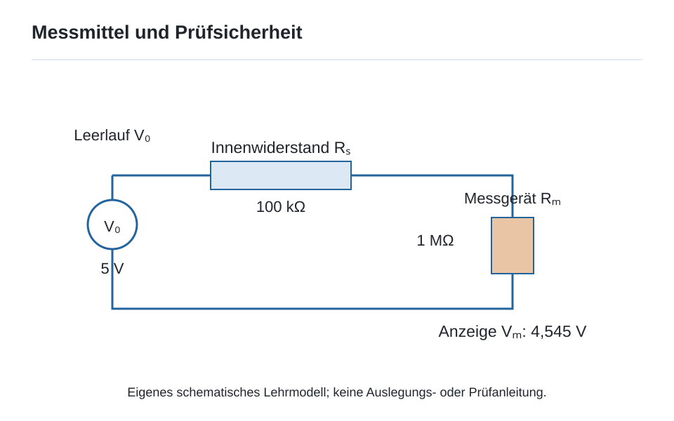

# M24-L1 – Messmittel und Prüfsicherheit {#L1}

**Kursbereich:** M24 – Bachelor: Elektrotechnische Prüf- und Laborpraxis

**Niveau:** Bachelor · Grundlagen

**Vorwissen:** [M20-L5](M20-L5.md).

**Lernziel:** Messmittel nach Messaufgabe einordnen, Belastungsfehler und Unsicherheit im Rechenmodell bestimmen.

## Messaufgabe und Sicherheitsgrenze {#S1}

Eine Messung verbindet Messgröße, Verfahren, Messmittel, Umgebungsbedingungen und Ergebnis. Ein Multimeter erfasst beispielsweise Spannung, Strom oder Widerstand, ein Oszilloskop zeitabhängige Signale, ein Leistungsanalysator die elektrische Leistung. Eingangsimpedanz, Bandbreite, Auflösung, zulässiger Einsatzbereich und Kalibrierstatus sind unterschiedliche Auswahlmerkmale. Reale elektrische Prüfungen erfordern qualifiziertes Personal, eine Gefährdungsbeurteilung und geeignete Geräte. Alle folgenden Aufgaben sind ausschließlich virtuelle Modelle; keine Messungen an Netzspannung, Hochspannung oder gespeicherter Energie durchführen.

## Belastung durch Messmittel {#S2}

Eine reale Spannungsmessung beeinflusst die Schaltung. Bei einer Thévenin-Quelle mit Leerlaufspannung $V_0$ und Innenwiderstand $R_s$ sowie einem Messgerät mit Eingangswiderstand $R_m$ ergibt sich $V_m=V_0R_m/(R_s+R_m)$. Der relative Belastungsfehler bezogen auf $V_0$ ist $-R_s/(R_s+R_m)$. Bei Wechselgrößen muss statt eines reinen Widerstands die frequenzabhängige Impedanz betrachtet werden. Eine hohe Anzeigenauflösung beseitigt weder Belastungsfehler noch Kalibrierabweichungen.

*Abbildung: Eigenes schematisches Lehrmodell; keine Auslegungs- oder Prüfanleitung.*

## Rechenbeispiel {#S3}

Im virtuellen Modell gelten $V_0=5$ V, $R_s=100$ kΩ und $R_m=1$ MΩ. Das Gerät zeigt idealisiert 4,545 V; der Belastungsfehler beträgt −9,09 %. Bei 10 MΩ sind es 4,950 V beziehungsweise −0,990 %. Ein bekannter Einfluss kann im Modell korrigiert werden; die Unsicherheit der Korrektur bleibt Bestandteil des Ergebnisses.

## Unsicherheit und Rückführbarkeit {#S4}

Bei unabhängigen Wiederholmessungen lässt sich die Unsicherheit des Mittelwerts mit $s/\sqrt{n}$ schätzen (Typ A). Typ B verwendet beispielsweise Angaben aus Kalibrierung oder Auflösung. Für eine angenommene Rechteckverteilung mit Halbbreite $a$ ist $u=a/\sqrt{3}$. Bei unkorrelierten Beiträgen gleicher Dimension und Sensitivität eins ergibt sich $u_c=\sqrt{u_A^2+u_B^2}$. Für 0,01 V und 0,02 V folgt $u_c=0,02236$ V und bei $k=2$ die erweiterte Unsicherheit $U=0,04472$ V. Der Faktor allein garantiert keine bestimmte Überdeckungswahrscheinlichkeit. Rückführbarkeit verlangt eine dokumentierte Kalibrierkette mit Unsicherheiten; sie ist nicht gleichbedeutend mit Fehlerfreiheit.

## Selbstkontrolle {#S5}

### Aufgaben

1. Wie groß ist der Belastungsfehler bei R_m=R_s?
2. Wie groß ist u bei rechteckiger Halbbreite 0,03 V?
3. Warum reicht eine höhere Auflösung nicht zur Verbesserung der Messrichtigkeit?

::: {.lc-solutions data-lc-section="S5"}
1. −50 %.
2. 0,01732 V.
3. Systematische Einflüsse und die Rückführbarkeit bleiben unabhängig von der Auflösung.
:::

## Quellen {#S6}

- [HSE – Work on electrical equipment, machinery or installations](https://www.hse.gov.uk/Electricity/withequip.htm) · HTML lines 65–87: planning, secure energy isolation, competence; UK guidance, not German legal authority · Zuletzt abgerufen: 2026-11-25 · Inhaltlich geprüft: 2026-11-25
- [HSE – Electrical inspection and testing](https://www.hse.gov.uk/electricity/information/testing.htm) · HTML lines 47–60: guidance by testing context; no full standard claimed (Prüfung auf belegten Teilumfang begrenzt) · Zuletzt abgerufen: 2026-11-25 · Inhaltlich geprüft: 2026-11-25
- [NIST TN 1297 – Classification of Components of Uncertainty](https://www.nist.gov/pml/nist-technical-note-1297/nist-tn-1297-2-classification-components-uncertainty) · HTML lines 147–157: type A/B, standard uncertainty and covariance · Zuletzt abgerufen: 2026-11-25 · Inhaltlich geprüft: 2026-11-25
- [NIST TN 1297 – Law of Propagation of Uncertainty](https://www.nist.gov/pml/nist-technical-note-1297/nist-tn-1297-appendix-law-propagation-uncertainty) · HTML lines 150–178: first-order propagation, mean and rectangular distribution · Zuletzt abgerufen: 2026-11-25 · Inhaltlich geprüft: 2026-11-25
- [NIST TN 1297 – Expanded Uncertainty](https://www.nist.gov/pml/nist-technical-note-1297/nist-tn-1297-6-expanded-uncertainty) · HTML lines 139–140: coverage factor and expanded uncertainty · Zuletzt abgerufen: 2026-11-25 · Inhaltlich geprüft: 2026-11-25
