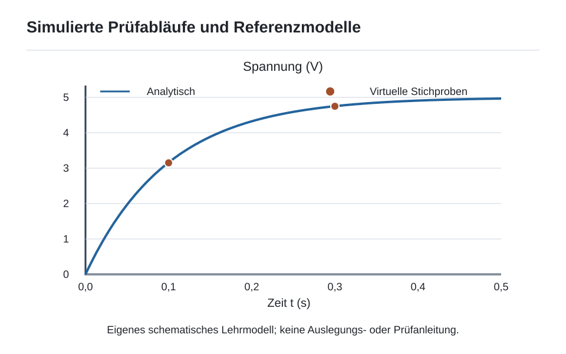

# M24-L2 – Simulierte Prüfabläufe und Referenzmodelle {#L2}

**Kursbereich:** M24 – Bachelor: Elektrotechnische Prüf- und Laborpraxis

**Niveau:** Bachelor · Grundlagen

**Vorwissen:** [M24-L1](M24-L1.md).

**Lernziel:** Ein virtuelles Prüfmodell mit unabhängiger analytischer Referenz und dokumentierten Abweichungen beurteilen.

## Vom Modell zur Prüfung {#S1}

Verifikation prüft, ob ein Modell mathematisch beziehungsweise numerisch wie spezifiziert gelöst wird. Validierung untersucht, ob das Modell für seinen Verwendungszweck hinreichend gut die Wirklichkeit beschreibt. Ein analytischer Vergleich kann die Verifikation unterstützen, ersetzt aber keine Validierung mit geeigneten Messdaten. Ein virtueller Versuch ist reproduzierbar, wenn Modellversion, Parameter, Anfangszustand, Rechenverfahren und Auswertung festgehalten werden.

## Referenz: RC-Sprungantwort {#S2}

Ein idealer RC-Tiefpass mit anfangs ungeladenem Kondensator und Spannungssprung $V_s$ besitzt die Antwort $v_C(t)=V_s(1-e^{-t/(RC)})$ für $t\ge 0$. Die Zeitkonstante ist $\tau=RC$. Für 1 kΩ, 100 µF und 5 V gilt $\tau=0,1$ s. Nach einer Zeitkonstante beträgt die Spannung rund 3,1606 V, nach drei Zeitkonstanten 4,7511 V. In einer Transientensimulation werden diese Werte mit numerischen Ergebnissen bei denselben Zeitpunkten verglichen.

*Abbildung: Eigenes schematisches Lehrmodell; keine Auslegungs- oder Prüfanleitung.*

## Rechenbeispiel: Abweichung {#S3}

Ein fiktiver numerischer Datensatz liefert bei 0,1 s den Wert 3,150 V und bei 0,3 s 4,748 V. Das Residuum $r=v_{num}-v_{ref}$ beträgt −10,6 mV beziehungsweise −3,1 mV. Bei einer vorab für dieses Lehrmodell definierten Toleranz von 20 mV liegen beide Stichproben innerhalb der Grenze. Das beweist weder die gesamte Kurve noch eine Übereinstimmung mit einem physischen Bauteil. Die Daten sind absichtlich erzeugte Übungswerte, keine ausgeführte SPICE-Messung.

## Numerische Qualität {#S4}

Ein DC-Arbeitspunkt beschreibt einen stationären Zustand, eine Transientenanalyse den Zeitverlauf. Bei einer Schrittweitenstudie wird das Ergebnis mit feineren Zeitschritten erneut bestimmt. Konvergenz, Anfangsbedingungen und Modellparameter müssen getrennt von Bauteiltoleranzen betrachtet werden. Als zusätzliche Prüffälle bieten sich der Anfangswert, der asymptotische Endwert, eine Parameteränderung und die Energieaufnahme des idealen Kondensators an. Änderungen der Prüfkriterien nach Sichtung des Ergebnisses sind gesondert zu begründen.

## Selbstkontrolle {#S5}

### Aufgaben

1. Welcher Wert wird nach einer Zeitkonstante erreicht?
2. Wie groß ist τ bei doppelter Kapazität?
3. Welcher Energieinhalt ergibt sich im Endzustand bei 100 µF und 5 V?

::: {.lc-solutions data-lc-section="S5"}
1. 63,21 % des Endwerts.
2. 0,2 s.
3. 1,25 mJ nach E=CV²/2.
:::

## Quellen {#S6}

- [ngspice – Control language tutorial](https://ngspice.sourceforge.io/ngspice-control-language-tutorial.html) · HTML lines 55–57, 185–215: simulation commands, operating points and output vectors; tutorial, not evidence of local execution · Zuletzt abgerufen: 2026-11-25 · Inhaltlich geprüft: 2026-11-25
