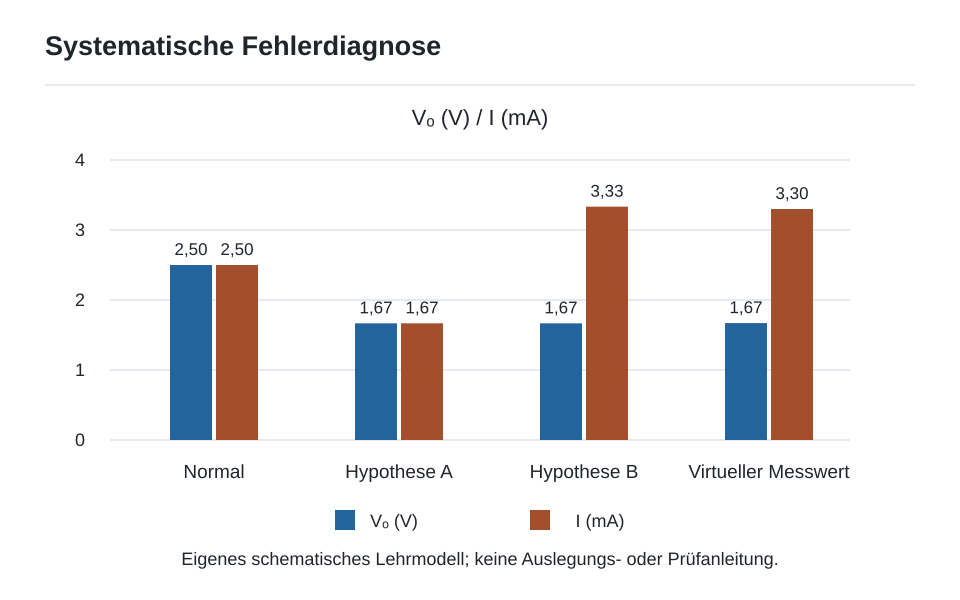

# M24-L3 – Systematische Fehlerdiagnose {#L3}

**Kursbereich:** M24 – Bachelor: Elektrotechnische Prüf- und Laborpraxis

**Niveau:** Bachelor · Grundlagen

**Vorwissen:** [M24-L2](M24-L2.md).

**Lernziel:** Aus virtuellen Beobachtungen konkurrierende Fehlerhypothesen ableiten und unterscheidende Modellprüfungen auswählen.

## Symptom, Ursache und Hypothese {#S1}

Ein Symptom ist eine beobachtete Abweichung, eine Ursache ein zugrunde liegender Mechanismus. Mehrere Ursachen können dasselbe Symptom erzeugen. Ein systematischer Diagnoseprozess hält deshalb Beobachtungen, mögliche Fehler, erwartete Folgen und diskriminierende Prüfkriterien getrennt fest. Alle Beispiele sind Simulationen ohne reale Anlage. Eingriffe in elektrische Betriebsmittel sind keine Aufgabe dieses Selbstlernkurses.

## Fehlersignaturen im Spannungsteiler {#S2}

Für eine ideale 5-V-Quelle mit $R_1=R_2=1$ kΩ gilt $V_o=5R_2/(R_1+R_2)=2,5$ V und $I=2,5$ mA. Hypothese A: $R_1$ steigt auf 2 kΩ, sodass $V_o=1,667$ V und $I=1,667$ mA. Hypothese B: $R_2$ sinkt auf 0,5 kΩ, sodass ebenfalls $V_o=1,667$ V, aber $I=3,333$ mA. Die Ausgangsspannung allein unterscheidet beide Fehler nicht. Der Modellstrom liefert eine zusätzliche, unabhängige Beobachtungsgröße.

*Abbildung: Eigenes schematisches Lehrmodell; keine Auslegungs- oder Prüfanleitung.*

## Rechenbeispiel: Residuen {#S3}

Ein fiktiver Datensatz enthält $V_o=1,67$ V und $I=3,30$ mA. Für die Stromabweichung ergeben sich gegenüber A rund +1,63 mA und gegenüber B rund −0,033 mA. Bei einer hypothetischen Akzeptanzgrenze von 0,1 mA passt B besser; sie ist damit nicht als reale Ursache bewiesen. Weitere Hypothesen wie Quellenänderung oder kombinierte Fehler bleiben möglich. Spannungs- und Stromresiduen verschiedener Einheiten dürfen nicht ohne geeignete Skalierung addiert werden.

## Diagnosequalität {#S4}

Eine Fehlermatrix ordnet Hypothesen den erwarteten Beobachtungen zu. Sind Signaturen identisch oder kleiner als die Modell- und Messunsicherheit, ist der Fehler mit den verfügbaren Daten nicht eindeutig identifizierbar. Im virtuellen Labor können Parameter einzeln verändert werden; so lassen sich Sensitivitäten und Mehrdeutigkeiten untersuchen. Ein Diagnosebericht benennt auch verworfene Hypothesen, Datenlücken und den nächsten sicheren, fachlich begründeten Prüfschritt. Bei realen Anlagen liegt diese Entscheidung ausschließlich beim zuständigen qualifizierten Personal.

## Selbstkontrolle {#S5}

### Aufgaben

1. Welche Ausgangsspannung ergibt sich bei R₁=R₂=2 kΩ?
2. Wie groß ist der Strom in diesem Fall?
3. Warum genügt ein einzelnes Spannungsresiduum nicht?

::: {.lc-solutions data-lc-section="S5"}
1. 2,5 V.
2. 1,25 mA.
3. Verschiedene Parameterkombinationen können denselben Ausgangswert erzeugen.
:::

## Quellen {#S6}

- [ngspice – Control language tutorial](https://ngspice.sourceforge.io/ngspice-control-language-tutorial.html) · HTML lines 55–57, 185–215: simulation commands, operating points and output vectors; tutorial, not evidence of local execution · Zuletzt abgerufen: 2026-11-25 · Inhaltlich geprüft: 2026-11-25
- [NIST TN 1297 – Law of Propagation of Uncertainty](https://www.nist.gov/pml/nist-technical-note-1297/nist-tn-1297-appendix-law-propagation-uncertainty) · HTML lines 150–178: first-order propagation, mean and rectangular distribution · Zuletzt abgerufen: 2026-11-25 · Inhaltlich geprüft: 2026-11-25
- [HSE – Work on electrical equipment, machinery or installations](https://www.hse.gov.uk/Electricity/withequip.htm) · HTML lines 65–87: planning, secure energy isolation, competence; UK guidance, not German legal authority · Zuletzt abgerufen: 2026-11-25 · Inhaltlich geprüft: 2026-11-25
