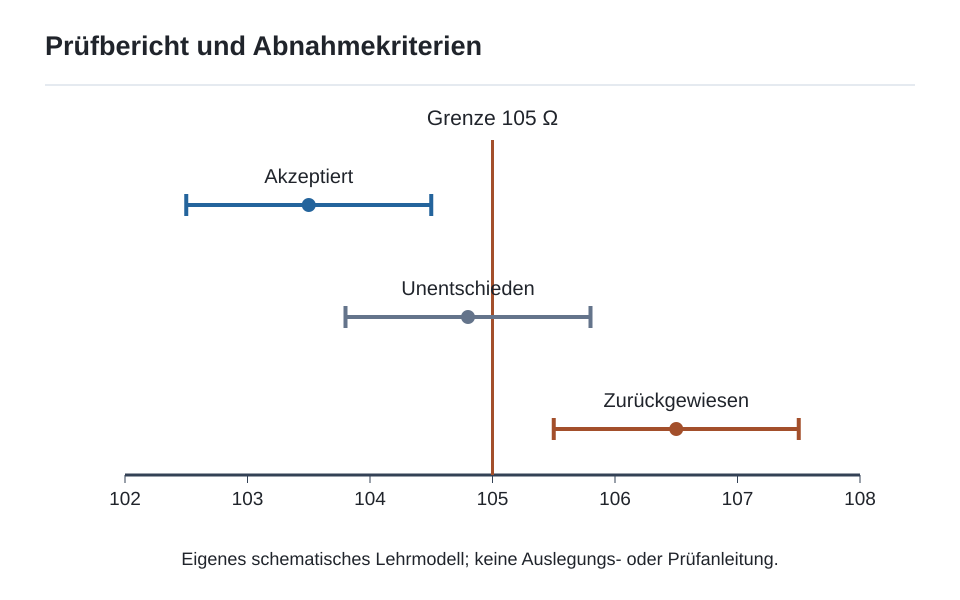

# M24-L4 – Prüfbericht und Abnahmekriterien {#L4}

**Kursbereich:** M24 – Bachelor: Elektrotechnische Prüf- und Laborpraxis

**Niveau:** Bachelor · Grundlagen

**Vorwissen:** [M24-L3](M24-L3.md).

**Lernziel:** Ein virtuelles Prüfergebnis mit Unsicherheit, vorher festgelegter Entscheidungsregel und nachvollziehbarem Bericht bewerten.

## Prüfbericht und Nachweiskette {#S1}

Ein nachvollziehbarer Bericht enthält Prüfobjekt und Version, Aufgabenstellung, Messgröße, Prüfmethode, Referenz, Bedingungen, Rohdaten, Auswertung, Unsicherheit, Entscheidungsregel, Ergebnis und Einschränkungen. Bei simulierten Daten muss die Herkunft eindeutig als synthetisch oder berechnet gekennzeichnet sein. Ein Prüfbericht dokumentiert das untersuchte Merkmal; er ist keine umfassende Sicherheitsfreigabe.

## Entscheidungsregel und Schutzabstand {#S2}

Für ein virtuelles Bauteil mit oberem Toleranzlimit $T$ wird vorab folgende beispielhafte dreistufige Regel gewählt: akzeptieren, wenn $y+U\le T$; zurückweisen, wenn $y-U>T$; sonst unentschieden. $y$ ist das Ergebnis und $U$ die erweiterte Unsicherheit. Die Regel verwendet einen Schutzabstand von $U$ zur oberen Grenze. Andere Regeln können unterschiedliche Risiken falscher Annahme und falscher Zurückweisung berücksichtigen. Diese Lehrregel ist keine universelle Normforderung.

*Abbildung: Eigenes schematisches Lehrmodell; keine Auslegungs- oder Prüfanleitung.*

## Rechenbeispiel {#S3}

Für ein fiktives Widerstandsmodell gelte $T=105$ Ω und $U=1$ Ω bei dokumentiertem $k=2$. Bei $y=103,5$ Ω ist die obere Intervallgrenze 104,5 Ω: akzeptiert. Bei $y=104,8$ Ω umfasst das Intervall 103,8 bis 105,8 Ω: unentschieden. Bei $y=106,5$ Ω liegt selbst die untere Grenze bei 105,5 Ω: zurückgewiesen. Die drei Entscheidungen gelten ausschließlich für das angegebene Merkmal und die definierte Regel.

## Muster einer dokumentierten Entscheidung {#S4}

Objekt: virtuelles Widerstandsmodell R-01, Version 1. Ergebnis: 104,8 Ω; erweiterte Unsicherheit 1 Ω, k=2, fiktive Datengrundlage. Spezifikation: obere Grenze 105 Ω, keine untere Grenze in dieser Übung. Regel: Intervall vollständig unter oder auf der Grenze zur Annahme, vollständig oberhalb zur Zurückweisung. Status: unentschieden. Nächster Schritt: Ursachen der Unsicherheit im Modell prüfen und gegebenenfalls eine vorab vereinbarte Nachprüfung mit dokumentierter Methode vorsehen. Rohdaten und frühere Ergebnisse bleiben erhalten. Für reale Abnahmen sind anwendbare Vorschriften, Normen und Verantwortlichkeiten gesondert zu bestimmen.

## Selbstkontrolle {#S5}

### Aufgaben

1. Wie lautet die Entscheidung bei y=104 Ω und U=1 Ω?
2. Wie lautet sie bei y=106 Ω und U=1 Ω?
3. Warum muss die Regel vor der Prüfung feststehen?

::: {.lc-solutions data-lc-section="S5"}
1. Akzeptiert, da y+U=105 Ω.
2. Unentschieden, da y−U=105 Ω und nicht größer ist.
3. Damit nachträgliche Ergebnisanpassungen vermieden und Risiken nachvollziehbar behandelt werden.
:::

## Quellen {#S6}

- [Eurachem/CITAC – Use of uncertainty information in compliance assessment (2021)](https://www.eurachem.org/index.php/publications/guides/uncertcompliance) · HTML lines 40–54, 70–73: decision rule, guard band and inconclusive results; guide summary only · Zuletzt abgerufen: 2026-11-25 · Inhaltlich geprüft: 2026-11-25
- [NIST TN 1297 – Expanded Uncertainty](https://www.nist.gov/pml/nist-technical-note-1297/nist-tn-1297-6-expanded-uncertainty) · HTML lines 139–140: coverage factor and expanded uncertainty · Zuletzt abgerufen: 2026-11-25 · Inhaltlich geprüft: 2026-11-25
- [NIST TN 1297 – Law of Propagation of Uncertainty](https://www.nist.gov/pml/nist-technical-note-1297/nist-tn-1297-appendix-law-propagation-uncertainty) · HTML lines 150–178: first-order propagation, mean and rectangular distribution · Zuletzt abgerufen: 2026-11-25 · Inhaltlich geprüft: 2026-11-25
