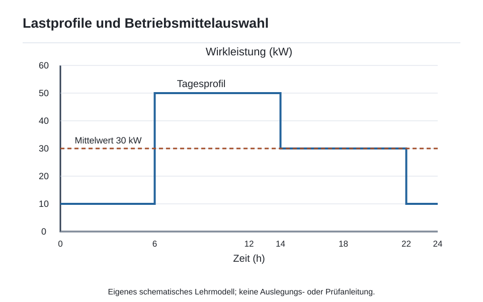

# M25-L1 – Lastprofile und Betriebsmittelauswahl {#L1}

**Kursbereich:** M25 – Bachelor: Anlagenplanung und Energiewirtschaft

**Niveau:** Bachelor · Grundlagen

**Vorwissen:** [M24-L4](M24-L4.md).

**Lernziel:** Zeitabhängige Lasten auswerten und den Leistungsbedarf im vereinfachten Modell von Energieverbrauch und Betriebsmittelgrenzen unterscheiden.

## Leistung und Energie {#S1}

Ein Lastprofil $P(t)$ beschreibt die zeitliche Wirkleistungsaufnahme. Für abschnittsweise konstante Werte gilt $E=\sum_i P_i\Delta t_i$. Die mittlere Leistung ist $\bar P=E/T$, der Lastfaktor $f_L=\bar P/P_{max}$ für dasselbe Beobachtungsintervall. Eine hohe Spitzenleistung kann trotz niedrigen Energieverbrauchs einen hohen Kapazitätsbedarf verursachen. Die zeitliche Auflösung ist entscheidend: Viertelstundenmittelwerte zeigen kurze Anlaufspitzen nicht.

## Beispiel eines virtuellen Betriebstages {#S2}

Ein fiktiver Betrieb benötigt zwischen 0 und 6 Uhr 10 kW, zwischen 6 und 14 Uhr 50 kW, zwischen 14 und 22 Uhr 30 kW und danach wieder 10 kW. Es ergeben sich $E=6\cdot10+8\cdot50+8\cdot30+2\cdot10=720$ kWh, $\bar P=30$ kW und $f_L=0,60$. Die größte mittlere Abschnittsleistung beträgt 50 kW. Das Modell kennt keine kurzzeitigen Spitzen. Bei gleicher Tagesenergie wäre ein gleichmäßiges Profil von 30 kW weniger spitzenlastintensiv.

*Abbildung: Eigenes schematisches Lehrmodell; keine Auslegungs- oder Prüfanleitung.*

## Gleichzeitigkeit und Scheinleistung {#S3}

Für zwei Lasten mit Einzelmaxima 40 und 30 kW und gemeinsamem Maximum 50 kW beträgt der Gleichzeitigkeitfaktor $k_s=50/70\approx0,714$. Sein Kehrwert ist der Diversitätsfaktor in der hier benutzten Definition; andere Literatur verwendet die Begriffe abweichend. Bei einer sinusförmigen symmetrischen Drehstromlast mit $\cos\varphi=0,8$ entsprechen 50 kW einer Scheinleistung $S=P/\cos\varphi=62,5$ kVA. Bei 400 V Leiterspannung folgt modellhaft $I=S/(\sqrt3 U)\approx90,2$ A. Bei Oberschwingungen darf der Leistungsfaktor nicht pauschal mit dem Verschiebungsfaktor gleichgesetzt werden.

## Von der Last zum Betriebsmittel {#S4}

Eine Kapazitätsabschätzung ist nur ein Eingangswert. Betriebsmittel müssen zusätzlich hinsichtlich thermischer Belastung, Anlauf, Spannung, Kurzschlussbeanspruchung, Umgebungsbedingungen, Redundanz und Reserven bewertet werden. Szenarien für Schichtwechsel, Erweiterung und Ausfallzustände vermeiden blindes Übertragen statistischer Mittelwerte. Das Beispiel ist keine Bemessung eines realen Transformators oder einer Leitung. Verbindliche Planung erfordert geprüfte Daten, geltende Regeln und qualifiziertes Personal.

## Selbstkontrolle {#S5}

### Aufgaben

1. Wie viel Energie benötigt eine konstante Last von 30 kW in 24 h?
2. Wie groß ist der Lastfaktor des Tagesprofils bei unveränderter Energie und einer neuen Spitze von 60 kW?
3. Welche Scheinleistung entsprechen 50 kW bei Leistungsfaktor 1?

::: {.lc-solutions data-lc-section="S5"}
1. 720 kWh.
2. 30/60 = 0,5.
3. 50 kVA.
:::

## Quellen {#S6}

- [EIA – Load factor](https://www.eia.gov/tools/glossary/index.php?id=Load_factor) · HTML line 237: ratio of average to peak load · Zuletzt abgerufen: 2026-11-25 · Inhaltlich geprüft: 2026-11-25
- [Schneider Electric – Estimation of actual maximum kVA demand](https://www.electrical-installation.org/enwiki/Estimation_of_actual_maximum_kVA_demand) · HTML lines 45–57: coincidence factor and limits of generic assumptions; manufacturer guidance (Prüfung auf belegten Teilumfang begrenzt) · Zuletzt abgerufen: 2026-11-25 · Inhaltlich geprüft: 2026-11-25
- [Schneider Electric – Electrical installation design methodology](https://www.electrical-installation.org/enwiki/Electrical_installation_design_methodology) · HTML lines 42–72: demand, operating modes, expansion and distribution architecture; manufacturer guidance (Prüfung auf belegten Teilumfang begrenzt) · Zuletzt abgerufen: 2026-11-25 · Inhaltlich geprüft: 2026-11-25
