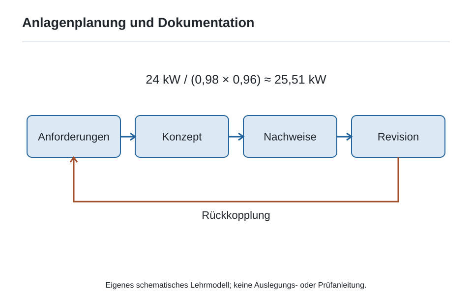

# M25-L2 – Anlagenplanung und Dokumentation {#L2}

**Kursbereich:** M25 – Bachelor: Anlagenplanung und Energiewirtschaft

**Niveau:** Bachelor · Grundlagen

**Vorwissen:** [M25-L1](M25-L1.md).

**Lernziel:** Planungsphasen, Schnittstellen und Nachweise einer elektrischen Anlage anhand eines virtuellen Projekts strukturieren.

## Anforderungen und Systemgrenze {#S1}

Am Anfang stehen Versorgungspflichten und Betriebszustände, nicht eine Geräteliste. Eine Anforderungsmatrix hält Lasten, Verfügbarkeit, Umgebung, Schnittstellen, Erweiterungen, Sicherheitsziele und Abnahmekriterien fest. Ein Einlinienschema stellt die funktionalen Energiepfade abstrahiert dar. Es ersetzt weder Stromlaufplan noch Schutzkonzept. Lastenliste, Gerätekennzeichen, Datenblätter und Berechnungen müssen auf denselben Revisionsstand verweisen.

## Planung als iterativer Prozess {#S2}

Aus Anforderungen entsteht ein Konzept; danach werden Varianten verglichen, Modelle gerechnet und Nachweise zugeordnet. Die Detailplanung prüft unter anderem Spannungsqualität, thermische Grenzen, Schutzkoordination und Fehlerzustände zusammen. Widersprüche führen zurück zur vorherigen Phase. Bei jeder Änderung wird ihre Auswirkung auf abhängige Dokumente bewertet. Die Freigabe eines Planungsdokuments ist nicht gleichbedeutend mit der Freigabe einer realen Anlage.

*Abbildung: Eigenes schematisches Lehrmodell; keine Auslegungs- oder Prüfanleitung.*

## Rechenbeispiel: Energiepfad {#S3}

Ein rein fiktiver Energiepfad besteht aus zwei Stufen mit Wirkungsgraden $\eta_1=0,98$ und $\eta_2=0,96$ am betrachteten Arbeitspunkt. Für 24 kW Nutzleistung ergibt sich $\eta_{ges}=0,9408$ und $P_{in}=24/0,9408\approx25,51$ kW. Rund 1,51 kW sind Verluste. Die Rechnung setzt konstante Wirkungsgrade und keine weiteren Verbraucher voraus. Bei wechselnder Last benötigt man Kennlinien und eine zeitliche Bilanz. Eine Änderung der Wirkungsgrade muss in Energiebilanz und Wärmemodell übernommen werden.

## Nachweis und Änderungsmanagement {#S4}

Ein nachvollziehbares Planungsregister verknüpft Anforderungs-ID, Berechnungsversion, Annahmen, Ergebnis, zuständige Rolle und Prüfstatus. Beispielsweise lässt sich das fiktive Ziel einer Gesamtverlustleistung unter 2 kW am gewählten Betriebspunkt mit der Rechnung oben verknüpfen. Andere Zustände bleiben ungeprüft. Offene Nachweise werden als solche gekennzeichnet. Für reale Anlagen sind lokale Vorschriften, Netzbetreiberanforderungen, Herstellerunterlagen, qualifizierte Prüfung und Abnahme gesondert erforderlich.

## Selbstkontrolle {#S5}

### Aufgaben

1. Wie hoch ist der Gesamtwirkungsgrad bei zwei Stufen mit je 95 %?
2. Wie hoch ist die Eingangsleistung bei 18,05 kW Ausgangsleistung und diesem Wirkungsgrad?
3. Warum müssen Dokumentrevisionen verknüpft werden?

::: {.lc-solutions data-lc-section="S5"}
1. 90,25 %.
2. 20 kW.
3. Damit Nachweise und Annahmen derselben Anlagenkonfiguration zugeordnet bleiben.
:::

## Quellen {#S6}

- [Schneider Electric – Electrical installation design methodology](https://www.electrical-installation.org/enwiki/Electrical_installation_design_methodology) · HTML lines 42–72: demand, operating modes, expansion and distribution architecture; manufacturer guidance (Prüfung auf belegten Teilumfang begrenzt) · Zuletzt abgerufen: 2026-11-25 · Inhaltlich geprüft: 2026-11-25
- [Schneider Electric – Conductor sizing: methodology and definition](https://www.electrical-installation.org/enwiki/Conductor_sizing:_methodology_and_definition) · HTML lines 45–79: simultaneous constraints on conductors and protection; manufacturer guidance, not normative approval (Prüfung auf belegten Teilumfang begrenzt) · Zuletzt abgerufen: 2026-11-25 · Inhaltlich geprüft: 2026-11-25
