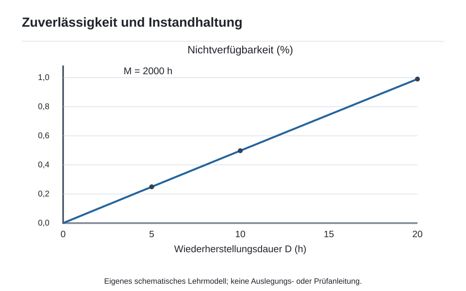

# M25-L3 – Zuverlässigkeit und Instandhaltung {#L3}

**Kursbereich:** M25 – Bachelor: Anlagenplanung und Energiewirtschaft

**Niveau:** Bachelor · Grundlagen

**Vorwissen:** [M25-L2](M25-L2.md).

**Lernziel:** Ausfallhäufigkeit, Verfügbarkeit und Instandhaltungsstrategien in einem transparenten Modell beurteilen.

## Zuverlässigkeit und Verfügbarkeit {#S1}

Zuverlässigkeit $R(t)$ beschreibt die Wahrscheinlichkeit, eine verlangte Funktion während eines Zeitraums ohne Ausfall zu erfüllen. Für ein exponentielles Lebensdauermodell mit konstanter Ausfallrate $\lambda$ gilt $R(t)=e^{-\lambda t}$. Verfügbarkeit beschreibt dagegen den Anteil betriebsbereiter Zeit beziehungsweise die Wahrscheinlichkeit der Betriebsbereitschaft zu einem Zeitpunkt. Reparatur kann die Verfügbarkeit erhöhen, ohne einen bereits eingetretenen Ausfall rückgängig zu machen.

## Rechenbeispiel: Betriebsdaten {#S2}

In einem fiktiven reparierbaren System wurden 10.000 Betriebsstunden und fünf Ausfälle beobachtet. Unter einer konstanten Ereignisrate ergibt sich $\hat\lambda=5/10000=0,0005$ pro Betriebsstunde und die geschätzte mittlere Betriebsdauer zwischen Ausfällen $M=2000$ h. Beträgt die mittlere Wiederherstellungsdauer $D=10$ h, ergibt das einfache stationäre Wechselmodell $A=M/(M+D)=2000/2010\approx99,50\%$. Es setzt repräsentative Mittelwerte und abwechselnde Betriebs- und Ausfallphasen voraus. Geplante Stillstände und logistische Wartezeiten sind hier nicht zusätzlich erfasst.

*Abbildung: Eigenes schematisches Lehrmodell; keine Auslegungs- oder Prüfanleitung.*

## Wartungsstrategien und Grenzen {#S3}

Reaktive Instandhaltung folgt einem Ausfall, vorbeugende Maßnahmen folgen geplanten Intervallen, zustandsorientierte Maßnahmen verwenden beobachtete Zustände und prädiktive Verfahren schätzen zukünftige Degradation. Zuverlässigkeitsorientierte Instandhaltung verbindet die Auswahl dieser Ansätze mit Funktionskritikalität und Ausfallfolgen. Ein statistischer Schätzwert aus fünf Ereignissen ist unsicher; Alterung oder wechselnde Betriebsbedingungen können die konstante Rate unbrauchbar machen.

## Entscheidung und Rückmeldung {#S4}

Wenn im Lernmodell die Wiederherstellungsdauer auf 5 h sinkt, steigt $A$ auf $2000/2005\approx99,75\%$. Die erwartete Nichtverfügbarkeit im Modell halbiert sich ungefähr. Dies ist keine Garantie für einzelne Zeiträume. Ein Instandhaltungsplan verknüpft Ausfallart, Folgen, beobachtbare Vorzeichen, Verantwortlichkeit und Wirksamkeitsnachweis. Sicherheitsrelevante Entscheidungen dürfen nicht allein auf wirtschaftlichen Kennzahlen beruhen. Arbeiten an realen elektrischen Anlagen bleiben qualifiziertem Personal vorbehalten.

## Selbstkontrolle {#S5}

### Aufgaben

1. Wie groß ist M bei 6000 Betriebsstunden und drei Ausfällen?
2. Welche Verfügbarkeit ergibt M=2000 h und D=20 h?
3. Warum bedeutet eine hohe Verfügbarkeit nicht automatisch hohe Zuverlässigkeit?

::: {.lc-solutions data-lc-section="S5"}
1. 2000 h.
2. 2000/2020 ≈ 99,01 %.
3. Häufige, rasch behobene Ausfälle können eine hohe Verfügbarkeit bei niedriger Zuverlässigkeit ergeben.
:::

## Quellen {#S6}

- [US DOE – Operations and Maintenance Challenges and Solutions](https://www.energy.gov/cmei/femp/operations-and-maintenance-challenges-and-solutions) · HTML lines 11–27: maintenance strategies, reliability and performance indicators · Zuletzt abgerufen: 2026-11-25 · Inhaltlich geprüft: 2026-11-25
- [NIST – Constant repair rate (HPP/exponential) model](https://www.itl.nist.gov/div898/handbook/apr/section4/apr451.htm) · HTML lines 8–30: MTBF estimator, constant-rate assumption and confidence limits · Zuletzt abgerufen: 2026-11-25 · Inhaltlich geprüft: 2026-11-25
