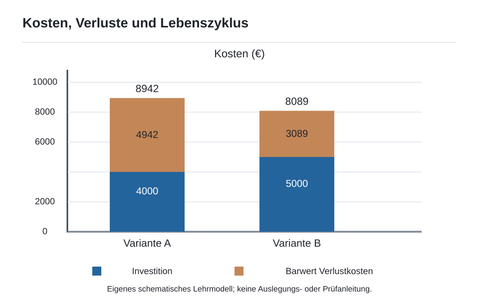

# M25-L4 – Kosten, Verluste und Lebenszyklus {#L4}

**Kursbereich:** M25 – Bachelor: Anlagenplanung und Energiewirtschaft

**Niveau:** Bachelor · Grundlagen

**Vorwissen:** [M25-L3](M25-L3.md).

**Lernziel:** Varianten mit gleicher Nutzfunktion durch Verlustenergie, abgezinste Kosten und Sensitivität vergleichen.

## Systemgrenze und Kostenarten {#S1}

Energiewirtschaftliche Bewertung verknüpft technische Leistung mit zeitabhängigen Kosten. Investition, Energie, Wartung, Ersatz, Ausfallkosten und Restwert gehören je nach Systemgrenze in die Rechnung. Leistungspreise können zusätzlich zu Arbeitspreisen anfallen. Varianten sind nur bei vergleichbarer Nutzfunktion, Lebensdauer und Zuverlässigkeitsanforderung sinnvoll vergleichbar. Die folgenden Preise und Leistungen sind frei gewählte Lehrdaten, keine Marktdaten.

## Rechenbeispiel: Verlustenergie {#S2}

Zwei fiktive Geräte erfüllen dieselbe Aufgabe. A kostet 4000 €, B 5000 €. Bei 4000 Betriebsstunden pro Jahr betragen ihre mittleren Verluste 0,8 beziehungsweise 0,5 kW. Die Verlustenergie beträgt 3200 beziehungsweise 2000 kWh pro Jahr; bei konstant 0,20 €/kWh entstehen 640 beziehungsweise 400 € jährliche Verlustkosten. Die Einsparung beträgt 240 €/Jahr. Ein einfacher statischer Rückfluss der Mehrinvestition von 1000 € dauert $1000/240\approx4,17$ Jahre. Übrige Kosten werden im Beispiel gleichgesetzt.

*Abbildung: Eigenes schematisches Lehrmodell; keine Auslegungs- oder Prüfanleitung.*

## Barwert über zehn Jahre {#S3}

Bei jährlichen Zahlungen am Jahresende ist der Barwertfaktor $F=(1-(1+r)^{-N})/r$ für $r>0$. Bei $r=0$ gilt $F=N$. Für zehn Jahre und 5 % realen Diskontsatz folgt $F\approx7,7217$. A verursacht $4000+640F\approx8942$ €, B $5000+400F\approx8089$ €. B spart rund 853 € Barwert; gemeinsame Kosten und gleiche Restwerte sind nicht enthalten. Konstante reale Preise erfordern einen konsistent realen Diskontsatz.

## Sensitivität und Entscheidung {#S4}

Der kritische konstante Energiepreis ergibt sich aus $1000/(1200F)\approx0,108$ €/kWh. Unterhalb davon lohnt sich B in diesem Modell nicht allein wegen der Verlustreduktion. Bei weniger Betriebsstunden, anderen Preisverläufen oder unterschiedlichen Wartungskosten verschiebt sich die Grenze. Technische und sicherheitsbezogene Mindestanforderungen sind unabhängig vom Kostenvergleich einzuhalten. Eine finanzielle Lebenszykluskostenanalyse ist keine vollständige Umwelt-Lebenszyklusanalyse.

## Selbstkontrolle {#S5}

### Aufgaben

1. Welche jährliche Energie spart B bei 2000 Betriebsstunden?
2. Wie lange ist dann die einfache Rückflusszeit bei 0,20 €/kWh?
3. Welcher Barwertfaktor ergibt sich ohne Diskontierung über zehn Jahre?

::: {.lc-solutions data-lc-section="S5"}
1. 600 kWh.
2. 1000/120 ≈ 8,33 Jahre.
3. 10.
:::

## Quellen {#S6}

- [US DOE – Building Life Cycle Cost Programs](https://www.energy.gov/cmei/femp/building-life-cycle-cost-programs) · HTML lines 31–39: discount factors and energy price escalation; US federal context · Zuletzt abgerufen: 2026-11-25 · Inhaltlich geprüft: 2026-11-25
- [US DOE – Purchasing Energy-Efficient Light Bulbs](https://www.energy.gov/cmei/femp/purchasing-energy-efficient-light-bulbs) · HTML lines 43–51, 64–66: discounted energy costs versus incremental investment; example methodology only · Zuletzt abgerufen: 2026-11-25 · Inhaltlich geprüft: 2026-11-25
