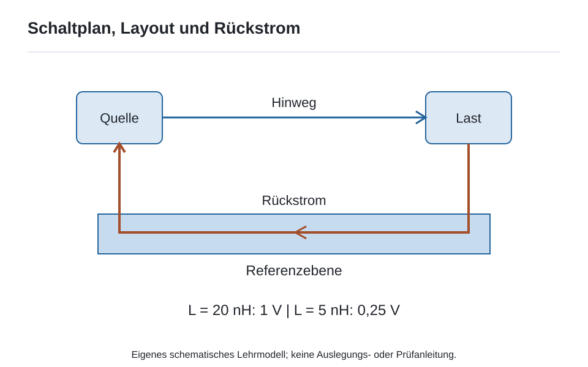

# M26-L1 – Schaltplan, Layout und Rückstrom {#L1}

**Kursbereich:** M26 – Bachelor: Elektronischer Geräte- und Leiterplattenentwurf

**Niveau:** Bachelor · Grundlagen

**Vorwissen:** [M25-L4](M25-L4.md).

**Lernziel:** Schaltungstopologie in eine physische Leiterplattenstruktur übertragen und parasitäre Effekte abschätzen.

## Vom Netz zur Geometrie {#S1}

Ein Schaltplan beschreibt elektrische Knoten und Bauteilfunktionen, nicht die räumliche Ausdehnung der Leiter. Im Layout werden Symbol-Pin und Gehäuse-Pad zugeordnet, Bauteile platziert und Verbindungen auf Kupferlagen geführt. Ein Lagenaufbau umfasst leitende Ebenen und Dielektrika; Durchkontaktierungen verbinden Lagen. Ein Netznamenvergleich erkennt manche Zuordnungsfehler, sagt jedoch nichts über Schleifeninduktivität oder Wärmeabfuhr aus.

## Rechenbeispiel: parasitäre Induktivität {#S2}

Eine Stromschleife habe im vereinfachten Modell $L=20$ nH. Steigt der Strom in 10 ns linear um 0,5 A, ergibt sich $u_L=L\,\mathrm{d}i/\mathrm{d}t=1$ V. Bei 5 nH sind es 0,25 V. Diese Spannung ist der induktive Spannungsanteil; ihre Polarität ergibt sich aus der gewählten Bezugsrichtung. Die Zahlen sind Modellwerte, keine gemessenen Leiterbahnparameter. Die Grafik zeigt eine nahe Referenzebene und den geschlossenen Strompfad.

*Abbildung: Eigenes schematisches Lehrmodell; keine Auslegungs- oder Prüfanleitung.*

## Rückstrom und Entkopplung {#S3}

Bei raschen Signalwechseln konzentriert sich der Rückstrom einer Leiterbahn über einer nahen, zusammenhängenden Referenzebene überwiegend in deren Nähe. Eine Unterbrechung kann den Rückweg verlängern. Große Stromschleifen erhöhen oft die magnetische Kopplung. Ein lokaler Abblockkondensator stellt Ladung für transiente Lasten bereit; Anschlussinduktivität, ESR und die tatsächliche Impedanz über der Frequenz begrenzen seine Wirksamkeit. Die Massefläche ist kein idealer Nullpotentialknoten.

## Entwurfsentscheidungen {#S4}

Lege Funktionsblöcke und Anschlüsse fest, identifiziere empfindliche Messknoten und starke Stromänderungen und prüfe für jedes Signal den Rückweg. Berücksichtige Gehäuse, mechanische Grenzen, Lagenaufbau und Herstellerdaten. Ein pauschales Auftrennen analoger und digitaler Masseflächen ist nicht automatisch sinnvoll. Designregeln prüfen modellierte Geometrie; die elektrische Funktion muss separat nachgewiesen werden. Das Lernmodell dient nicht der Freigabe einer realen Baugruppe.

## Selbstkontrolle {#S5}

### Aufgaben

1. Welche Spannung ergibt L=10 nH bei derselben Stromänderung?
2. Was ändert sich bei verdoppelter Anstiegszeit?
3. Warum ist der Rückweg Teil des Layoutentwurfs?

::: {.lc-solutions data-lc-section="S5"}
1. 0,5 V.
2. Der induktive Spannungsanteil halbiert sich bei linearer Stromrampe.
3. Er schließt den Stromkreis und beeinflusst Schleifenimpedanz und Kopplung.
:::

## Quellen {#S6}

- [Analog Devices – Mixed-Signal PCB Layout](https://www.analog.com/en/resources/analog-dialogue/articles/what-are-the-basic-guidelines-for-layout-design-of-mixed-signal-pcbs.html) · HTML 75–89: frequency-dependent return paths and reference planes; application guidance · Zuletzt abgerufen: 2026-11-25 · Inhaltlich geprüft: 2026-11-25
- [KiCad 9.0 – Getting Started](https://docs.kicad.org/9.0/en/getting_started_in_kicad/getting_started_in_kicad.html) · HTML 296–306, 384–406: stackup, constraints, DRC, fabrication and drill outputs · Zuletzt abgerufen: 2026-11-25 · Inhaltlich geprüft: 2026-11-25
