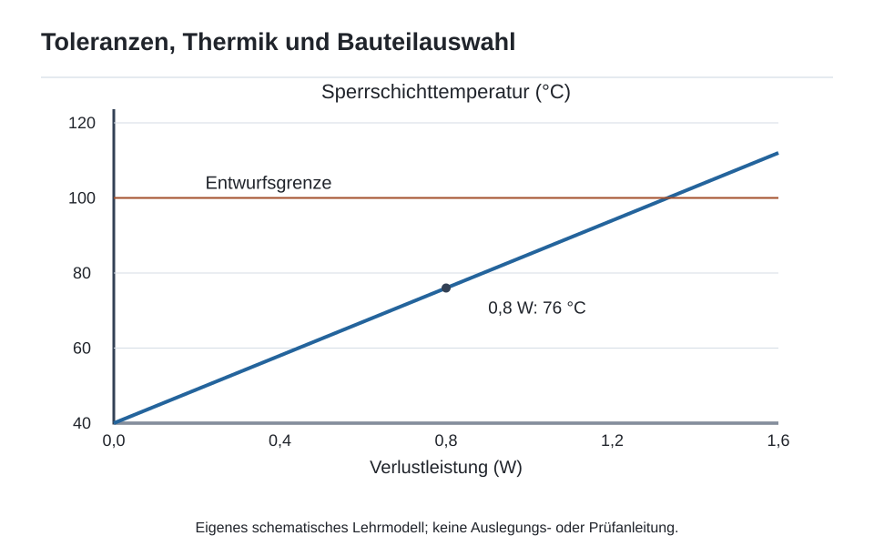

# M26-L2 – Toleranzen, Thermik und Bauteilauswahl {#L2}

**Kursbereich:** M26 – Bachelor: Elektronischer Geräte- und Leiterplattenentwurf

**Niveau:** Bachelor · Grundlagen

**Vorwissen:** [M26-L1](M26-L1.md).

**Lernziel:** Grenzwerte eines Spannungsteilers und stationäre Erwärmung mit expliziten Modellannahmen bestimmen.

## Bauteildaten interpretieren {#S1}

Nennwerte sind keine garantierten Istwerte. Toleranz, Temperaturkoeffizient, Alterung, Versorgung und Last verändern Schaltungsgrößen. Absolute Maximalwerte sind Belastungsgrenzen und keine empfohlenen Arbeitspunkte. Ein Entwurf benötigt funktionale Grenzwerte mit Reserven sowie ein Modell der Umgebungsbedingungen. Korrelationen können die möglichen Kombinationen von Abweichungen verändern.

## Rechenbeispiel: Spannungsteiler {#S2}

Ein unbelasteter Teiler besteht aus zwei Widerständen $R_1=R_2=10$ kΩ mit jeweils ±1 % Toleranz und exakt 5 V Eingangsspannung. $U_o=5R_2/(R_1+R_2)$ ergibt nominell 2,5 V. Das Minimum liegt bei $R_1=10,1$ kΩ und $R_2=9,9$ kΩ: 2,475 V. Das Maximum liegt bei vertauschten Grenzwerten: 2,525 V. Der Bereich beträgt ±25 mV; zusätzliche Eingangs- und Lastfehler sind nicht berücksichtigt. Bei einer Last von 10 kΩ parallel zu R2 sinkt die Nennspannung auf etwa 1,667 V.

*Abbildung: Eigenes schematisches Lehrmodell; keine Auslegungs- oder Prüfanleitung.*

## Stationäres thermisches Modell {#S3}

Ein Bauteil mit Verlustleistung $P=0,8$ W und angenommenem effektivem Wärmewiderstand $\theta_{JA}=45$ K/W erreicht bei $T_A=40$ °C im stationären linearen Modell $T_J=T_A+P\theta_{JA}=76$ °C. Eine fiktive Entwurfsgrenze von 100 °C lässt 24 K Reserve. Bei 1,4 W ergäben sich 103 °C. Das Modell bildet weder transiente Temperaturverläufe noch Nachbarerwärmung ab. Datenblattwerte für $\theta_{JA}$ hängen von Testplatine und Umgebung ab und dürfen nicht ungeprüft auf andere Aufbauten übertragen werden.

## Auswahl und Verifikation {#S4}

Prüfe die Grenzfälle der Funktion, Verlustleistung, Gehäuse, Verfügbarkeit und geeignete Kühlung gemeinsam. Eine Worst-Case-Rechnung betrachtet zulässige Extremkombinationen; statistische Verfahren benötigen Verteilungsannahmen und erfassen nicht automatisch alle Grenzfälle. Temperaturmessungen und ein zum Aufbau passendes thermisches Modell ergänzen die Rechnung. Alle Zahlen sind fiktive Lehrwerte, keine Bauteilfreigabe.

## Selbstkontrolle {#S5}

### Aufgaben

1. Wie hoch ist T_J bei 0,6 W unter denselben Annahmen?
2. Welche Verlustleistung erreicht modellhaft 100 °C?
3. Warum ist eine Nennwertsimulation kein Toleranznachweis?

::: {.lc-solutions data-lc-section="S5"}
1. 67 °C.
2. (100−40)/45 ≈ 1,33 W.
3. Sie untersucht keine zulässigen Parameterabweichungen.
:::

## Quellen {#S6}

- [Analog Devices – Resistor Divider Tool](https://www.analog.com/en/resources/analog-dialogue/articles/how-to-improve-power-supply-output-regulation-accuracy-with-the-ltpowercad-resistor-divider-tool.html) · HTML 66–67: resistor tolerance and output-voltage error · Zuletzt abgerufen: 2026-11-25 · Inhaltlich geprüft: 2026-11-25
- [Analog Devices – Absolute Maximum Ratings and Thermal Resistances](https://www.analog.com/en/resources/technical-articles/data-sheet-intricacies-absolute-maximum-ratings-and-thermal-resistances.html) · HTML 61–98: thermal resistance and dependence on test environment · Zuletzt abgerufen: 2026-11-25 · Inhaltlich geprüft: 2026-11-25
