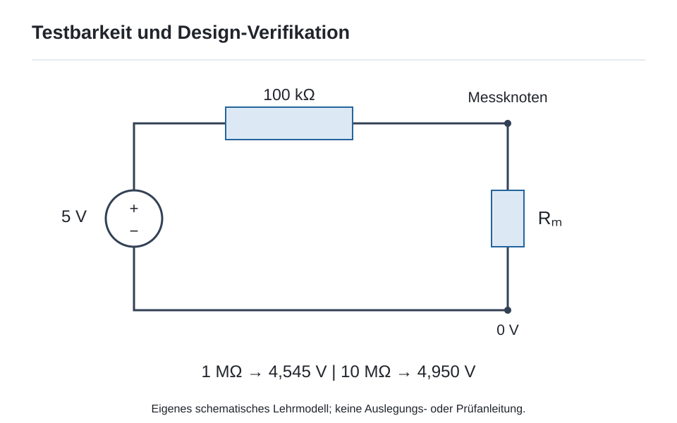

# M26-L3 – Testbarkeit und Design-Verifikation {#L3}

**Kursbereich:** M26 – Bachelor: Elektronischer Geräte- und Leiterplattenentwurf

**Niveau:** Bachelor · Grundlagen

**Vorwissen:** [M26-L2](M26-L2.md).

**Lernziel:** Prüfanforderungen ableiten und den Einfluss einer Messanordnung quantitativ untersuchen.

## Prüfbare Anforderungen {#S1}

Eine überprüfbare Anforderung nennt Messgröße, Betriebsbedingungen, Grenzbereich und Entscheidungskriterium. Verifikation untersucht die Übereinstimmung mit spezifizierten Anforderungen, Validierung die Eignung für den vorgesehenen Einsatz. Schaltplanprüfung, Layoutprüfung, Simulation und Prototypmessung liefern verschiedene Nachweise. Zugängliche Testpunkte, definierte Referenzknoten und reproduzierbare Konfigurationen erleichtern die Diagnose; ein Testpunkt kann aber zusätzliche Kapazität verursachen.

## Rechenbeispiel: Messbelastung {#S2}

Ein virtueller Messknoten hat die Leerlaufspannung 5 V und den Thevenin-Widerstand $R_s=100$ kΩ. Ein Messgerät mit $R_m=1$ MΩ zeigt im Gleichstrommodell $U_m=5R_m/(R_s+R_m)\approx4,545$ V; der relative Fehler ist −9,09 %. Mit 10 MΩ ergeben sich 4,950 V und −0,99 %. Wird im zweiten Fall eine Eingangskapazität von 15 pF angenommen, beträgt die Zeitkonstante $(R_s\parallel R_m)C\approx1,485$ µs; die −3-dB-Grenzfrequenz bezogen auf den Gleichspannungspegel liegt bei rund 107 kHz. Die Grafik zeigt den rein ohmschen Fall.

*Abbildung: Eigenes schematisches Lehrmodell; keine Auslegungs- oder Prüfanleitung.*

## Verifikationsmatrix {#S3}

Für einen fiktiven 2,5-V-Ausgang mit erlaubten ±50 mV sind Prüfungen bei minimaler und maximaler Versorgung, Temperatur und Last zu planen. Ein Messwert von 2,545 V bei erweiterter Unsicherheit 10 mV belegt die Einhaltung der oberen 2,550-V-Grenze nicht zweifelsfrei; eine konservative Intervallregel verlangt, dass das gesamte Unsicherheitsintervall im Toleranzbereich liegt. Akzeptanzregeln müssen vor der Prüfung vereinbart werden. Dieser Lernfall ist kein allgemeingültiges normatives Entscheidungsverfahren.

## Nachweis und Fehlerisolation {#S4}

Speichere Anforderungs-ID, Revision, Modell beziehungsweise Prüfumgebung, Messwert, Unsicherheit und Ergebnis. Unterscheide Fehler der Schaltung von Fehlern des Messaufbaus. Ein Design-Rule-Check kann geometrische Konflikte melden, aber keine vollständige Funktion bescheinigen. Praktische Tests an gefährlichen Spannungen sind nicht Teil dieser Selbstlernaufgabe; alle Beispiele werden analytisch betrachtet.

## Selbstkontrolle {#S5}

### Aufgaben

1. Was zeigt ein ideal unendlich hochohmiges DC-Messgerät?
2. Wie verändert sich die Zeitkonstante bei doppelter Eingangskapazität?
3. Warum muss die Akzeptanzregel vor der Prüfung feststehen?

::: {.lc-solutions data-lc-section="S5"}
1. 5 V.
2. Sie verdoppelt sich im selben Modell.
3. Damit die Ergebnisbewertung reproduzierbar und nicht nachträglich angepasst ist.
:::

## Quellen {#S6}

- [Tektronix – How Oscilloscope Probes Affect Your Measurement](https://www.tek.com/en/documents/application-note/how-oscilloscope-probes-affect-your-measurement) · HTML 281–302, 328–338: resistive and capacitive loading · Zuletzt abgerufen: 2026-11-25 · Inhaltlich geprüft: 2026-11-25
- [KiCad 9.0 – Getting Started](https://docs.kicad.org/9.0/en/getting_started_in_kicad/getting_started_in_kicad.html) · HTML 296–306, 384–406: stackup, constraints, DRC, fabrication and drill outputs · Zuletzt abgerufen: 2026-11-25 · Inhaltlich geprüft: 2026-11-25
