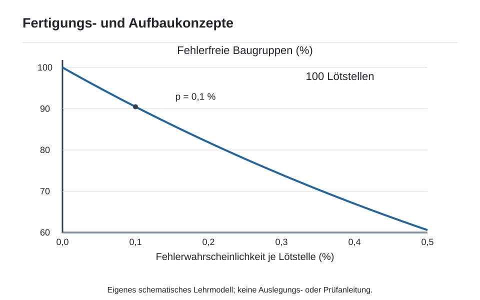

# M26-L4 – Fertigungs- und Aufbaukonzepte {#L4}

**Kursbereich:** M26 – Bachelor: Elektronischer Geräte- und Leiterplattenentwurf

**Niveau:** Bachelor · Grundlagen

**Vorwissen:** [M26-L3](M26-L3.md).

**Lernziel:** Fertigungsdaten und Bestückungsprozesse unterscheiden sowie einfache Ausbeutemodelle beurteilen.

## Leiterplattenfertigung und Bestückung {#S1}

Die unbestückte Leiterplatte bildet den mechanischen und elektrischen Träger. Kupferstrukturierung, Lagenverbindung, Bohrung, Oberflächenfinish und Lötstoppmaske gehören zur Fertigung. Die Bestückung bringt Bauteile auf die vorbereiteten Anschlussflächen; bei Oberflächenmontage folgen typischerweise Pastenauftrag, Platzierung und Reflow. Durchsteckmontage verwendet Anschlussdrähte in Bohrungen. Verfahren und Prozessfenster hängen von Material, Gehäuse und Fertigungsanlage ab.

## Rechenbeispiel: vereinfachte Ausbeute {#S2}

Eine virtuelle Baugruppe besitze 100 statistisch unabhängige Lötstellen mit identischer Fehlerwahrscheinlichkeit $p=0,001$. Die Wahrscheinlichkeit, dass keine Lötstelle fehlerhaft ist, beträgt $Y=(1-p)^{100}=0,999^{100}\approx0,9048$. Von 1000 Baugruppen wären im Erwartungswert etwa 905 ohne diesen Fehler. Bei $p=0,0002$ ergibt sich $Y\approx0,9802$. Das Modell beschreibt keine reale Fertigungsstatistik; gemeinsame Prozessursachen können die Unabhängigkeitsannahme verletzen und weitere Fehlerarten fehlen.

*Abbildung: Eigenes schematisches Lehrmodell; keine Auslegungs- oder Prüfanleitung.*

## Fertigungsgerechte Daten {#S3}

Ein revisionsgebundenes Übergabepaket enthält Lagen- und Konturdaten, Bohrdaten, Stackup, Stückliste, Bestückungskoordinaten und Montagehinweise. Gerber beschreibt Fertigungsbilder einzelner Lagen, nicht den vollständigen elektrischen Entwurf. Abgleich von Pin-1-Lage, Orientierung, Gehäuseabmessungen und Stücklistenvarianten verhindert systematische Fehler. Herstellergrenzen für Leiterbreiten, Abstände und Bohrungen müssen im Regelwerk des konkreten Designs berücksichtigt werden.

## Prozessprüfung und Rückkopplung {#S4}

Optische Inspektion erfasst sichtbare Geometrie und Bestückungsmerkmale; verdeckte Lötstellen können zusätzliche bildgebende oder elektrische Prüfmethoden benötigen. Elektrischer Funktionstest, Inspektion und Prozessdaten ergänzen sich, ersetzen einander aber nicht. Die Auswertung verknüpft Fehlerart, Prozessschritt und Korrekturmaßnahme. Reflowparameter und zulässige Defektgrenzen sind produktspezifisch; diese Lektion gibt keine Prozessfreigabe oder universelle Normgrenzwerte an.

## Selbstkontrolle {#S5}

### Aufgaben

1. Wie groß ist Y bei 50 Lötstellen und p=0,001?
2. Welche Annahme ist bei einem gemeinsamen Ofenfehler besonders fragwürdig?
3. Welche Daten ergänzen Gerber für die Bestückung?

::: {.lc-solutions data-lc-section="S5"}
1. 0,999^50 ≈ 95,12 %.
2. Die statistische Unabhängigkeit der Lötstellenfehler.
3. Unter anderem Stückliste, Koordinaten, Orientierung und Montagehinweise.
:::

## Quellen {#S6}

- [KiCad 9.0 – Getting Started](https://docs.kicad.org/9.0/en/getting_started_in_kicad/getting_started_in_kicad.html) · HTML 296–306, 384–406: stackup, constraints, DRC, fabrication and drill outputs · Zuletzt abgerufen: 2026-11-25 · Inhaltlich geprüft: 2026-11-25
- [Analog Devices – SMT Assembly and PCB Design Guidelines for QFN](https://www.analog.com/en/resources/app-notes/smt-assembly-and-pcb-design-guidelines-for-maxims-standard-wirebonded-quad-flatpack.html) · HTML 27–36, 77–105, 128–160: package-specific assembly, solder paste and inspection limitations · Zuletzt abgerufen: 2026-11-25 · Inhaltlich geprüft: 2026-11-25
