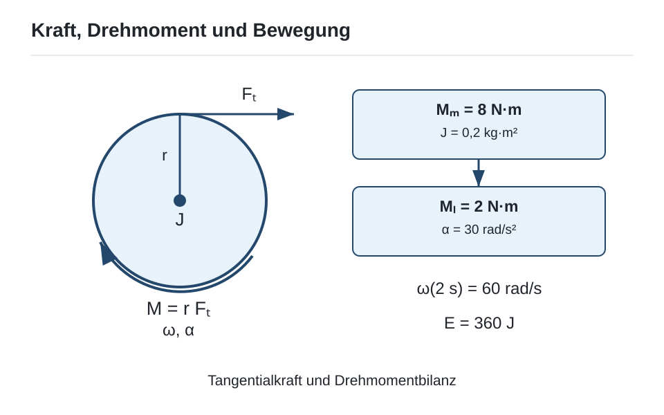

# M27-L1 – Kraft, Drehmoment und Bewegung {#L1}

**Kursbereich:** M27 – Bachelor: Mechanik und Wärme in elektrischen Systemen

**Niveau:** Bachelor · Grundlagen

**Vorwissen:** [M23-L5](M23-L5.md).

**Lernziel:** Kräfte und Drehmomente auf eine Welle bilanzieren, Beschleunigung, Energie und Leistung berechnen und eine Getriebeübersetzung beurteilen.

## Kraft und rotatorisches Ersatzmodell {#S1}

Eine elektrische Maschine liefert nicht unmittelbar eine Drehzahl, sondern ein elektromagnetisches Drehmoment. Ein starrer Körper mit fester Drehachse reagiert darauf gemäß seiner Massenträgheit. Bei einer tangentialen Kraft $F_t$ am Radius $r$ ist das Drehmoment $M=rF_t$. Allgemein gilt $\vec M=\vec r\times\vec F$. Eine radiale Kraft allein erzeugt bezüglich der Achse kein Drehmoment, belastet aber beispielsweise ein Lager.

Die Winkelgeschwindigkeit $\omega$ in rad/s hängt mit der Drehzahl $n$ in min⁻¹ über $\omega=2\pi n/60$ zusammen. Die Winkelbeschleunigung ist $\alpha=d\omega/dt$. Das Trägheitsmoment $J$ in kg·m² beschreibt die Massenverteilung um die Achse. Für eine homogene Vollscheibe gilt $J=mr^2/2$. Für starr gekoppelte Körper addieren sich die auf dieselbe Achse bezogenen Trägheitsmomente.

## Drehmomentbilanz und Rechenbeispiel {#S2}

Wähle die positive Drehrichtung und zähle alle Drehmomente mit Vorzeichen. Für Motor- und Lastmoment $M_m,M_L$ sowie viskose Reibung $b\omega$ ergibt sich bei positiver Drehung:

$$
J\frac{d\omega}{dt}=M_m-M_L-b\omega
$$

Ein fiktiver Antrieb hat $J=0{,}2\,\mathrm{kg\,m^2}$, $M_m=8\,\mathrm{N\,m}$ und $M_L=2\,\mathrm{N\,m}$. Zunächst vernachlässigen wir die Reibung. Dann ist $\alpha=30\,\mathrm{rad/s^2}$. Aus dem Stillstand erreicht der Antrieb nach 2 s eine Winkelgeschwindigkeit von 60 rad/s (rund 573 min⁻¹). Die rotatorische Energie beträgt $E=J\omega^2/2=360\,\mathrm J$.

*Abbildung: Eigenes schematisches Lehrmodell mit fiktiven Rechenwerten.*

## Arbeit, Leistung und Getriebe {#S3}

Die momentane mechanische Leistung an der Welle ist $P=M\omega$. Im Beispiel liefert der Motor am Ende 480 W, die Last nimmt 120 W auf und die Differenz 360 W erhöht in diesem Augenblick die Rotationsenergie. Während der gesamten Beschleunigung ist $\theta=\alpha t^2/2=60\,\mathrm{rad}$; die Nettoarbeit $6\,\mathrm{N\,m}\cdot60\,\mathrm{rad}=360\,\mathrm J$ bestätigt die Energiebilanz.

Bei einem idealen Getriebe mit $g=\omega_m/\omega_L$ und gleicher Drehrichtung wird eine Lastträgheit $J_L$ auf die Motorseite als $J_L/g^2$ abgebildet, weil die kinetische Energie gleich bleiben muss. Bei $g=4$ und $J_L=0{,}8\,\mathrm{kg\,m^2}$ ergibt sich $0{,}05\,\mathrm{kg\,m^2}$. Reale Getriebe haben Wirkungsgradverluste, Spiel und zusätzliche Trägheit.

## Modellgrenzen und Auslegung {#S4}

Bei konstantem Lastmoment und linearer Reibung nähert sich die Drehzahl einem Gleichgewicht, sofern der Motor ein konstantes Moment aufrechterhält und $b>0$ gilt. Ein Modell ohne Reibung und ohne Drehzahlbegrenzung sagt dagegen unbegrenzte Beschleunigung vorher. Das ist keine reale Antriebskennlinie. Drehmomentgrenzen, Stromgrenzen, Lastsprünge und zulässige Drehzahl müssen aus dem tatsächlichen System stammen. Elastische Wellen erfordern zusätzliche Zustände für Verdrehung und Schwingungen. Untersuche solche Effekte zunächst im Modell, nicht an ungeschützten rotierenden Anlagen.

## Selbstkontrolle {#S5}

### Aufgaben

1. Welche Beschleunigung entsteht bei J=0,3 kg·m² und einem Nettomoment von 6 N·m?
2. Welche Rotationsenergie besitzt diese Trägheit bei 40 rad/s?
3. Wie groß ist die auf die Motorseite bezogene Lastträgheit bei J_L=1,8 kg·m² und g=3?

::: {.lc-solutions data-lc-section="S5"}
1. 20 rad/s².
2. 240 J.
3. 0,2 kg·m².
:::

**Weiterlesen:** [M27-L2](M27-L2.md)

## Quellen {#S6}

- [OpenStax – University Physics Volume 1, § 10.7 Newton’s Second Law for Rotation](https://openstax.org/books/university-physics-volume-1/pages/10-7-newtons-second-law-for-rotation) · HTML 29–53: Drehmomentbilanz und Trägheitsmoment · Zuletzt abgerufen: 2026-11-25 · Inhaltlich geprüft: 2026-11-25
- [OpenStax – University Physics Volume 1, § 10.8 Work and Power for Rotational Motion](https://openstax.org/books/university-physics-volume-1/pages/10-8-work-and-power-for-rotational-motion) · HTML 53–86: Arbeit und Rotationsenergie · Zuletzt abgerufen: 2026-11-25 · Inhaltlich geprüft: 2026-11-25
