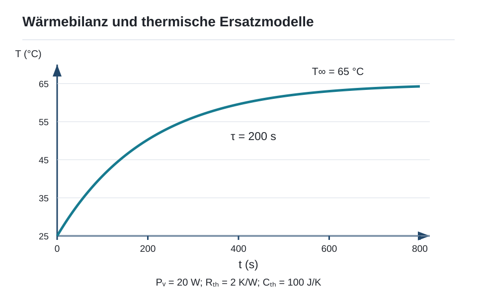

# M27-L2 – Wärmebilanz und thermische Ersatzmodelle {#L2}

**Kursbereich:** M27 – Bachelor: Mechanik und Wärme in elektrischen Systemen

**Niveau:** Bachelor · Grundlagen

**Vorwissen:** [M27-L1](M27-L1.md).

**Lernziel:** Verlustleistung, Wärmewiderstand und Wärmekapazität unterscheiden und ein thermisches Modell erster Ordnung lösen.

## Wärmequellen und Wärmewege {#S1}

Kupferverluste $I^2R$, magnetische Verluste, Schaltverluste und Reibung wandeln einen Teil der zugeführten Energie in innere Energie um. Die Verlustleistung $P_v$ ist eine Rate in Watt; die Temperatur allein ist keine Energie. Wärmeleitung durch Festkörper, Konvektion an Oberflächen und Strahlung übertragen Energie an die Umgebung. Für eine ebene Schicht mit Dicke $d$, Fläche $A$ und Wärmeleitfähigkeit $k$ ist der stationäre Wärmewiderstand $R_\mathrm{th}=d/(kA)$ in K/W, sofern der Wärmefluss eindimensional ist. Der Widerstand mehrerer serieller Schichten addiert sich; parallele Wärmewege addieren ihre Leitwerte. Kontaktwiderstände und Konvektion können dominieren.

## Thermisches RC-Modell und Rechenbeispiel {#S2}

Fasse eine näherungsweise isotherme Baugruppe durch die Temperatur $T$, die Wärmekapazität $C_\mathrm{th}=mc$ in J/K und einen konstanten Wärmewiderstand zur Umgebung $T_a$ zusammen. Die Bilanz lautet:

$$
C_\mathrm{th}\frac{dT}{dt}=P_v-\frac{T-T_a}{R_\mathrm{th}}
$$

Bei konstantem $P_v,T_a$ und Starttemperatur $T(0)=T_a$ ist die Lösung

$$
T(t)=T_a+P_vR_\mathrm{th}(1-e^{-t/\tau}),\qquad \tau=R_\mathrm{th}C_\mathrm{th}.
$$

Eine fiktive Baugruppe hat $P_v=20\,\mathrm W$, $R_\mathrm{th}=2\,\mathrm{K/W}$, $C_\mathrm{th}=100\,\mathrm{J/K}$ und $T_a=25\,{}^\circ\mathrm C$. Die Zeitkonstante beträgt 200 s, die stationäre Temperatur 65 °C. Nach 200 s beträgt sie rund 50,3 °C; nach 600 s etwa 63,0 °C.

*Abbildung: Eigenes schematisches Lehrmodell mit fiktiven Rechenwerten.*

## Parameter und Abkühlung {#S3}

Ein abgekühlter Körper hat im selben Modell nach Abschalten der Verluste den Verlauf $T(t)=T_a+(T_0-T_a)e^{-t/\tau}$. Startet die Abkühlung bei 65 °C, verbleibt nach 200 s ein Temperaturüberschuss von 14,7 K. Der Widerstand lässt sich aus stationärer Temperaturdifferenz und bekannter Verlustleistung bestimmen. Die Zeitkonstante folgt näherungsweise aus dem Verlauf einer Leistungsstufe; daraus ergibt sich $C_\mathrm{th}=\tau/R_\mathrm{th}$. Beide Parameter gehören zu einem definierten Betriebspunkt und einer festgelegten thermischen Grenze. Bei temperaturabhängigen Verlusten ist die Gleichung im Allgemeinen nicht mehr linear.

## Grenzen der thermischen Analogie {#S4}

Wärmekapazität speichert innere Energie; ein thermischer Widerstand beschreibt den Energiefluss, nicht elektrische Ladung. Eine Halbleitersperrschicht, das Gehäuse und ein Kühlkörper haben oft unterschiedliche Temperaturen. Dann benötigt man mehrere Knoten. Datenblatt-Wärmewiderstände gelten unter festgelegten Randbedingungen und dürfen nicht ohne Prüfung auf eine andere Montage übertragen werden. Das Lehrmodell liefert weder einen Berührungsschutz-Nachweis noch eine zulässige Bauteiltemperatur. Für eine reale Auslegung sind geeignete Messungen, Unsicherheit und die Spezifikation erforderlich.

## Selbstkontrolle {#S5}

### Aufgaben

1. Berechne bei R_th=3 K/W, C_th=80 J/K die Zeitkonstante.
2. Bei 10 W und 25 °C Umgebung: Welche stationäre Temperatur ergibt sich?
3. Wie hoch ist die Temperatur nach einer Zeitkonstante, ausgehend von 25 °C?

::: {.lc-solutions data-lc-section="S5"}
1. 240 s.
2. 55 °C.
3. Etwa 44,0 °C.
:::

**Weiterlesen:** [M27-L3](M27-L3.md)

## Quellen {#S6}

- [OpenStax – University Physics Volume 2, § 1.4 Heat Transfer, Specific Heat, and Calorimetry](https://openstax.org/books/university-physics-volume-2/pages/1-4-heat-transfer-specific-heat-and-calorimetry) · HTML 156–179: Energieerhaltung und Wärmekapazität · Zuletzt abgerufen: 2026-11-25 · Inhaltlich geprüft: 2026-11-25
- [OpenStax – University Physics Volume 2, § 1.6 Mechanisms of Heat Transfer](https://openstax.org/books/university-physics-volume-2/pages/1-6-mechanisms-of-heat-transfer) · HTML 55–65: stationäre Wärmeleitung · Zuletzt abgerufen: 2026-11-25 · Inhaltlich geprüft: 2026-11-25
