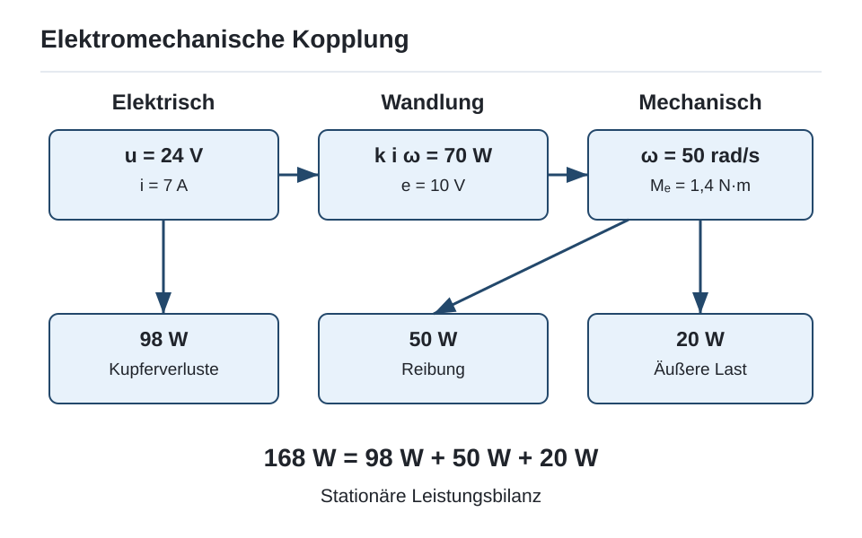

# M27-L3 – Elektromechanische Kopplung {#L3}

**Kursbereich:** M27 – Bachelor: Mechanik und Wärme in elektrischen Systemen

**Niveau:** Bachelor · Grundlagen

**Vorwissen:** [M27-L2](M27-L2.md).

**Lernziel:** Das elektrische und mechanische Teilmodell einer Gleichstrommaschine koppeln, stationäre Zustände und die Leistungsbilanz bestimmen.

## Zwei gekoppelte Energiedomänen {#S1}

Ein idealisierter Gleichstrommotor mit konstantem Erregerfluss besitzt eine Ankerinduktivität $L$, den Ankerwiderstand $R$ und eine mechanische Trägheit $J$. Der Ankerstrom $i$ erzeugt ein Drehmoment $M_e=k_t i$. Die Bewegung induziert die Gegen-EMK $e=k_e\omega$, welche im motorischen Betrieb der angelegten Spannung entgegenwirkt. Die Konstanten sind bei konsistenten SI-Einheiten und ideal verlustfreier Wandlung numerisch gleich ($k_t=k_e=k$), aber ihre Einheit wird jeweils der elektrischen oder mechanischen Gleichung entsprechend geschrieben.

## Differentialgleichungen und stationärer Zustand {#S2}

Für eine feste positive Drehrichtung, lineare Reibung $b\omega$ und vorzeichenbehaftetes Lastmoment $M_L$ gelten:

$$
L\frac{di}{dt}=u-Ri-k\omega
$$

$$
J\frac{d\omega}{dt}=ki-b\omega-M_L
$$

Die Zustände $i$ und $\omega$ können bei endlicher Induktivität und Trägheit nicht sprunghaft wechseln. Im stationären Fall verschwinden ihre Ableitungen. Elimination von $i$ liefert $\omega=(ku-RM_L)/(Rb+k^2)$ und danach $i=(u-k\omega)/R$. Für ein fiktives Beispiel seien $u=24\,\mathrm V$, $R=2\,\Omega$, $k=0{,}2$, $b=0{,}02\,\mathrm{N\,m\,s/rad}$ und $M_L=0{,}4\,\mathrm{N\,m}$. Dann ergeben sich 50 rad/s, 7 A und $M_e=1{,}4\,\mathrm{N\,m}$; das Reibungsmoment beträgt 1 N·m.

*Abbildung: Eigenes schematisches Lehrmodell mit fiktiven Rechenwerten.*

## Leistungsbilanz und Rückwirkung {#S3}

Multipliziere die elektrische Gleichung mit $i$ und die mechanische mit $\omega$. Die Kopplungsleistung $ki\omega$ fällt bei der Addition der Bilanzen weg:

$$
ui=Ri^2+b\omega^2+M_L\omega+\frac{d}{dt}\left(\frac{Li^2}{2}+\frac{J\omega^2}{2}\right).
$$

Im Beispiel werden 168 W aufgenommen. 98 W entfallen auf den Ankerwiderstand, 50 W auf die modellierte Reibung und 20 W auf die äußere Last. Steigt das Lastmoment, fällt bei unveränderter Spannung im stationären Modell die Drehzahl; die Gegen-EMK sinkt und der Strom steigt. Bei negativem $ki\omega$ fließt Wandlungsleistung in die Gegenrichtung. Ob Energie tatsächlich in die Quelle zurückgespeist werden kann, hängt von der angeschlossenen Leistungselektronik ab.

## Dynamik und Grenzen {#S4}

Für $L=0{,}1\,\mathrm H$, $J=0{,}05\,\mathrm{kg\,m^2}$ und die oben definierten Parameter besitzt das homogene lineare Modell die Systemmatrix $A=[[-20,-2],[4,-0{,}4]]$ in den Zustandskoordinaten Strom und Winkelgeschwindigkeit. Die charakteristische Gleichung ist $s^2+20{,}4s+16=0$; beide Eigenwerte sind negativ. Das begründet die asymptotische Stabilität dieses festen Modellbetriebspunkts, nicht die Sicherheit einer realen Maschine. Sättigung, temperaturabhängige Widerstände, Umrichtergrenzen, Kommutierung und elastische Lasten fehlen. Ein blockierter Motor kann trotz null mechanischer Ausgangsleistung hohe Verluste verursachen. Die Modellrechnungen sind rein virtuell.

## Selbstkontrolle {#S5}

### Aufgaben

1. Wie groß sind Gegen-EMK und Drehmoment bei 50 rad/s, 7 A und k=0,2?
2. Welche Aufnahmeleistung und welche Kupferverluste entstehen bei 24 V, 7 A und 2 Ω?
3. Welche stationäre Drehzahl ergibt sich im Beispiel bei M_L=0,8 N·m?

::: {.lc-solutions data-lc-section="S5"}
1. 10 V und 1,4 N·m.
2. 168 W und 98 W.
3. 40 rad/s (Strom 8 A).
:::

## Quellen {#S6}

- [MathWorks – Linear (LTI) Models](https://www.mathworks.com/help/control/getstart/linear-lti-models.html) · HTML 40–85: idealisierte Gleichstrommotor-Gleichungen und Zustandsraum · Zuletzt abgerufen: 2026-11-25 · Inhaltlich geprüft: 2026-11-25
- [OpenStax – University Physics Volume 2, § 13.6 Electric Generators and Back Emf](https://openstax.org/books/university-physics-volume-2/pages/13-6-electric-generators-and-back-emf) · HTML 103–121: Gegen-EMK, Motorlast und Verluste · Zuletzt abgerufen: 2026-11-25 · Inhaltlich geprüft: 2026-11-25
