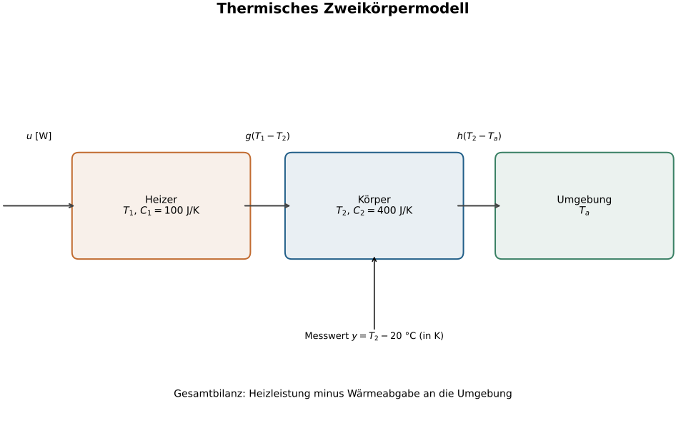

# M28-L1 – Vom Experiment zum Zustandsmodell: Differentialgleichungen, Arbeitspunkt und Linearisierung {#L1}

**Kursbereich:** M28 – Bachelor–Master-Brücke: Übergang Regelung und Zustandsraum

**Niveau:** Bachelor · Bachelor–Master-Brücke

**Vorwissen:** [M12-L2](M12-L2.md), [M13-L1](M13-L1.md), [M2-L2](M2-L2.md).

**Lernziel:** Aus einer physikalischen Bilanz ein Zustandsmodell ableiten und einen Arbeitspunkt linearisieren.

## Diagnostischer Selbsttest {#S1}

Bearbeite die Fragen zunächst ohne Hilfsmittel. Prüfe erst danach die Antworten.

1. Welche Einheit besitzt eine Wärmekapazität? **Antwort:** J/K.
2. Wie bestimmt man einen stationären Zustand aus $\dot x=f(x,u)$? **Antwort:** $f(x_0,u_0)=0$ lösen.
3. Was bedeutet ein negativer reeller Eigenwert? **Antwort:** Die zugehörige freie Mode klingt exponentiell ab.
4. Ist die Anzahl der Messkanäle zwingend gleich der Anzahl der Zustände? **Antwort:** Nein.

Wer die Bilanz oder Eigenwertrechnung noch nicht sicher beherrscht, wiederholt [M12-L2](M12-L2.md) und die linearen Gleichungssysteme in [M2-L2](M2-L2.md). Die Brücke dient der Standortbestimmung, nicht der erstmaligen Einführung aller Begriffe.

## Vom Aufbau zur Energiebilanz {#S2}

Ein elektrischer Heizer mit Temperatur $T_1$ überträgt Wärme an einen Körper mit Temperatur $T_2$. Der Körper gibt Wärme an die Umgebung $T_a$ ab. Beide Temperaturen werden jeweils als räumlich homogen angenommen. Die Heizleistung $u$ ist bereits die in Wärme umgesetzte Leistung. Mit Wärmekapazitäten $C_1,C_2$ und Leitwerten $g,h$ gilt

$$C_1\dot T_1=u-g(T_1-T_2),\qquad C_2\dot T_2=g(T_1-T_2)-h(T_2-T_a).$$

Durch Addition ergibt sich $C_1\dot T_1+C_2\dot T_2=u-h(T_2-T_a)$. Der innere Wärmefluss hebt sich auf. Dies ist ein unabhängiger Strukturtest. Für $C_1=100$ J/K, $C_2=400$ J/K, $g=2$ W/K und $h=1$ W/K besitzt der Lehrversuch zwei Speicher. Ein einzelner gemessener Temperaturwert reicht nicht aus, um die weitere Entwicklung ohne zusätzliche Anfangsinformation vorherzusagen.

{alt="Wärmefluss zwischen Heizer, Körper und Umgebung; Zustandsgrößen und Leistungspfad."}

## Zustandsdarstellung und Arbeitspunkt {#S3}

Temperaturdifferenzen in K gegenüber 20 °C seien $x_1,x_2$; die Umgebung wird durch $d=T_a-20\,^{\circ}\mathrm C$ beschrieben. Der Ausgang ist $y=x_2$. Dann gilt

$$\dot x=Ax+Bu+Ed,\quad y=Cx,$$

$$A=\begin{pmatrix}-.02&.02\\.005&-.0075\end{pmatrix},\quad B=\begin{pmatrix}.01\\0\end{pmatrix},\quad E=\begin{pmatrix}0\\.0025\end{pmatrix},\quad C=\begin{pmatrix}0&1\end{pmatrix}.$$

$A$ hat die Einheit 1/s; $B$ bildet W auf K/s ab. Die Ausgangsmatrix ist hier dimensionslos. Bei $u_0=10$ W, $d_0=0$ ist $x_{20}=10$ K und $x_{10}=15$ K. Die absoluten Temperaturen betragen damit 30 und 35 °C. Im Gleichgewicht ist der Wärmefluss durch jeden Leitwert gleich der Heizleistung.

## Nichtlineare Erweiterung und lokale Linearisierung {#S4}

Strahlungsverluste können einen Term $q_{rad}=k(T_2^4-T_a^4)$ ergänzen, wobei beide Temperaturen absolute Kelvinwerte und $k$ in W/K$^4$ angegeben sind. Um einen stationären Punkt $z_0,v_0$ gilt für ein allgemeines Modell $\dot z=f(z,v)$ und $y=m(z,v)$ näherungsweise

$$\delta\dot z=A\delta z+B\delta v,\quad A=\left.\frac{\partial f}{\partial z}\right|_0,\quad B=\left.\frac{\partial f}{\partial v}\right|_0,$$

und entsprechend $\delta y=C\delta z+D\delta v$. Der Strahlungsterm besitzt am Arbeitspunkt den differentiellen Leitwert $4kT_{20}^3$. Für $k=2\cdot10^{-9}$ W/K$^4$ und $T_{20}=303{,}15$ K beträgt er rund 0,223 W/K. Er ist nicht mit dem Quotienten aus Gesamtwärmestrom und absoluter Temperatur identisch. Große Temperaturänderungen oder wechselnde Wärmeübergänge können eine neue Linearisierung verlangen. Der Arbeitspunkt ist aus dem erweiterten Modell neu zu berechnen; der zuvor berechnete Punkt gilt nur für das lineare Modell.

Im Experiment helfen getrennte Leistungsstufen und Temperaturverläufe, Parameter zu schätzen. Eine gute Anpassung an einen Verlauf beweist keine eindeutigen Parameter. Eine zusätzliche Heizertemperaturmessung oder andere Eingangsanregung kann die Unterscheidung verbessern.

## Übungen mit Lösungen {#S5}

1. Bestimme beide stationären Temperaturdifferenzen für $u=8$ W und $d=-2$ K. **Lösung:** $x_2=6$ K, $x_1=10$ K.
2. Welche Auswirkung hat ein verdoppeltes $C_2$ auf den stationären Arbeitspunkt? **Lösung:** Keine bei unveränderten Leitwerten; die Dynamik ändert sich.
3. Wie ändert sich die Ableitung des Strahlungsverlusts bei verdoppelter absoluter Temperatur? **Lösung:** Faktor acht.
4. Warum ist eine räumlich homogene Temperatur eine Annahme? **Lösung:** Reale Körper besitzen Gradienten und weitere Speicher; die Modellordnung muss zur Aufgabe passen.

## Quellen {#S6}

- [Åström und Murray – Feedback Systems, 2. Auflage, Kapitel 2, 5–12](https://fbswiki.org/wiki/index.php/Feedback_Systems%3A_An_Introduction_for_Scientists_and_Engineers) · Kapitelübersicht 3 und 6: Zustandsmodelle und Linearisierung; Kapitel-PDFs nicht geprüft. · Zuletzt abgerufen: 2026-11-25
- [MIT OpenCourseWare – 16.30 Feedback Control Systems](https://ocw.mit.edu/courses/16-30-feedback-control-systems-fall-2010/) · Vorlesungen 5–7: Einführung und Eigenschaften von Zustandsmodellen; verlinkte Skripte nicht geöffnet. · Zuletzt abgerufen: 2026-11-25
