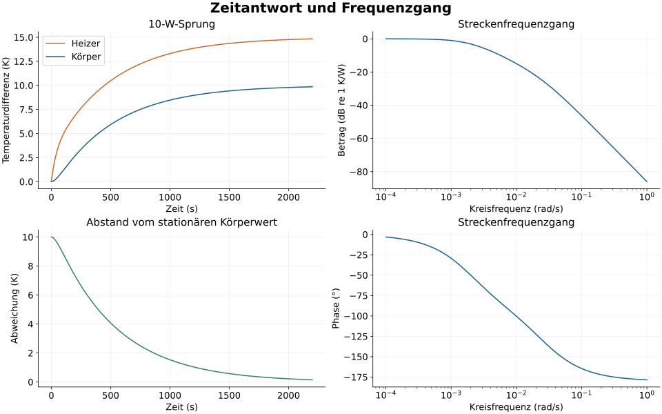

# M28-L2 – Systemantwort und Stabilität: Laplace-Transformation, Polstellen und Frequenzgang {#L2}

**Kursbereich:** M28 – Bachelor–Master-Brücke: Übergang Regelung und Zustandsraum

**Niveau:** Bachelor · Bachelor–Master-Brücke

**Vorwissen:** [M28-L1](M28-L1.md), [M5-L2](M5-L2.md).

**Lernziel:** Stabilität und Zeitverhalten aus Eigenwerten und Übertragungsfunktion begründen.

## Freie und erzwungene Bewegung {#S1}

Für das zeitinvariante lineare Modell aus [M28-L1](M28-L1.md) folgt bei $d=0$

$$x(t)=e^{At}x(0)+\int_0^t e^{A(t-\tau)}Bu(\tau)\,d\tau.$$

Der erste Anteil beschreibt die Anfangszustände. Der zweite beschreibt die Wirkung des Eingangs. Asymptotische interne Stabilität verlangt bei einem endlichdimensionalen kontinuierlichen LTI-System, dass alle Eigenwerte von $A$ einen strikt negativen Realteil besitzen. Beim Modell sind sie etwa $-0{,}025542$ und $-0{,}001958$ s$^{-1}$. Ihre Zeitkonstanten liegen bei 39,15 und 510,85 s. Die langsamere Mode ist wesentlich für das Ausregeln des Körpers.

## Laplace-Transformation und Übertragungsfunktion {#S2}

Aus $sX-x(0)=AX+BU$ folgt bei verschwindenden Anfangszuständen

$$G(s)=C(sI-A)^{-1}B+D=\frac{0{,}00005}{s^2+0{,}0275s+0{,}00005}.$$

$G(0)=1$ K/W. Der Umgebungseinfluss besitzt die eigene Übertragungsfunktion

$$G_d(s)=\frac{0{,}0025(s+0{,}02)}{s^2+0{,}0275s+0{,}00005},$$

und $G_d(0)=1$ K/K. Die Nullstelle des zweiten Pfads verändert dessen Zeitverhalten. Die Ausgangsantwort auf eine Leistung $U_0$ als Sprung ist $Y(s)=G(s)U_0/s$. Das Modell hat zwei reelle, negative Pole ohne Pol-Nullstellen-Kürzung im Leistungspfad. In anderen Realisierungen können verborgene instabile Zustände trotz unauffälliger Übertragungsfunktion auftreten; interne Stabilität ist deshalb getrennt zu prüfen.

## Frequenzgang {#S3}

Für eine eingeschwungene sinusförmige Leistung mit Kreisfrequenz $\omega$ erhält man $G(j\omega)$. Der Amplitudenfaktor und die Phase sind

$$|G(j\omega)|=\frac{0{,}00005}{\sqrt{(0{,}00005-\omega^2)^2+(0{,}0275\omega)^2}},\quad \varphi=-\operatorname{atan2}(0{,}0275\omega,0{,}00005-\omega^2).$$

Ein Bode-Diagramm verwendet logarithmische Frequenz und $20\log_{10}(|G|/G_{ref})$ mit $G_{ref}=1$ K/W. Bei hohen Frequenzen fällt der Betrag asymptotisch um 40 dB pro Dekade, die Phase nähert sich -180°. Bei $\omega=0{,}01$ rad/s beträgt der Betrag etwa 0,179 K/W und die Phase -100,3°. Die zugehörige Frequenz ist $f=\omega/(2\pi)$, nicht $\omega$ Hz.

{alt="Sprungantwort beider Temperaturen, Amplituden- und Phasengang der Strecke."}

## Stabilitätsbegriffe und Grenzen {#S4}

Ein stabiler Körper kann bei jedem zulässigen konstanten Eingang einen anderen Gleichgewichtswert annehmen. Stabilität ist nicht gleich Sollwerttreue. BIBO-Stabilität (beschränkter Eingang, beschränkter Ausgang) bezieht sich auf das Ein-/Ausgangsverhalten. Bei einer minimalen rationalen Realisierung ohne instabile verborgene Moden stimmen beide Stabilitätsaussagen überein. Ein reiner Integrator hat Pol null: Eine konstante Eingangsstufe erzeugt eine unbegrenzt anwachsende Antwort.

Die langsame thermische Mode verlangt eine hinreichend lange Messzeit. Eine Messung über nur 100 s zeigt einen Übergang, aber kaum den stationären Verstärkungsfaktor. Die Frequenzantwort gilt für die lineare Strecke und eine sinusförmige Anregung um einen zulässigen Arbeitspunkt;  negative absolute Heizleistung ist nicht verfügbar.

## Übungen mit Lösungen {#S5}

1. Bestimme den stationären Ausgang bei 6 W Leistung und $d=-1$ K. **Lösung:** 5 K.
2. Was passiert bei einem Pol $+0{,}002$ s$^{-1}$? **Lösung:** Eine freie Mode wächst mit Zeitkonstante 500 s.
3. Wie stark fällt ein idealer Zweipol asymptotisch bei einer Frequenzverzehnfachung? **Lösung:** Faktor 100 im Betrag bzw. -40 dB.
4. Berechne näherungsweise die Zeit, bis die langsame Mode auf 2 % gefallen ist. **Lösung:** $-\ln(0{,}02)/0{,}001958\approx1998$ s; das ist keine exakte Einschwingzeit der vollständigen Antwort.

## Quellen {#S6}

- [Åström und Murray – Feedback Systems, 2. Auflage, Kapitel 2, 5–12](https://fbswiki.org/wiki/index.php/Feedback_Systems%3A_An_Introduction_for_Scientists_and_Engineers) · Kapitelübersicht 5, 9 und 10: Stabilität, Laplace-Transformation und Frequenzanalyse. · Zuletzt abgerufen: 2026-11-25
- [MIT OpenCourseWare – 16.30 Feedback Control Systems](https://ocw.mit.edu/courses/16-30-feedback-control-systems-fall-2010/) · Vorlesungen 2–4, 6 und 8: Pole, Antwortverfahren und Übertragungsmodelle; verlinkte Skripte nicht geöffnet. · Zuletzt abgerufen: 2026-11-25
