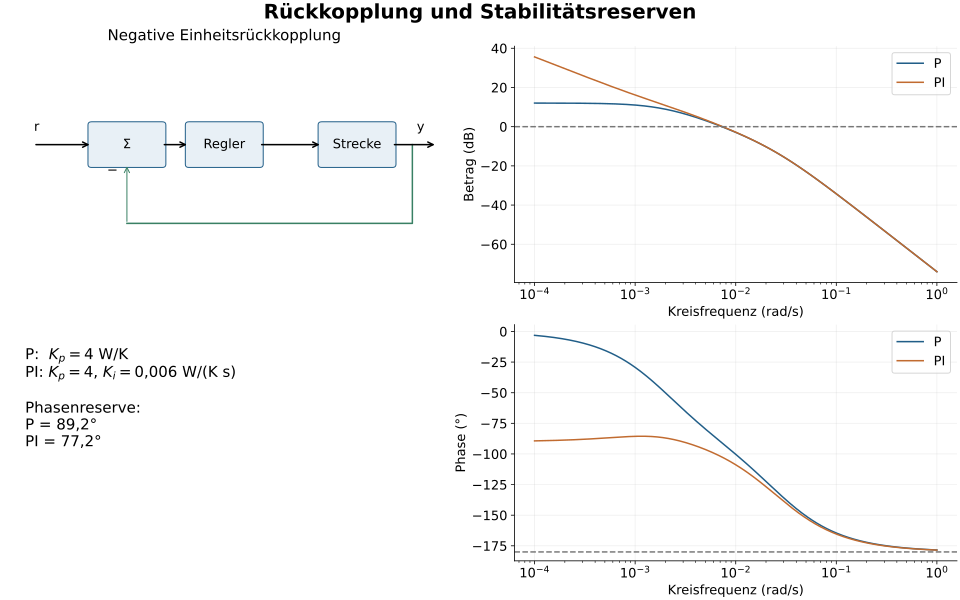

# M28-L3 – Rückkopplung und Reglerentwurf: PID, Stabilitätsreserven und Nachführung {#L3}

**Kursbereich:** M28 – Bachelor–Master-Brücke: Übergang Regelung und Zustandsraum

**Niveau:** Bachelor · Bachelor–Master-Brücke

**Vorwissen:** [M13-L2](M13-L2.md), [M28-L2](M28-L2.md).

**Lernziel:** P-, PI- und PID-Strukturen unterscheiden und Nachführung sowie Phasenreserve bewerten.

## Regelkreis und Fehler {#S1}

Der Sollwert $r$ und der gemessene Ausgang $y$ bilden die Abweichung $e=r-y$. Bei negativer Einheitsrückkopplung, linearer Strecke $G$ und Regler $R$ ist die Schleifenübertragung $L=RG$. Die geschlossene Sollwertübertragung lautet

$$T(s)=\frac{L(s)}{1+L(s)},\qquad S(s)=\frac{1}{1+L(s)},\qquad T+S=1.$$

Ein am Streckenausgang addierter Störeinfluss wirkt über $S$, der Umgebungseingang des Temperaturmodells dagegen über $SG_d$. Sensorrauschen wirkt bei idealer Messrückführung auf die tatsächliche Temperatur über $-T$. Diese Gleichungen sind nur im linearen, nicht gesättigten Betrieb gültig. Vorsteuerung kann zusätzlich die nominale stationäre Leistung bereitstellen.

## P, PI und PID {#S2}

Eine übliche parallele Struktur mit realisierbarer D-Filterung ist

$$R(s)=K_p+\frac{K_i}{s}+\frac{K_ds}{1+\tau_f s},\qquad \tau_f>0.$$

$K_p$ hat hier die Einheit W/K, $K_i$ W/(K s), $K_d$ W s/K. P reagiert unmittelbar, I addiert länger anhaltende Fehler, D kann auf schnelle Änderungen reagieren. D auf den Messwert statt auf den Sollwert vermeidet den Ableitungsstoß bei einem Sollwertsprung; dann ist dies eine Struktur mit getrennten Sollwert- und Rückführungspfaden. D verstärkt hochfrequentes Rauschen, weshalb die Filterung wichtig ist.

Für das thermische Modell wird zunächst $K_p=4$ W/K gewählt. Mit Vorsteuerung $u_{ff}=10$ W bei $r=10$ K gilt im stationären Modell $y=u+d$. Somit folgt bei $d=-3$ K der bleibende Fehler $e=3/(1+4)=0{,}6$ K. Bei einem stabilen PI-Regler mit $K_i=0{,}006$ W/(K s) verschwindet der stationäre Fehler bei konstanter Störung, sofern genügend Heizleistung verfügbar ist. Darauf beruht die Sollwertnachführung in der Arbeitsprobe.

## Stabilität und Reserven {#S3}

Beim P-Regler ist der Nenner des geschlossenen Kreises $s^2+0{,}0275s+0{,}00025$. Beim PI-Regler erhält man

$$s^3+0{,}0275s^2+0{,}00025s+0{,}0000003.$$

Für das kubische Polynom $s^3+a_2s^2+a_1s+a_0$ verlangt das Routh-Hurwitz-Kriterium positive Koeffizienten und $a_2a_1>a_0$. Hier ist das Produkt $6{,}875\cdot10^{-6}$ größer als $3\cdot10^{-7}$. Die Pole liegen bei etwa $-0{,}01305\pm j0{,}00656$ und $-0{,}001406$ s$^{-1}$.

Bei der Durchtrittsfrequenz $|L(j\omega_c)|=1$ ist die Phasenreserve $180^\circ+\arg L(j\omega_c)$ (Phase um -180° stetig geführt). Für den P-Regler folgt $\omega_c\approx0{,}007272$ rad/s und 89,2°, für den PI-Regler $0{,}007418$ rad/s und 77,2°. Die Verstärkungsreserve beschreibt die relative Verstärkungsänderung am -180°-Phasendurchtritt. Beide Modelle haben keinen endlichen solchen Durchtritt bei positiver Frequenz; die idealisierte Verstärkungsreserve ist unendlich. Das ist kein Nachweis für beliebige reale Verzögerungen oder beliebige Reglermodelle. Bei mehreren Durchtritten oder offenen instabilen Polen sind vollständige Nyquist- und interne Stabilitätsanalysen erforderlich.

{alt="Blockbild eines Temperaturregelkreises sowie Bode-Gänge der offenen P- und PI-Regelkreise."}

## Sättigung und Anti-Windup {#S4}

Der Heizer kann nur $0\le u\le30$ W liefern. Während eines großen Fehlers ist die gewünschte Leistung möglicherweise größer. Ohne Begrenzung des Integratorzustands wächst dieser trotz unveränderter realer Stellgröße weiter (Windup). Eine einfache bedingte Integration lässt den Integrator nur weiterlaufen, wenn der unbeschränkte Stellwert im zulässigen Bereich liegt oder das Fehlerzeichen den Stellwert zurück in den Bereich bewegt. Die Abtastlogik in [M28-L5](M28-L5.md) verwendet diese Variante.

Bei einem nicht erreichbaren Sollwert ist kein Regler in der Lage, die physikalische Leistungsgrenze aufzuheben. Die Auslegung verbindet deshalb Stabilität, Stellaufwand, stationäre Abweichung, Überschwingen und Robustheit. Die angegebenen Reserven betreffen ausschließlich den kontinuierlichen nominalen Kleinsignalkreis.

## Übungen mit Lösungen {#S5}

1. Welcher stationäre Fehler bleibt mit P-Regler, 10 W Vorsteuerung und $d=-5$ K? **Lösung:** 1 K.
2. Ist eine Tustin- oder Euler-Diskretisierung bei beliebig großem Abtastschritt äquivalent zum kontinuierlichen Regler? **Lösung:** Nein, Abtastung und Halteglied verändern die Dynamik.
3. Prüfe $K_i=0{,}2$ bei $K_p=4$. **Lösung:** $a_0=10^{-5}$, größer als $a_2a_1$; der ideale kontinuierliche Kreis ist instabil.
4. Welcher stationäre Stellwert ist bei $r=10$ K und $d=-3$ K nötig? **Lösung:** 13 W im nominalen Modell.

## Quellen {#S6}

- [Åström und Murray – Feedback Systems, 2. Auflage, Kapitel 2, 5–12](https://fbswiki.org/wiki/index.php/Feedback_Systems%3A_An_Introduction_for_Scientists_and_Engineers) · Kapitelübersicht 10 und 11: Stabilitätsreserven und PID-Regler. · Zuletzt abgerufen: 2026-11-25
- [MIT OpenCourseWare – 16.30 Feedback Control Systems](https://ocw.mit.edu/courses/16-30-feedback-control-systems-fall-2010/) · Vorlesungen 2–4: Wurzelortskurve und Reglerentwurf im Frequenzbereich; PID-Details erfordern separaten Beleg; Skripte nicht geöffnet. · Zuletzt abgerufen: 2026-11-25
