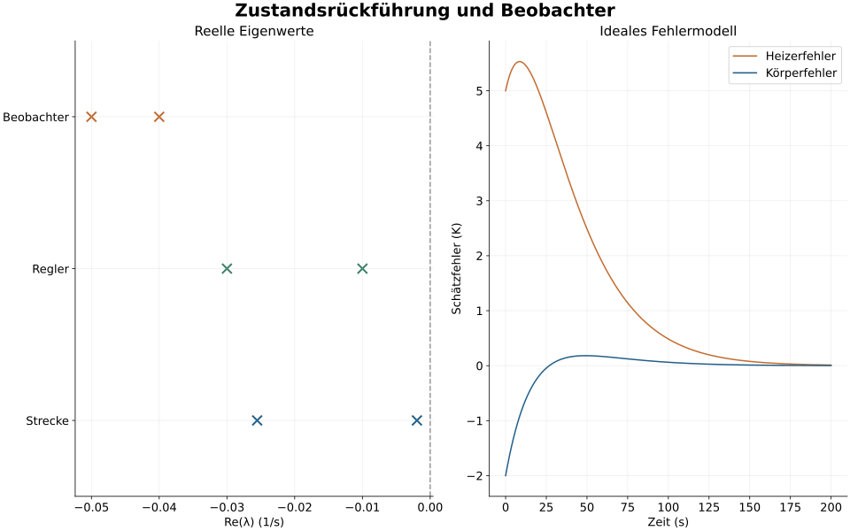

# M28-L4 – Steuerbarkeit und Beobachtbarkeit: Zustandsrückführung und Beobachter {#L4}

**Kursbereich:** M28 – Bachelor–Master-Brücke: Übergang Regelung und Zustandsraum

**Niveau:** Bachelor · Bachelor–Master-Brücke

**Vorwissen:** [M28-L1](M28-L1.md) bis [M28-L3](M28-L3.md).

**Lernziel:** Rangtests ausführen, Pole per Zustandsrückführung vorgeben und einen Beobachter begründen.

## Steuerbarkeit {#S1}

Für $\dot x=Ax+Bu$ mit $n$ Zuständen lautet die Kalman-Steuerbarkeitsmatrix

$$\mathcal R=[B\ AB\ \cdots\ A^{n-1}B].$$

Sie besitzt genau dann vollen Zeilenrang, wenn das kontinuierliche LTI-System ohne Stellgrenzen vollständig steuerbar ist. Für das Zweikörpermodell gilt

$$\mathcal R=\begin{pmatrix}0{,}01&-0{,}0002\\0&0{,}00005\end{pmatrix},\qquad \det\mathcal R=5\cdot10^{-7}.$$

Damit ist die Matrix regulär. Bei getrennten Körpern ($g=0$) geht diese Eigenschaft verloren, solange nur der erste Körper beheizt wird. Rang ist eine strukturelle Eigenschaft; kleine Kopplungen, Stellgrenzen und Einheitenwahl beeinflussen die praktische Schwierigkeit der Ansteuerung. Eine Determinante allein ist kein skalierungsunabhängiges Gütemaß.

## Beobachtbarkeit {#S2}

Mit nur der Körpertemperatur $C=(0\ 1)$ lautet die Beobachtbarkeitsmatrix

$$\mathcal O=\begin{pmatrix}C\\CA\end{pmatrix}=\begin{pmatrix}0&1\\0{,}005&-0{,}0075\end{pmatrix},\qquad \det\mathcal O=-0{,}005.$$

Beide Anfangszustände können im idealen Modell aus dem Messverlauf und bekannten Eingängen bestimmt werden. Das heißt nicht, dass einzelne verrauschte Messwerte die Heizertemperatur genau angeben. Die formale Beziehung $x_1=(\dot y+0{,}0075y-0{,}0025d)/0{,}005$ erfordert eine Ableitung und verstärkt Messrauschen. Der dynamische Beobachter vermeidet eine direkte numerische Differentiation.

## Zustandsrückführung {#S3}

Mit $u=-Kx+Nr$ lautet die geschlossene Systemmatrix $A-BK$. Für gewünschte Pole $-0{,}01$ und $-0{,}03$ s$^{-1}$ muss das charakteristische Polynom $s^2+0{,}04s+0{,}0003$ lauten. Der Koeffizientenvergleich ergibt $K=(1{,}25\ 3{,}125)$ W/K. Die Vorverstärkung für stationäre Einheitsnachführung ohne Störung ist

$$N=-[C(A-BK)^{-1}B]^{-1}=6\ \mathrm{W/K}.$$

Für $r=10$ K und $x=0$ wäre der gewünschte Stellwert bereits 60 W, also außerhalb der 30-W-Grenze. Polvorgabe allein reicht damit für den großen Sprung nicht aus; sie beschreibt hier das lineare Verhalten nahe einem passenden Arbeitspunkt. Eine Vorsteuerung ohne Integrator beseitigt zudem nicht beliebige konstante Störungen.

## Beobachter {#S4}

Ein Luenberger-Beobachter mit bekannten $u,d$ lautet

$$\dot{\hat x}=A\hat x+Bu+Ed+L_o(y-C\hat x).$$

Für $\tilde x=x-\hat x$ folgt $\dot{\tilde x}=(A-L_o C)\tilde x$. Mit gewünschten Beobachterpolen -0,04 und -0,05 s$^{-1}$ erhält man $L_o=(0{,}14\ 0{,}0625)^T$ s$^{-1}$. Die Fehlerdynamik ist schneller als die Regeldynamik. Der Beobachter korrigiert seine Schätzung aufgrund der Abweichung zwischen gemessenem und vorhergesagtem Ausgang. Ein nicht modellierter Umgebungseinfluss oder Sensoroffset führt zu zusätzlichem Fehlerantrieb; schnelle Pole können die Empfindlichkeit gegenüber Rauschen erhöhen.

{alt="Freie und geregelte Eigenwerte sowie Fehlerverlauf eines Luenberger-Beobachters."}

Unter idealen LTI-Bedingungen und bei Einsatz $u=-K\hat x+Nr$ besitzt das kombinierte System die Pole von $A-BK$ und $A-L_oC$ (Separationsprinzip). Dies folgt aus der blockdreieckigen Dynamik in den Koordinaten $(x,\tilde x)$. Bei Sättigung muss dem Beobachter der tatsächlich wirkende Eingang zugeführt werden. Die lineare Polvereinigung beschreibt dann nicht mehr den gesamten nichtlinearen Regelkreis.

## Übungen mit Lösungen {#S5}

1. Ist eine Messung beider Zustände notwendig für Beobachtbarkeit? **Lösung:** Nein, wie der Rangtest mit einem Kanal zeigt.
2. Wie ändern sich die Steuerbarkeit und Beobachtbarkeit bei $g=0$? **Lösung:** Beide verlieren hier den vollen Rang.
3. Berechne die Vorsteuerleistung bei $r=2$ K, $x=0$. **Lösung:** 12 W.
4. Was geschieht bei unbekannter Umgebungstemperatur im Beobachter? **Lösung:** Die Fehlerdynamik enthält zusätzlich $E(d-\hat d)$; der Fehler muss nicht gegen null gehen.

## Quellen {#S6}

- [Åström und Murray – Feedback Systems, 2. Auflage, Kapitel 2, 5–12](https://fbswiki.org/wiki/index.php/Feedback_Systems%3A_An_Introduction_for_Scientists_and_Engineers) · Kapitelübersicht 7 und 8: Zustandsrückführung, Beobachtbarkeit und Zustandsschätzung. · Zuletzt abgerufen: 2026-11-25
- [MIT OpenCourseWare – 16.30 Feedback Control Systems](https://ocw.mit.edu/courses/16-30-feedback-control-systems-fall-2010/) · Vorlesungen 10–15: Steuerbarkeit, Rückführung, Polvorgabe und Schätzer; Skripte nicht geöffnet. · Zuletzt abgerufen: 2026-11-25
