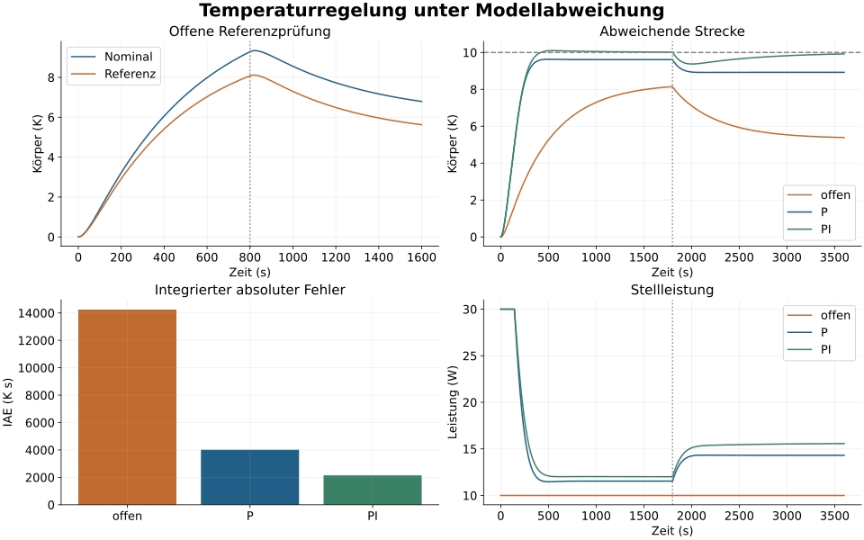

# M28-L5 – Arbeitsprobe: Einen Temperaturregelkreis simulieren und das Modell gegen Referenzdaten prüfen {#L5}

**Kursbereich:** M28 – Bachelor–Master-Brücke: Übergang Regelung und Zustandsraum

**Niveau:** Bachelor · Bachelor–Master-Brücke

**Vorwissen:** [M28-L1](M28-L1.md) bis [M28-L4](M28-L4.md).

**Lernziel:** Eine reproduzierbare Regelungssimulation mit unabhängiger Referenzrechnung, Modellabweichung und Abtastvergleich dokumentieren.

## Auftrag und Datengrundlage {#S1}

Für das Zweikörpermodell soll die Körpertemperatur von 20 auf 30 °C gebracht werden. Die Umgebung fällt nach 1800 s von 20 auf 17 °C. Der Versuch umfasst 3600 s, beide Zustände beginnen bei null K Abweichung. Die Heizleistung liegt zwischen 0 und 30 W. Verglichen werden offene Steuerung (10 W), P-Regelung mit Vorsteuerung (10 W, $K_p=4$ W/K) und PI-Regelung mit gleicher Vorsteuerung und $K_i=0{,}006$ W/(K s). Die nominalen Werte stammen aus [M28-L1](M28-L1.md). Eine zweite, synthetische Referenzstrecke besitzt $h=1{,}2$ W/K und $C_2=440$ J/K. Alle übrigen Parameter bleiben gleich. Die Parameter wurden didaktisch gewählt; es handelt sich nicht um gemessene Gerätedaten.

Zunächst werden beide Strecken offen mit 12 W während 800 s und anschließend 6 W bis 1600 s angeregt. Der erste Abschnitt ist zur Modellbewertung, der zweite als zusätzlicher Prüfabschnitt vorgesehen. Es werden keine Parameter an diese Daten angepasst. Die Referenzdaten sind synthetische Berechnungen aus einer abweichenden Parametrisierung; eine unabhängige physikalische Validierung ist damit nicht möglich. Zusätzlich prüft eine zweite mathematische Lösungsmethode die nominale Rechnung.

## Rechenverfahren und Programm {#S2}

Für während eines Abtastintervalls konstanten Eingang $v=(u,d)^T$ lässt sich das lineare Modell exakt in der Zeit fortschreiben. Mit $B_v=(B,E)$ gilt

$$\begin{pmatrix}A_d&B_d\\0&I\end{pmatrix}=\exp\left(\Delta t\begin{pmatrix}A&B_v\\0&0\end{pmatrix}\right),\qquad x_{k+1}=A_dx_k+B_dv_k.$$

Das ist eine exakte ZOH-Streckenabbildung bis auf numerische Rundungsfehler. Die Regelung wird mit $\Delta t=1$ s realisiert. Die Stellgröße wird zu Beginn jedes Intervalls berechnet und konstant gehalten. Der Integrator wird anschließend per bedingter Euler-Aktualisierung fortgeschrieben. Damit entspricht die digitale Schleife nicht exakt dem kontinuierlichen Entwurf. Die Abtastzeitvergleiche erfassen die Wirkung dieser Diskretisierung, nicht einen Fehler der analytischen ZOH-Lösung.

Das Programm benötigt Python, NumPy und SciPy. Es erzeugt sämtliche Daten ohne externe Dateien.

```python
import numpy as np
from scipy.linalg import expm
from scipy.signal import place_poles
from scipy.integrate import solve_ivp

def plant(g=2., h=1., c1=100., c2=400.):
    A=np.array([[-g/c1,g/c1],[g/c2,-(g+h)/c2]])
    B=np.array([[1/c1,0],[0,h/c2]])
    return A,B

def zoh(A,B,dt):
    M=np.block([[A,B],[np.zeros((2,4))]])
    E=expm(M*dt)
    return E[:2,:2],E[:2,2:]

def open_loop(A,B,dt=1.):
    t=np.arange(0,1600+dt,dt); x=np.zeros((len(t),2))
    ad,bd=zoh(A,B,dt)
    for k in range(len(t)-1):
        u=12. if t[k]<800 else 6.
        x[k+1]=ad@x[k]+bd@np.array([u,0.])
    return t,x

def run(mode,dt=1.,actual=False):
    A,B=plant(h=1.2,c2=440.) if actual else plant()
    ad,bd=zoh(A,B,dt)
    t=np.arange(0,3600+dt,dt); x=np.zeros((len(t),2)); u=np.zeros(len(t)-1)
    integ=0.
    for k in range(len(u)):
        e=10.-x[k,1]
        v=10. if mode=='open' else 10.+4.*e+(integ if mode=='PI' else 0.)
        u[k]=np.clip(v,0.,30.)
        if mode=='PI' and (0.<v<30. or (v>=30. and e<0.) or (v<=0. and e>0.)):
            integ+=.006*e*dt
        d=-3. if t[k]>=1800 else 0.
        x[k+1]=ad@x[k]+bd@np.array([u[k],d])
    return t,x,u

def metrics(t,x,u):
    return np.max(x[:,1]),10.-x[-1,1],np.sum(abs(10.-x[:-1,1]))*(t[1]-t[0]),np.sum(u)*(t[1]-t[0])/3600

if __name__=='__main__':
    A,B=plant(); C=np.array([[0.,1.]])
    K=place_poles(A,B[:,:1],[-.01,-.03]).gain_matrix
    L=place_poles(A.T,C.T,[-.04,-.05]).gain_matrix.T
    print('poles',np.linalg.eigvals(A),'K',K,'L',L.ravel())
    t,x=open_loop(A,B); _,ref=open_loop(*plant(h=1.2,c2=440.))
    for sl in [t<=800,t>800]:
        print('reference RMSE',np.sqrt(np.mean((x[sl,1]-ref[sl,1])**2)))
    ode=solve_ivp(lambda t,x:A@x+B@np.array([12.,0.]),[0,800],[0.,0.],rtol=1e-10,atol=1e-12,t_eval=t[t<=800])
    print('ODE check',np.max(abs(ode.y.T-x[t<=800])))
    assert np.max(abs(ode.y.T-x[t<=800]))<1e-7
    for actual in (False,True):
        for mode in ('open','P','PI'):
            t,x,u=run(mode,actual=actual); print(actual,mode,*metrics(t,x,u)); assert np.all((u>=0)&(u<=30))
    for dt in (2.,1.,.5):
        print('step',dt,*metrics(*run('PI',dt,True)))
```

## Ergebnisse und Interpretation {#S3}

$\mathrm{IAE}=\int |r-y|\,dt$ wird auf dem Raster als linke Rechtecksumme in K s ausgewertet. Der Verbrauch $\sum_k u_k\Delta t/3600$ ist in Wh; er ist die modellierte Heizenergie, nicht der Stromverbrauch eines vollständigen realen Geräts. Der vorzeichenbehaftete Endfehler lautet $10-x_2(3600)$.

| Strecke | Regler | Max. $x_2$ (K) | Endfehler (K) | IAE (K s) | Heizenergie (Wh) |
| --- | --- | ---: | ---: | ---: | ---: |
| nominal | offen | 9,681 | 2,923 | 9442,9 | 10,000 |
| nominal | P | 10,032 | 0,600 | 2465,1 | 12,297 |
| nominal | PI | 10,412 | 0,057 | 2099,9 | 12,643 |
| abweichend | offen | 8,151 | 4,612 | 14244,6 | 10,000 |
| abweichend | P | 9,633 | 1,077 | 4015,1 | 14,000 |
| abweichend | PI | 10,100 | 0,078 | 2142,6 | 14,837 |

{alt="Vergleich offener Steuerung, P- und PI-Regelung bei nominaler und abweichender Strecke sowie Modell-/Referenzverlauf."}

Bei der abweichenden Strecke erfordert der Sollwert nach dem Störsprung stationär $1{,}2(10+3)=15{,}6$ W. Der P-Regler besitzt dort einen analytischen Endfehler $e=(15{,}6-10)/(4+1{,}2)=1{,}0769$ K. Das Ergebnis bestätigt die Simulation. Der PI-Regler nähert sich auch bei Modellabweichung dem Sollwert an; die verbleibenden 0,078 K am endlichen Versuchsende sind kein stationärer Fehlernachweis. Die offene Steuerung verbraucht weniger Energie, hält aber den Sollwert deutlich schlechter ein. Ein sinnvoller Vergleich muss beide Aspekte enthalten.

## Prüfschritte und Reproduzierbarkeit {#S4}

Der RMSE der Körpertemperatur zwischen nominaler und abweichender offener Strecke beträgt 0,727 K im ersten Abschnitt einschließlich 800 s und 1,228 K im zweiten Abschnitt nach 800 s. Diese Zahlen zeigen Modellabweichung, nicht Messunsicherheit. Die nominale 12-W-Sprungantwort wird separat mit `solve_ivp` (relative Toleranz $10^{-10}$, absolute Toleranz $10^{-12}$) berechnet. Die maximale Zustandsdifferenz gegenüber ZOH beträgt rund $2{,}65\cdot10^{-10}$ K. Die Solver-Übereinstimmung verifiziert die Rechnung, aber nicht die Annahmen des thermischen Modells.

| Abtastzeit (s) | Max. $x_2$ (K), PI abweichend | Endfehler (K) | IAE (K s) |
| ---: | ---: | ---: | ---: |
| 2 | 10,0975 | 0,07748 | 2145,10 |
| 1 | 10,1000 | 0,07755 | 2142,62 |
| 0,5 | 10,0989 | 0,07762 | 2140,38 |

Die Abweichungen sind für diesen Versuch klein. Die drei Abtastzeiten sind keine allgemeine Stabilitätsgarantie. Für eine experimentelle Validierung wären mindestens zeitgestempelte Soll-, Ist-, Umgebungs- und Stellwerte, Sensorunsicherheit, bekannte Anfangszustände, getrennte Identifikations-/Prüfdaten und festgelegte Akzeptanzgrenzen erforderlich. Der Lehrversuch enthält keine Freigabe eines realen Heizsystems.

## Arbeitsprobe und Selbstkontrolle {#S5}

Erstelle einen Kurzbericht mit: Bilanz und Modellannahmen, zwei offenen Referenzkurven, geschlossenen Temperatur- und Stellwertverläufen, Ergebnistabelle, analytischer Kontrolle und Modellgrenzen. Variiere zusätzlich die maximale Heizleistung oder die Umgebungstemperatur. Dokumentiere, welche Größe geändert wurde, und verwende dieselben Kenngrößen. Als Brücken-Nachweis sollen Modell, Simulation, Interpretation und Wiederholbarkeit nachvollziehbar sein.

1. Wie viel Leistung wäre nach dem Störsprung bei der nominalen Strecke ideal stationär nötig? **Lösung:** 13 W.
2. Was passiert bei maximal 12 W in der abweichenden Strecke? **Lösung:** 30 °C sind bei 17 °C Umgebung nicht erreichbar; bei voller Leistung stellt sich nur 27 °C ein.
3. Warum ist der zweite RMSE-Abschnitt keine unabhängige empirische Validierung? **Lösung:** Er nutzt dasselbe synthetische Referenzmodell und keine reale Messung.
4. Nenne ein Abnahmekriterium für einen künftigen Laborversuch. **Lösungshinweis:** Zum Beispiel maximaler Fehler nach vereinbarter Einschwingzeit bei definiertem Störsprung; Grenze und Messunsicherheit vor dem Versuch festlegen.

## Quellen {#S6}

- [Åström und Murray – Feedback Systems, 2. Auflage, Kapitel 2, 5–12](https://fbswiki.org/wiki/index.php/Feedback_Systems%3A_An_Introduction_for_Scientists_and_Engineers) · 2. Auflage, Kapitel 2: lineare Dynamikmodelle, Störunterdrückung, Führungsfolge und Robustheit; nur Inhaltsverzeichnis. · Zuletzt abgerufen: 2026-11-25
- [MIT OpenCourseWare – 16.30 Feedback Control Systems](https://ocw.mit.edu/courses/16-30-feedback-control-systems-fall-2010/) · Vorlesungen 5–7 und 11–12: Zustandsmodelle und Rückführungsentwurf; keine Validierung des virtuellen Versuchs; Skripte nicht geöffnet. · Zuletzt abgerufen: 2026-11-25
